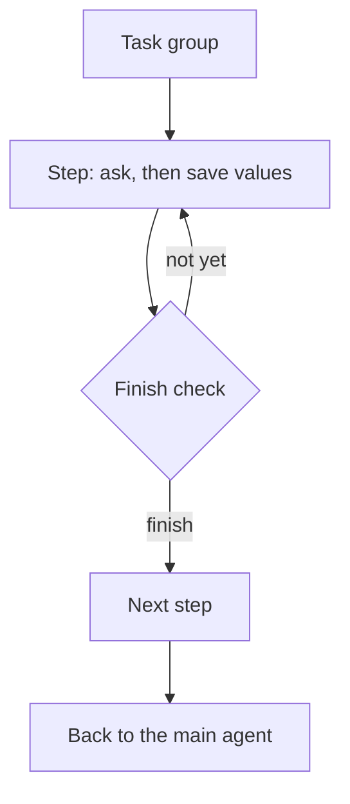

A task is a step that saves values to the call state. A task group runs several
tasks in order. The rules live in the core, so LiveKit and Pipecat behave the same.

Use it when:

- The call must collect several values in a set order, like a name, a service and a day.
- A value must be confirmed before a tool uses it, like a booking.
- A step needs its own short prompt and its own tools.
- You want a broken flow to fail at startup, not in the middle of a call.

## Choose a shape

| You need | Use |
|---|---|
| One behaviour, a few tools, no fixed order | A single prompt with [tools](/core/build/tools) |
| Several values in order, each saved and checked | Tasks and a task group |
| A different agent, with its own prompt, for the rest of the call | A [handoff](/core/build/handoffs) |

## What it handles for you

| On a call without it | What the library does |
|---|---|
| A broken flow shows up in the middle of a call. | `TaskPlan` checks tasks, values and tools at startup, and names what to fix. [Your first task](/core/build/tasks/first-task#troubleshooting) |
| A weak model says "Noted, thank you" and never finishes. The step waits forever. | The finish check asks the model: finish, or not yet. [How a step ends](/core/build/tasks/how-a-step-ends) |
| The model saves a guess, or an answer from an earlier step. | A save before the caller spoke in the step is held, and the model asks. [Held saves](/core/build/tasks/held-saves) |
| The caller answers, then hangs up before the step ends. The answer is lost. | Held answers are settled when the call ends. [Held saves](/core/build/tasks/held-saves) |
| A booking tool runs on what the model guessed. | Code asks "Shall I book Friday, October 16?" and books only what the caller heard. [Reply and confirm](/core/build/tasks/confirm-in-code) |
| The caller corrects an earlier answer and the flow cannot go back. | `go_back_to_step` runs the earlier step again. [How a step ends](/core/build/tasks/how-a-step-ends#going-back-to-an-earlier-step) |
| The model returns nothing and the step dies in silence. | On LiveKit, the model tries up to 3 times, then a fallback line plays. [How a step ends](/core/build/tasks/how-a-step-ends#when-the-reply-is-empty) |

Build it step by step in the salon tutorial: [Book step by step](/core/tutorial/book-step-by-step).

## In this section

<CardGroup cols={2}>
  <Card title="Your first task" icon="list-checks" href="/core/build/tasks/first-task">
    Define one task, check it with `TaskPlan` and run it on each framework.
  </Card>
  <Card title="Groups" icon="list-ordered" href="/core/build/tasks/groups">
    Run several tasks in order, and decide what follows.
  </Card>
  <Card title="How a step ends" icon="flag" href="/core/build/tasks/how-a-step-ends">
    The finish check, a held finish, going back and the empty-reply retry.
  </Card>
  <Card title="Held saves" icon="clock" href="/core/build/tasks/held-saves">
    What happens to a save made before the caller spoke.
  </Card>
  <Card title="Reply and confirm" icon="message-square" href="/core/build/tasks/confirm-in-code">
    Fixed lines for a tool result, and a question before a tool runs.
  </Card>
  <Card title="What the model reads" icon="eye" href="/core/build/tasks/what-the-model-reads">
    History, small results and placeholder names.
  </Card>
  <Card title="Tasks reference" icon="book-open" href="/core/reference/tasks">
    Every argument of every task class.
  </Card>
  <Card title="Unmute tasks" icon="list-checks" href="/build/orchestration/tasks">
    How `agent.yaml` declares the same tasks and groups.
  </Card>
</CardGroup>
