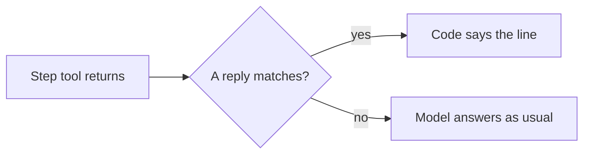
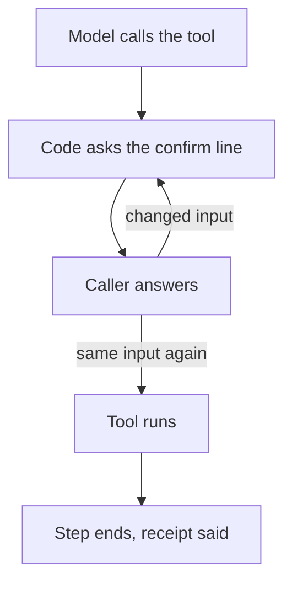

A step can speak fixed lines from code, so the words a caller hears do not depend on the model. A `ToolReply` speaks for a tool result. A `FinishRule` with `confirm` lines asks before a tool runs.

## Quickstart

```python agent.py
from unmute_core.tasks import Assign, FinishRule, TaskSpec

TaskSpec(
    name="find_slot",
    when="The caller wants to book a time.",
    instructions="Find a free time, then book the one the caller picks.",
    tools=["list_times", "book_slot"],
    assign=[Assign(variable="slot", path=("slot",))],
    finish=[
        FinishRule(
            tool="book_slot",
            success={"booked": [True]},
            confirm=["Shall I book {{input.slot}}?"],
            say=["Booked for {{result.slot}}."],
        )
    ],
)
```

The model calls `book_slot` with `{"slot": "2026-10-16"}`. The tool does not run. The caller hears "Shall I book Friday, October 16?" On a yes, the model calls it again, the tool runs, and the caller hears "Booked for Friday, October 16."

## Why use unmute for this

A booking tool should run on what the caller heard, not on what the model guessed. Code asks the question, checks that the caller heard it, and runs the tool only on the same input. The line is word for word, the same on both frameworks.

## Say a fixed reply to a tool result

A `ToolReply` is a line code speaks when one of the step's tools returns a matching result.

```python
from unmute_core.tasks import Assign, FinishRule, TaskSpec, ToolReply

TaskSpec(
    name="find_slot",
    when="The caller wants to book a time.",
    instructions="Find a free time, then book the one the caller picks.",
    tools=["list_times", "book_slot"],
    assign=[Assign(variable="slot", path=("slot",))],
    finish=[FinishRule(tool="book_slot", success={"booked": [True]})],
    replies=[
        ToolReply(
            tool="list_times",
            when={"found": [True]},
            say=["I have {{result.times}}. Which suits you?"],
        )
    ],
)
```

When `list_times` returns `{"found": true, "times": "10:00, 11:30 or 14:00"}`, the
caller hears "I have 10:00, 11:30 or 14:00. Which suits you?" The model is asked
for no reply. Use a `ToolReply` for a line that must come out word for word, like
the times on offer.



1. The model calls one of the step's tools. The tool returns a result.
2. Each `ToolReply` of that tool is checked in order. The first whose `when` and `state` match is used.
3. The line is spoken. The model reads the result, but is asked for no reply.
4. When none matches, the model replies as usual.
5. Both frameworks speak the line, so the call sounds the same.

Rules for the lines:

1. A line fills from the tool's result and the State. `{{result.times}}` reads a field of the result. `{{slot}}` reads a State value.
2. A result value is said by its output field's JSON Schema `format`, in the call's language, as a confirm line says an input. A `date` field reads "tomorrow, October 16".
3. `when` matches result fields. `state` matches State values, like `state={"vip": [True]}`. A reply with neither is spoken for every result of the tool.
4. The plan checks each `{{result.<field>}}` and `when` field against the tool's output model. A field the tool does not return fails when the plan is built.
5. When a line cannot fill, because a field is missing or empty, it is skipped. The next line is tried.
6. When no line fills, the model replies as usual.
7. With several lines, the next call says the next one, so the agent does not repeat itself.
8. A question the caller must answer before a tool runs belongs in `FinishRule.confirm`, not here.

An agent without tasks lists the same `ToolReply` rows on its `ToolRegistry`. See
[Save a result and speak it](/core/build/tools#save-a-result-and-speak-it).

**Why it works this way.** A model may reword a list of times. A line from code comes out word for word, and the model is not asked for a reply.

**Best practice.**

1. Use a `ToolReply` for a line that must come out word for word.
2. Give several lines when the same reply may repeat, so the agent does not repeat itself.

## Ask before a closing tool runs

A `FinishRule` ends a step by itself when its tool returns a result the rule calls a success. Its `confirm` lines ask the caller first.

```python
FinishRule(
    tool="book_slot",
    success={"booked": [True]},
    confirm=["Shall I book {{input.slot}}?"],
    say=["Booked for {{result.slot}}."],
)
```



1. The model calls the closing tool. Code does not run it.
2. Code fills a `confirm` line from that call's input and says it. No model reply is asked for.
3. The model reads that the tool has not run, and waits for the caller.
4. On a yes, the model calls the tool again with the same input. The tool runs.
5. If the caller changes something, the model calls it with the new input. Code asks again, with the new values.
6. A successful result ends the step. The `say` lines are the receipt.

The rules:

1. `confirm` takes up to five lines. They may use `{{input.<field>}}`, `{{variable}}` and a field of a shape in the State, like `{{account.amount_words}}`. A path that does not exist fails when the agent is built. A line that cannot fill is skipped. When none can, the tool is refused and the model is told what to get from the caller.
2. `confirm` belongs to the tool. Every rule of that tool must give the same lines.
3. The tool runs only when the caller heard the line. A line cut off after it said every value it holds counts as heard, where the adapter knows the words that played. LiveKit knows them. A line cut off sooner is asked again.
4. The input must be the same as the one asked about, and so must the tool's locked values. Any other input, or a locked value that changed since, like a report the caller corrected, is asked again.
5. An input is said by its JSON Schema `format`, in the call's language. A `date` is named from today: "today, October 8", "tomorrow, October 9", "Friday, October 16". So put a date after "for" or "to", never after "on". An `enum` value is said as words: `hair-color` is "hair color".
6. A step may open on a closing tool that has `confirm` lines. See [Open a step with a tool](#open-a-step-with-a-tool). The opening asks the line about State values. It is skipped when every value is one a step confirms and is already confirmed. A tool with no `arguments` always asks.

**Why it works this way.** The tool runs only when the caller heard the line and the input is the same. A booking then matches what the caller agreed to.

**Best practice.**

1. Put a date after "for" or "to" in a line, never after "on".
2. Give every rule of one tool the same `confirm` lines.

**On each framework.** LiveKit knows the words that played, so a line cut off after every value counts as heard. A line cut off sooner is asked again.

## Open a step with a tool

An `OpeningTool` is a tool a step runs in code as it opens, before any model request. Its `arguments` map a tool parameter to the State value it takes. The tool runs only when every value is set. A parameter the tool's schema declares and does not require is left out of the call when its value is not set.

```python
TaskSpec(
    name="manage_booking",
    instructions="Offer the times, then book the one the caller picks.",
    tools=["find_slots"],
    opens_with=OpeningTool(
        tool="find_slots",
        arguments={"service": "requested_service", "date": "requested_day"},
        say=["{{result.offer}}"],
    ),
)
```

When a `say` line fills, the step speaks it and waits for the caller. No model
request is made. Use a tool that only reads, because the model may call it again.
A tool the step ends on may open it too, when it has `confirm` lines. Then code
asks the confirm line about the State values and waits for the caller's yes. Give no `say` for a tool with `confirm` lines. The first `say` line that fills is spoken.

## What a step can offer

### A step that reads a prefetch lookup

A `TaskInput` is something a step reads at the end of its prompt. Its `kind` is `memory` (a State value), `input` (a fixed text, in `value`, up to 4000 characters) or `tool` (what a prefetch lookup returned, recorded by name).

```python
prefetch = Prefetch([Lookup("load_customer", local_tool(load_customer), {}, background=True)])
call = CallHooks(state, prefetch=prefetch)
agent = UnmuteAgent(AgentSpec(PROMPT, tasks=plan), call=call)  # or UnmuteFlows(..., call=call)
```

```python
TaskSpec(name="greet_member", instructions="...", inputs=[TaskInput(kind="tool", name="load_customer")])
```

1. A `tool` input must name a prefetch `Lookup`. The adapter checks this when the agent is built with the call's `CallHooks`. A name no `Lookup` runs raises `ValueError`, and so does any `tool` input when the hooks have no prefetch. An agent built without hooks is not checked. A tool lookup may have an empty `assign`. `CallHooks` records its result as JSON in `call.results`, by entry name.
2. Give the adapter `call=call`. It passes `call.results` to the steps, so a step reads the same text at the end of its prompt. In your own host, pass `call.results` to `CallTasks(call_start=...)`.
3. Until the tool has finished, the step reads that the input is not available yet.
4. See [Prefetch](/core/build/prefetch) and [The call's life](/core/build/call-lifecycle).

### A step that hands off

`TaskSpec.handoffs` names handoff tools of the agent that the step offers too.
The step's opening reply leaves them out. They come back once the caller speaks
in the step. Calling one ends the step and its task or group, and gives the call
to the other agent. See [Handoffs](/core/build/handoffs#a-handoff-from-a-task-step).

### A step that offers the agent's native tools

```python
TaskSpec(
    name="look_up_customer",
    when="The caller asks about their account.",
    instructions="Find the customer, then confirm the account.",
    native_tools=("crm",),
    # more fields
)
```

1. On LiveKit, a toolset is named by its id. The tools come from `UnmuteAgent(native_tools=...)`.
2. On Pipecat, the names are `FunctionSchema`s in `UnmuteFlows(native_tools=...)`.
3. An unknown name raises when the plan is built.
4. A name may not also be a tool or a handoff of the same task.
5. A step gets only the native tools it lists.

### A task on its own model

```python
TaskSpec(name="summarize_order", instructions="...", model="fast")

AgentSpec(PROMPT, tasks=plan, task_models={"fast": LiveKitModel(fast_llm)})
```

`TaskSpec.model` names the model a task's steps run on. The agent's spec maps the
name to a model.

1. On LiveKit, `AgentSpec(task_models=...)` maps each name to a `ModelCall`. A LiveKit LLM plugin goes in as `LiveKitModel(plugin)`. A step of that task sends its requests there. The main agent keeps its own model.
2. A name `task_models` does not hold raises `ValueError` when the spec is built.
3. On Pipecat, `UnmuteFlows` refuses a task with a model when it is built. Every step runs on the agent's LLM service there, as in Unmute.

## Troubleshooting

### The model books before the caller agreed

The closing tool has no `confirm` line, so code does not ask first.

**Fix:** add `confirm` lines to the `FinishRule` of the tool.

### A confirm line is skipped and the tool is refused

No `confirm` line could fill from the call's input.

**Fix:** write the lines with `{{input.<field>}}` for fields the tool takes, and check the names.

### A tool input raises `ValueError` when the agent is built

A `tool` input names a lookup that no prefetch `Lookup` runs, or the hooks have no prefetch.

**Fix:** add the `Lookup` to `Prefetch`, and build the agent with the call's `CallHooks`.

In the salon tutorial: [Book step by step](/core/tutorial/book-step-by-step).

Every argument: [Tasks reference](/core/reference/tasks#finishrule).

## Where to go next

<CardGroup cols={2}>
  <Card title="What the model reads" icon="eye" href="/core/build/tasks/what-the-model-reads">
    The small results a task sends to the model.
  </Card>
  <Card title="Tools" icon="wrench" href="/core/build/tools">
    The tools a step lists in `tools`.
  </Card>
  <Card title="Handoffs" icon="git-branch" href="/core/build/handoffs">
    Give the call to another agent.
  </Card>
</CardGroup>
