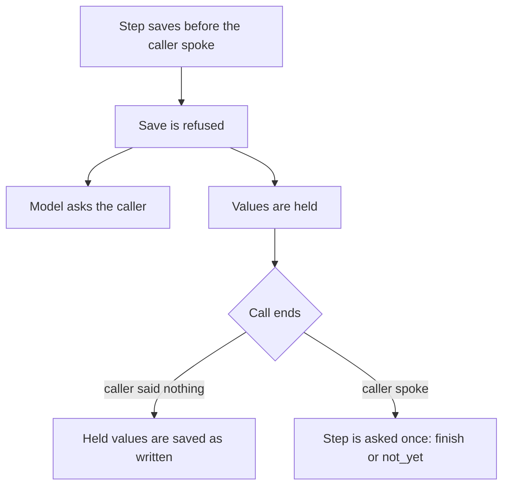

A held save is a save a step tried before the caller said anything in that step. The library refuses it, keeps the values aside and settles them when the call ends.

## Quickstart

```python agent.py
await state.settle_held()
```

Adapters do this for you. A host without an adapter calls `CallState.settle_held()` directly, as above.

## Why use unmute for this

A model sometimes saves a guess, or an answer from an earlier step. The library refuses that save and makes the model ask. It still keeps the answer the caller gave before the step began, in case the call ends first.

## What a held save is

A step's first reply may try to save values before the caller said anything in
that step. To settle a held save is to decide, when the call ends, whether to keep it. The save is refused, because the model guessed or reused an old answer.



1. The model reads the refusal and asks the caller.
2. When the refused reply already spoke, like "Your note: a call back. Is that right?", no second reply follows. The caller answers next.
3. The refused values are held for the end of the call. The caller may have given the answer before the step began, and heard the agent take it.
4. When the call ends with a save still held, the result depends on what the caller did after the hold.

| What the caller did after the hold | What is saved |
|---|---|
| Said nothing | The held values, as written |
| Spoke | The step is asked once, `finish` or `not_yet`, on what the caller said. "Thanks, bye" keeps the values. "No, make it an email" saves the correction. A doubt or a no saves nothing. |

1. A value saved this way is never marked confirmed. No step was left to confirm it.
2. The step's next finish releases the hold, so a step that goes on normally never uses it.
3. The decision waits at most 4 seconds. One that fails or runs out of time saves nothing.
4. A step whose values come from its own tool holds nothing. The caller cannot have given those before the step began.

**Why it works this way.** The caller may have given the answer before the step began and heard the agent take it. Dropping it would lose a real answer. Marking it confirmed would hide that nobody checked it.

**Best practice.**

1. Let the adapter settle held saves when you can.
2. Read a value saved this way as unconfirmed.

## Settle held saves on each framework

**On each framework.** Each adapter settles held saves when the call ends:

- **LiveKit:** automatic, when the session closes.
- **Pipecat:** with `UnmuteFlows(call=...)`, `await call.end(...)` after `runner.run()` settles them. Without hooks, call `await flows.settle()` when the caller hangs up, before the `EndFrame`. The decision is then traced in the last turn.

`CallState.settle_held()` does the work. A host without an adapter calls it
directly:

```python
await state.settle_held()
```

## Troubleshooting

### A value is saved but never marked confirmed

It was saved from a hold. No step was left to confirm it.

**Fix:** none is needed. Ask the caller again in a later step if you need it confirmed.

### Held values are lost on Pipecat

Nothing settled them when the caller hung up.

**Fix:** pass `call=` to `UnmuteFlows` and call `await call.end(...)` after `runner.run()`. Without hooks, call `await flows.settle()` before the `EndFrame`.

In the salon tutorial: [Book step by step](/core/tutorial/book-step-by-step).

Every argument: [Tasks reference](/core/reference/tasks#calltasks).

## Where to go next

<CardGroup cols={2}>
  <Card title="Reply and confirm in code" icon="message-square" href="/core/build/tasks/confirm-in-code">
    Ask the caller before a closing tool runs.
  </Card>
  <Card title="State" icon="database" href="/core/build/state">
    How the call state keeps held values.
  </Card>
  <Card title="How a step ends" icon="flag" href="/core/build/tasks/how-a-step-ends">
    The finish check that a held save uses.
  </Card>
</CardGroup>
