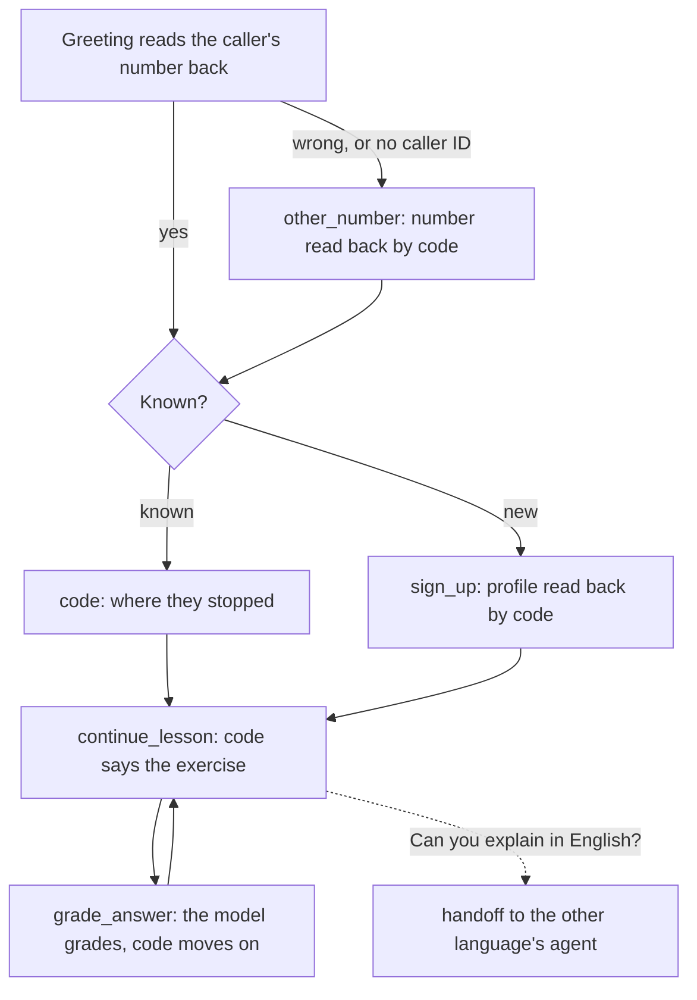

Faro is a language companion on the phone. It knows learners by their number,
signs new ones up, and teaches short lessons in English or Spanish. It explains
in the learner's own language, puts each exercise, judges the answer, and
carries on from where they stopped, across calls. The code is in
`examples/faro`.



## The model grades, code teaches

The lesson needs no task. Five main-agent tools carry it, and each result says
its own line:

| The learner | The model calls | Code says |
|---|---|---|
| answers the exercise | `grade_answer(answer, grade, feedback)` | the feedback, then the next exercise, the retry, or "Lesson complete" |
| asks for help | `give_hint(hint)` | the hint. The next right answer counts as practised with help. |
| wants to go on | `continue_lesson()` | the exercise, in their language |
| wants a recap | `read_progress()` | what is done, what to review, what is next |
| says something about themselves | `remember(key, text)` | "Noted." |

```python faro/agent.py
learner = {"learner_id": "{{learner_id}}", "explanation": "{{explanation}}"}
local_tool(
    desk.grade_answer,
    locked={**learner, "waiting": "{{waiting}}", "helped": "{{helped}}"},
    interruption="continue",
)
```

The learner, the language and the exercise waiting are locked. The model sends
only the answer, a grade of four (`correct`, `partly`, `wrong`, `unclear`) and
one line of feedback. Code turns the grade into a result, records the attempt
in SQLite, moves the learner on or not, and says the next line.

**Why it works this way.** The model cannot finish a lesson by saying so. Only
graded answers move progress, and an answer to an exercise that is not waiting
is refused. Grading is the one judgement only a model can make, so it is the
one thing the model decides.

## Two agents, one per language

The library says some lines itself: a read-back, a step's first question. Those
lines belong to an `AgentSpec`, so Faro is two agents built from one template,
`faro_en` and `faro_es`. They share the prompt and the tools.

```python faro/agent.py
def agents(self, state: CallState) -> dict[str, AgentSpec]:
    return {
        f"faro_{lang.lower()}": AgentSpec(
            PROMPT,
            name=f"faro_{lang.lower()}",
            tasks=self.plans[lang],
            language=lang.lower(),
            timezone=TIMEZONE,
            handoffs=("to_spanish",) if lang == "EN" else ("to_english",),
        )
        for lang in LINES
    }
```

A learner who asks to switch is handed to the other agent. The handoff saves
the new `explanation`, so every line code says from then on is in that
language. See [Handoffs](/core/build/handoffs).

A known caller is greeted by the agent of their own language. A `Lookup` in the
prefetch reads the language from their number before the greeting. Nothing
about them is said until they say the number is theirs.

## Read back before it is used

Two tasks hold what must be read back first:

1. `other_number`: a number the caller says. It takes the number as a task `argument` and opens on `check_number`, so code reads it back with no model request.
2. `sign_up`: a new profile. Code reads back the name, the language, the goal and the level, and creates the profile on a yes.

```python faro/agent.py
"confirm": ["Shall I create your profile as {{input.name}}, learning {{input.learn}} for {{input.goal}}, at level {{input.level}}?"]
```

`learn`, `goal` and `level` are `Literal`s. A number from outside Spain is
refused by the `Phone` type.

## What a call costs

| Caller says | Who speaks | Model requests |
|---|---|---|
| (call opens) | code: "is your number +34 600 555 666?" | 0 |
| "Yes, that's me." | code: "Hi, Emma" and where she stopped | 1 |
| "Let's carry on." | code: the first exercise | 1 |
| "Un kilo de manzanas, por favor." | code: the model's feedback, then the next exercise | 1 |
| "¿Cuánto cuesta?" | code: feedback and the third exercise | 1 |
| "Quiero pan y leche." | code: "Lesson complete: shopping." | 1 |

## The parts

| unmute-core | Used for |
|---|---|
| Two `AgentSpec`s, `language="en"` and `"es"` | The library's own lines in the learner's language |
| `hand_off` on both adapters | Switching language mid-call |
| `Prefetch`: `CallValue` and a `Lookup` | The caller's number, and the language to greet them in |
| `Greeting` with a fallback `instruction` | The number read back. With no caller ID, the model asks for it. |
| `ToolRegistry(assign=..., replies=...)` | The whole lesson, with no task |
| Locked `{{learner_id}}`, `{{waiting}}`, `{{helped}}` | The model never names the learner or the exercise |
| `TasksSpec` with `arguments`, `opens_with` and `confirm` | A spoken number and a new profile, read back first |

**Best practice.**

1. Keep the lines code says in a table per language, and build one agent per language from it.
2. Save the language in the State on the handoff. Every line code says can then read it.
3. Let the model make only the judgement a model must make. Give it a closed set of answers.

## Try it

The store has three learners. Call as Emma with
`UNMUTE_CALL_START={"call": {"direction": "inbound", "calling_number": "+34600555666"}}`.

1. "Yes." Code greets Emma and says where she stopped.
2. "Let's carry on." Code says the first exercise of "shopping".
3. "Un kilo de manzanas, por favor." Then "¿Cuánto cuesta?" Then "Quiero pan y leche. ¿Cuánto es en total?"
4. "Can you explain in Spanish?" The other agent takes over and puts the exercise again.

Lucía (+34 600 111 222) explains in Spanish. Any other Spanish number is a new
caller, who gets a profile read back and then the first lesson.

## Troubleshooting

### After a switch, the model says the exercise in its own words

The model wrote the first reply after the switch. **Fix:** give each `Handoff`
`opens_with=OpeningTool(tool="continue_lesson")`. Code then puts the exercise again
in the new language, with no model request.

### A hint is said twice

The model said the hint and passed it to `give_hint`. **Fix:** tell it to call
`give_hint` "with no words of your own". Code says the hint from the result.

## Where to go next

<CardGroup cols={2}>
  <Card title="Example agents" icon="layout-grid" href="/core/examples/overview">
    Back to the overview, and how to run and check each example.
  </Card>
  <Card title="Handoffs" icon="arrow-right-left" href="/core/build/handoffs">
    Every argument of a handoff, on both frameworks.
  </Card>
</CardGroup>
