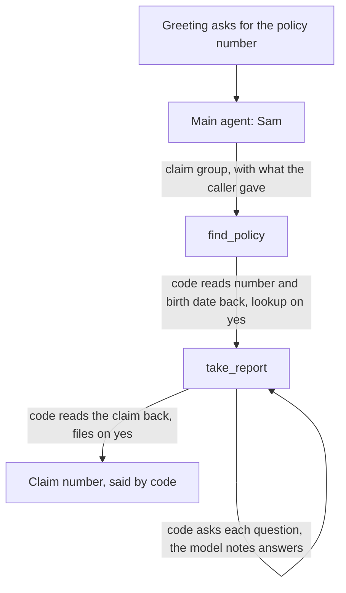

Kestrel is an inbound claims line for a motor insurer. Sam answers, finds the
caller's policy, takes the report of what happened one question at a time,
reads the whole claim back and files it on the caller's yes. The code is in
`examples/kestrel`.



## The group

One group, `claim`, runs two steps. The group's `arguments` carry what the
caller said before the group started, so a caller who gives everything at once
hears the read-back at once.

```python kestrel/agent.py
{
    "name": "claim",
    "when": "The caller gives a policy number or a date of birth, or wants to report an accident.",
    "steps": ["find_policy", "take_report"],
    "context_scope": "shared",
    "arguments": ["policy_number", "birth_date"],
}
```

`find_policy` opens with `lookup_policy` on those two values. The lookup has a
`confirm` line, so code asks before it runs:

```python kestrel/agent.py
"opens_with": {
    "tool": "lookup_policy",
    "arguments": {"policy_number": "policy_number", "birth_date": "birth_date"},
},
"finish": [{
    "tool": "lookup_policy",
    "success": {"found": [True]},
    "confirm": ["Is your policy number {{input.policy_number}}, with a date of birth of {{input.birth_date}}?"],
    "say": ["Thank you, {{result.first_name}}, I have your policy."],
}],
```

## Code asks every question

`take_report` holds two tools. The model calls `note_facts` with whatever the
caller just said, as typed arguments. Code saves the facts, picks the next
missing one, and says its question.

```python kestrel/agent.py
{
    "name": "take_report",
    "tools": ["note_facts", "file_claim"],
    "opens_with": {"tool": "note_facts", "say": ["{{result.next_question}}"]},
    "replies": [{"tool": "note_facts", "when": {"complete": [False]}, "say": ["{{result.next_question}}"]}],
    "finish": [{
        "tool": "file_claim",
        "success": {"filed": [True]},
        "confirm": ["{{read_back}}"],
        "say": [FILED],
    }],
}
```

1. The step opens on `note_facts` with nothing noted. Its result's `next_question` is the first question. No model request.
2. The caller answers. The model calls `note_facts(incident_day=..., place=...)` with only what they said. A caller who tells it all in one breath fills several facts in one call.
3. When the report is complete, the model calls `file_claim`. Code says the whole claim, from `read_back` in the State, and files it only on the caller's yes.

The questions come in a fixed order: when, where, what happened, anyone hurt,
police, another driver, which car, can it be driven. A car is picked only from
the cars on the policy.

## Why it works this way

**The model only fills typed fields.** `incident_day` is a date. `injuries` is a
`bool`. `incident_time` is a time or one of four parts of the day.

**Code decides, and code says it.** A day in the future is the tool's rule, not
the argument's. `note_facts` keeps it out of the report and returns
`status: "future_day"`. A reply on the tool turns that into "That day hasn't
happened yet. On which day did it happen?" The model makes one request for the
turn, the call, and says nothing.

**Every read-back is code's.** The caller hears the same claim read-back on
every call. The model never paraphrases the report it is about to file.

**Nothing the caller did not hear is filed.** `file_claim` locks the report,
the policy number and the call's id, and takes nothing from the model. A yes
runs it only while its locked values are the ones read back. A correction
after the read-back changes the report, so code reads the claim back again.

**Each answer is saved as it comes.** `note_facts` merges the new facts into
the report and returns it. Its `assign` rows on the registry save the report
and the read-back as soon as it returns, inside the step:

```python kestrel/agent.py
local_tool(
    desk.note_facts,
    locked={"report": "{{report}}", "policy": "{{policy}}"},
    hidden=("report", "read_back"),
),
...
assign={
    "note_facts": [
        Assign(variable="report", path=("report",)),
        Assign(variable="read_back", path=("read_back",)),
    ]
},
```

The model reads `complete` and `next_question` only. The report and the
read-back are `hidden`: a model that sees the read-back says it in its own
words, before code reads it back.

**Codes and birthdays are typed for speech.** The policy and claim numbers are
`Spelled`, so code says them a character at a time: "K C, 1 0 0, 2 3 1". The
date of birth is a `BirthDate`, said with its year: "5 June 1979".

## What a call costs

| Turn | Who speaks | Model requests |
|---|---|---|
| Greeting | code | 0 |
| Policy number and date of birth read back | code (`confirm`) | 1 |
| "Thank you, Daniel, I have your policy." | code (`say`) | 1 |
| Each of the eight report questions | code (`ToolReply` on `note_facts`) | 1 |
| The whole claim read back | code (`confirm`, from the State) | 1 or 2 |
| "Your claim is filed. Your claim number is K C, 1 0 0, 2 3 1..." | code (`say`) | 1 |

A whole 13 turn claim costs 15 model requests, on both frameworks.

## The parts

| unmute-core | Used for |
|---|---|
| A Pydantic `State` with validators | `PolicyNumber` (one spelling), `Policy`, `Report`, the claim number |
| `local_tool(precheck=...)` | "KP and six digits", answered in code before the number is read back |
| `TasksSpec` in `record` mode, one group | `claim` runs `find_policy` then `take_report` |
| Group `arguments` and `OpeningTool` | What the caller already said opens the first step with its read-back |
| `FinishRule` `confirm` and `say` | Both read-backs, and the lines after the lookup and the filing |
| `ToolReply` | The next question after each answer, and "I can't find a policy" |
| Locked arguments | The call id, the report and the policy number never come from the model |
| `Prefetch` with a `Clock` | Today on the London clock, so "yesterday" becomes a date |
| `IdleNudges` | A patient nudge for a shaken caller who goes quiet |

**Best practice.**

1. When a step asks many questions, keep the order in code and give the model one tool that takes them all as optional typed fields.
2. Say codes letter by letter in code, like "K P, four eight two, nine one three". A model reading "KP482913" may say it as a word.
3. Save a long read-back to the State and use it as the `confirm` line, `{{read_back}}`.

## Try it

The demo desk has two policies. KP482913 is Daniel, born 5 June 1979, with a
blue Toyota Corolla. KP731508 is Priya, born 23 January 1992, with two cars.

1. "It's KP482913, and I was born on the fifth of June 1979." Code reads both back.
2. "Yes." Code says "Thank you, Daniel" and asks when it happened.
3. Answer each question. Try "Yesterday afternoon on the high street, someone reversed into me."
4. After the read-back, say "Actually it was the morning." Code reads the changed claim back.

## Troubleshooting

### The step asks the first question twice

The prompt also tells the model to ask. **Fix:** tell the model the
application asks the next question itself, in the step prompt and in the
tool's docstring.

## Where to go next

<CardGroup cols={2}>
  <Card title="Wasla: an outbound reminder" icon="phone-outgoing" href="/core/examples/wasla">
    Verify a person before saying anything about their account.
  </Card>
  <Card title="Groups" icon="list-ordered" href="/core/build/tasks/groups">
    Group fields, arguments and what follows a group.
  </Card>
</CardGroup>
