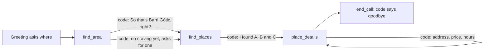

Nosh rings someone who asked for help finding a place to eat. It finds the area
they mean, reads it back, lists places there, and says a picked place's
address, price and today's hours. It changes nothing anywhere, so nothing needs
a yes. The code is in `examples/nosh`.



## Who asked for the call

Nosh rings someone back, so it must know who. The dispatch sends their name as a
required start value:

```python nosh/agent.py
GREETING = Greeting(text=f"Hey {{{{customer_name}}}}, it's Nosh! You wanted a hand finding somewhere good. {ASK_WHERE}")
CALL_START = {"customer_name": "required"}
GREETING.check(None, CALL_START)

state = CallState(State, call_start=CALL_START, call=call)
save_call_start(state, dispatched)
```

`customer_name` is a `str` of 1 to 40 characters, trimmed. A dispatch without
it is refused with `Missing call_start fields: customer_name`, and an empty or
too long one with `call_start: customer_name: ...`. The call never reaches the
greeting. The prompt reads the name too: `you rang {{customer_name}}`.

`GREETING.check(None, CALL_START)` runs at import: a greeting that names a value
nothing fills before it fails then, not on a call.

## The registry

Nosh has no tasks. It is one `AgentSpec` with a `ToolRegistry`. The registry
holds the tools, what each result saves, and the line code says for it.

```python nosh/agent.py
ToolRegistry(
    [
        local_tool(finder.find_area, announce=["Let me see.", "Hmm, let me look."]),
        local_tool(finder.find_places, locked={"spot": "{{spot}}"}),
        local_tool(finder.place_details, locked={"offer": "{{offer}}"}),
        local_tool(end_call, effect="ends_conversation", announce=GOODBYE, announce_wait=True),
    ],
    state=State,
    assign={
        "find_area": [Assign(variable="spot", path=("spot",)), Assign(variable="offer", path=("offer",))],
        "find_places": [Assign(variable="offer", path=("offer",))],
        "place_details": [Assign(variable="details", path=("details",))],
    },
    replies=[
        ToolReply(tool="find_area", when={"found": [True], "ask_craving": [False]}, say=["So that's {{result.formatted_address}}, right?"]),
        ToolReply(tool="find_area", when={"found": [True], "ask_craving": [True]}, say=["So that's {{result.formatted_address}}. What are you in the mood for? ..."]),
        ToolReply(tool="find_places", when={"found": [True]}, say=["I found {{result.listed}}. Do any of those sound good?"]),
        ToolReply(tool="place_details", when={"found": [True]}, say=["{{result.spoken}}"]),
    ],
)
```

The real file has a reply for every result shape, the "not found" ones too.

## Why it works this way

**Every result speaks.** Each tool returns a Pydantic model that carries the
next line. The registry checks the result, saves its values and says the line.
The model is asked for no reply. So a caller turn costs one model request: the
one that picks the tool.

**What the caller agreed to is locked.** A search runs only on the spot read
back to the caller: `find_places` locks `{{spot}}`. The model cannot search
somewhere else by mistake. A new area replaces the spot, and its result clears
the old offer.

**The read-back carries the next step.** With no craving and no exact address,
`find_area` returns `ask_craving: true`, and its line asks for one. A "yes" to
the read-back never makes the model invent a craving. A craving said with the
area rides on the spot, so `find_places` needs no craving on the caller's yes.

**A pick must have been offered.** `place_details` locks `{{offer}}` and takes
only an id like `p1`. An id that was never offered raises `ToolError`, with the
offer listed, so the model can ask the caller again.

**Words come from data.** Prices and hours are never worded by the model.
`speech.py` turns the place service's fields into words. Nothing is said that
the service did not return.

**The goodbye is code's.** `end_call` has an `announce` line and
`announce_wait=True`. The line plays in full, then the call ends.

## What a call costs

| Caller says | Who speaks | Model requests |
|---|---|---|
| (call opens) | code: the greeting names them and asks where | 0 |
| "Tapas in the Gothic Quarter." | code: the area read back | 1 |
| "Yes." | code: three places | 1 |
| "The first one." | code: address, price, hours | 1 |
| "What's their number?" | the model, from the saved details | 1 |
| "That's all, thanks." | code: the goodbye | 1 |

## The parts

| unmute-core | Used for |
|---|---|
| `CallState(call_start=...)` | The caller's name, required from the dispatch |
| `AgentSpec(tools=...)` | An agent with no tasks |
| `ToolRegistry(assign=..., replies=...)` | What each result saves, and the line code says for it |
| `local_tool(..., locked=...)` | The spot and the offer go to the tools whole, never from the model |
| `ToolError` | An id that was never offered, in words the model acts on |
| `local_tool(..., announce=...)` | A short line while the place service answers |
| `effect="ends_conversation"` with `announce_wait=True` | The goodbye, then the end of the call |

**Best practice.**

1. Give each result shape its own `ToolReply`, keyed by a field like `found`.
2. Save the result as a typed value, then lock it into the next tool. The model never copies an id.
3. Keep the spoken text in the result, and say it with `{{result.spoken}}`. Build it in code from the data.

## Try it

Without `TOOLS_API_KEY`, Nosh answers from demo places in Barcelona. The
project's `.env.example` sets `UNMUTE_CALL_START` to `{"customer_name": "Sam"}`.

1. "Tapas in the Gothic Quarter, Barcelona." Code reads the area back.
2. "Yes." Code lists three places.
3. "The first one." Code says its address, price and today's hours.
4. "Actually, what about the Born instead?" A new area takes back the old list.
5. "Sushi." Nothing is found, on purpose. Code offers to look wider.

## Troubleshooting

### The model lists the places in its own words

The tool's docstring does not say who speaks the result. **Fix:** end the
docstring with "The application says them." The model reads it as the tool's
description.

### A pick of "the second one" is refused

The model sent the place's name, not its id. **Fix:** describe the parameter as
"The id of the place they picked from the offer, like p1." The refusal lists
the offer, so the model corrects itself on the same turn.

## Where to go next

<CardGroup cols={2}>
  <Card title="Kestrel: a long intake" icon="car" href="/core/examples/kestrel">
    Tasks that ask every question in code, and a read-back before filing.
  </Card>
  <Card title="Save a result and speak it" icon="wrench" href="/core/build/tools#save-a-result-and-speak-it">
    Every rule of `Assign` and `ToolReply` on a registry.
  </Card>
</CardGroup>
