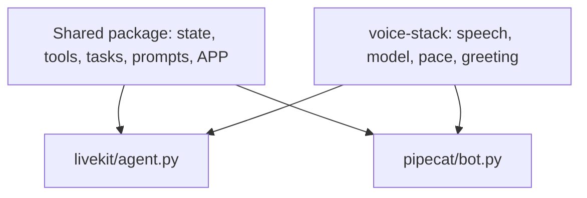

Four example agents show unmute-core on calls that are nothing like the salon.
Each one is a real project in the repo's `examples/` folder. Each one runs on
LiveKit and on Pipecat from the same code, and each one is checked with whole
scripted calls on its real model.

Use them when:

- You want to see a whole agent, not one feature.
- Your call has a shape the salon does not have: a long intake, an outbound call, a tools-only finder, two languages.
- You want to copy a working setup for SLNG speech and Gemini in the EU.

## Pick the closest one

| Example | The call | The shape | What to copy |
|---|---|---|---|
| [Nosh](/core/examples/nosh) | Find a restaurant or bar near the caller | One agent, three tools, no tasks | Results that save values and speak their own line |
| [Kestrel](/core/examples/kestrel) | Report a car accident to an insurer | A task group: find the policy, then a long report | Code asks every question, the model only notes answers |
| [Wasla](/core/examples/wasla) | Remind a customer of an overdue payment | Outbound, three task groups | Verify first, say nothing about the account before |
| [Faro](/core/examples/faro) | A language lesson on the phone | Two agents, one per language, with handoffs | The model grades, code teaches and keeps progress |

All four follow one idea: **type the agent's path**. The model reads what the
caller meant and turns it into a typed tool call. Code checks it, saves it,
and says the next line. [Type the path](/core/examples/typed-path) explains it
and how to apply it to your own agent.

## What they have in common



1. **One package per agent.** It holds the `State`, the tools, the tasks and the prompts. It imports no framework.
2. **Two small projects.** `livekit/agent.py` and `pipecat/bot.py` are about 20 lines each. They import the package's `APP` and run it.
3. **One voice stack.** `examples/voice-stack` builds the framework side once: SLNG speech to text and text to speech, Gemini on Vertex AI, the turn pace, the greeting and the handoffs. Use it as a starting point for your own pipeline.

| Part | Default |
|---|---|
| Speech to text | Soniox `soniox/speech-ai:rt-v5`, through SLNG |
| Text to speech | Fish Audio `slng/fish/tts:s2.1-pro`, through SLNG |
| SLNG region | `eu-north`. Set `SLNG_WORLD_PART` to change it. |
| Model | Gemini Flash Lite on Vertex AI's `eu` endpoint, with a Vertex API key |

Every value can be changed in the project's `.env`. The `.env.example` of each
project lists them.

## Run one

<CodeGroup>
```bash LiveKit
cd examples/nosh/livekit
cp .env.example .env      # SLNG_API_KEY and GOOGLE_API_KEY
uv sync
lk agent console agent.py
```

```bash Pipecat
cd examples/nosh/pipecat
cp .env.example .env      # SLNG_API_KEY and GOOGLE_API_KEY
uv sync
uv run bot.py -t webrtc   # then open http://localhost:7860
```
</CodeGroup>

Each example's README lists what to say on a call, and the demo data it ships with.

## Check one

Every example has whole calls written as JSON in its `scenarios/` folder. A
scripted caller says each line, and the check reads what the agent said, the
tools it called, the model requests each turn made, and the state at the end.

```bash
scripts/converse-examples.sh examples/kestrel/livekit           # typed caller, real model
scripts/converse-examples.sh --audio examples/kestrel/pipecat   # spoken caller, the whole voice pipeline
```

A scenario can also send its start values the way a real dispatch does: in the
LiveKit job's metadata, or in the Pipecat runner's request body. A scenario
with `refused` checks that a call with a missing or wrong start value never
starts, and that the log says why.

The `--audio` run speaks each caller line with SLNG text to speech and sends it
through the real pipeline: voice detection, turn detection, speech to text, the
model and text to speech.

## In this section

<CardGroup cols={2}>
  <Card title="Type the path" icon="route" href="/core/examples/typed-path">
    Spend the model on understanding, and let code do the rest.
  </Card>
  <Card title="Nosh: a tools-only finder" icon="utensils" href="/core/examples/nosh">
    One agent, three tools, and one model request per caller turn.
  </Card>
  <Card title="Kestrel: a long intake" icon="car" href="/core/examples/kestrel">
    Code asks every question and reads the whole claim back.
  </Card>
  <Card title="Wasla: an outbound reminder" icon="phone-outgoing" href="/core/examples/wasla">
    Verify the person first, then record a promise or a concern.
  </Card>
  <Card title="Faro: two languages" icon="languages" href="/core/examples/faro">
    One agent per language, and a handoff to switch.
  </Card>
</CardGroup>
