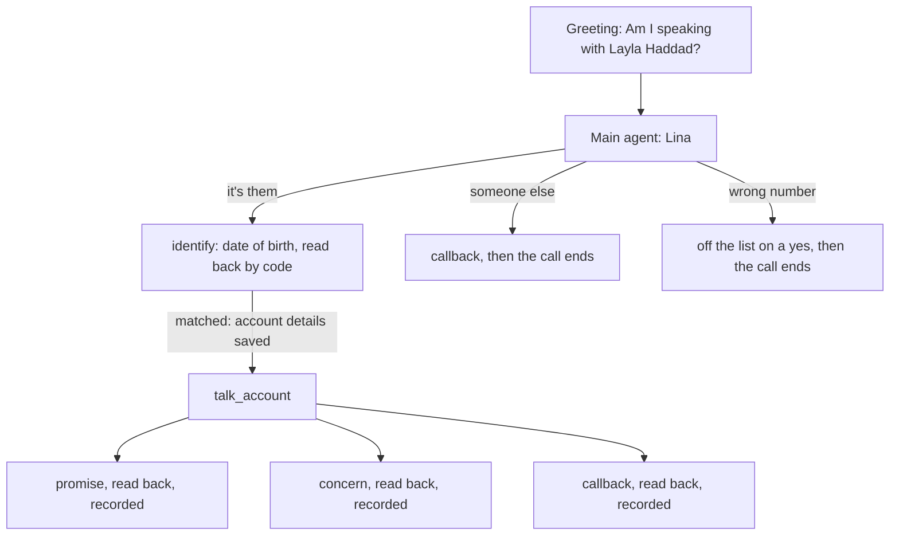

Wasla calls the holder of one overdue payment. Lina checks it is them by their
date of birth, says what is overdue, and records one outcome: a promise to pay,
a callback, a wrong number, or a concern in the holder's own words. The code is
in `examples/wasla`.



## The account is a required input

An outbound call about nothing must never ring anyone. So the account id is a
required start value, typed as `WA` and four digits.

```python wasla/agent.py
AccountId = Annotated[str, StringConstraints(pattern=r"^WA-\d{4}$")]

state = CallState(State, confirm=CONFIRM, call_start={"account_id": "required"}, call=call)
save_call_start(state, dispatched)
await self.prefetch.run(state)
if state.plain("first_name") is None:
    raise CallStartError(f"call_start: account_id: no account {state.plain('account_id')}")
```

| The dispatch sends | What happens |
|---|---|
| `{"account_id": "WA-1001"}` | The call starts. The greeting names Layla Haddad. |
| `{}`, or no `call_start` | Refused: `Missing call_start fields: account_id` |
| `{"account_id": "1001"}` | Refused: `call_start: account_id: String should match pattern ...` |
| `{"account_id": "WA-9999"}` | Refused: `call_start: account_id: no account WA-9999` |

A refused call never reaches the greeting. The voice stack logs the reason and
ends the job on LiveKit, or builds no pipeline on Pipecat. See
[Start values](/core/build/call-lifecycle#start-values).

## Nothing before the check

The call is about money, so nothing may reach the wrong person. Only the
holder's name is read before the greeting:

```python wasla/agent.py
Prefetch(
    [
        Clock("today", TIMEZONE, {"today": "date", "weekday": "day_of_week"}),
        Lookup("account", opened, {name: name for name in ("first_name", "last_name", "deadline")}, inputs=["account_id"]),
    ],
    state=State,
)
```

The amount, the shop and the dates come back only from a matching date of
birth. The `identify` step saves them from `verify_holder`'s result:

```python wasla/agent.py
"assign": [
    {"variable": "birth_date", "path": ["birth_date"]},
    {"variable": "amount_words", "path": ["amount_words"]},
    {"variable": "merchant", "path": ["merchant"]},
],
```

Until then, every prompt reads those values as empty. A relative who answers
cannot hear them, whatever the model does.

**Why it works this way.** A prompt rule like "do not say the amount before the
check" can fail. A value the State does not hold cannot be said. The check is a
tool: three wrong dates lock the account, and code says the support line.

## Every outcome is read back

Each write has a `FinishRule` with a `confirm` line. Code says it, and the
write runs only when the holder heard it and said yes.

```python wasla/agent.py
{
    "tool": "record_promise",
    "success": {"status": ["PTP"]},
    "confirm": ["Shall I record your promise to pay {{amount_words}} for {{input.day}}?"],
    "say": ["Thank you. Your promise to pay {{result.when}} is recorded. ..."],
}
```

A concern is one tool with four kinds. One `confirm` line serves them all, and
each kind gets its own receipt, picked by the result's `kind`:

```python wasla/agent.py
def concern_rule(kind: str) -> dict[str, Any]:
    return {
        "tool": "note_concern",
        "success": {"kind": [kind]},
        "confirm": ["Shall I pass this to our team as a {{input.kind}}: {{input.note}}?"],
        "say": [CONCERN_SAID[kind]],
    }
```

## The window is the tool's rule

```python wasla/ledger.py
def outside_window(day: date) -> Recorded | None:
    if day < today():
        return Recorded(status="past_day")
    deadline = today() + timedelta(days=WINDOW_DAYS)
    if day > deadline:
        return Recorded(status="after_deadline", when=words.day(deadline))
    return None
```

```python wasla/agent.py
local_tool(ledger.record_promise, locked=LOCKED, precheck=outside_window, replies=OUTSIDE_WINDOW)
```

A day outside the ten-day window is answered by the tool's `precheck`, before
the promise is read back. Its reply says "I can only note a day up to Sunday
the 25th of October", with no model request. A concern is a `Literal` of four
kinds. The amount is said by code as "four hundred thirty-four dirhams and fifty
fils". The model never turns a number into speech.

## Three groups

| Group | Steps | Then |
|---|---|---|
| `account` | `identify`, then `talk_account` | back to Lina |
| `callback` | `take_callback`, with `arguments` for a day and time already said | the call ends |
| `wrong_number` | `take_off_list` | the call ends |

1. `identify` opens with `opening: listen` and an `announce` line. Code asks for the date of birth, with no model request.
2. `skip_when_confirmed` skips `identify` when the date of birth is already confirmed in this call.
3. A group with `then: "end"` ends the call once its receipt has played.

## The parts

| unmute-core | Used for |
|---|---|
| `Prefetch` with a `Clock` and a `Lookup` | Today in Dubai, and whose account it is, before the greeting |
| `Greeting` with placeholders | `Am I speaking with {{first_name}} {{last_name}}?`, checked against the prefetch |
| `CallState(call_start=...)` and `save_call_start` | The account the call is about, required and typed |
| `CallState(confirm=...)` | Only `identify` confirms the date of birth |
| `FinishRule` per kind | One read-back, four receipts |
| Group `arguments` and `OpeningTool` | A callback day and time already given are read back at once |
| Locked `{{account_id}}` and `{{call.session_id}}` | The model never names the account or the call a write goes to |

**Best practice.**

1. Keep sensitive values out of the State until a tool proves who is on the line. Then save them from that tool's result.
2. Put business rules in argument types, with an error message that says what to tell the caller.
3. One tool with a `Literal` kind and one `FinishRule` per kind beats one tool per kind. The model picks among fewer tools.

## Try it

The project's `.env.example` sets `UNMUTE_CALL_START` to
`{"account_id": "WA-1001"}`: Layla Haddad, born 14 March 1990. Use
`{"account_id": "WA-1002"}` for Omar Khalil, born 2 November 1985.

1. "Yes, speaking." Code asks for the date of birth.
2. "The fourteenth of March, 1990." Code reads it back.
3. "Yes." Then "Yes, go ahead." Code says the amount.
4. "Can I pay this Sunday?" Code reads the promise back, and records it on your yes.
5. Call again and say "He's not here, call back tomorrow at five." Code reads the callback back and ends the call.

## Troubleshooting

### The step that confirms a value is never reached

A step that confirms a value needs a `when`, even inside a group. **Fix:** give
it a `when` that says it is only for a correction.

## Where to go next

<CardGroup cols={2}>
  <Card title="Faro: two languages" icon="languages" href="/core/examples/faro">
    One agent per language, and a handoff to switch.
  </Card>
  <Card title="Prefetch" icon="download" href="/core/build/prefetch">
    Read values in before the greeting.
  </Card>
</CardGroup>
