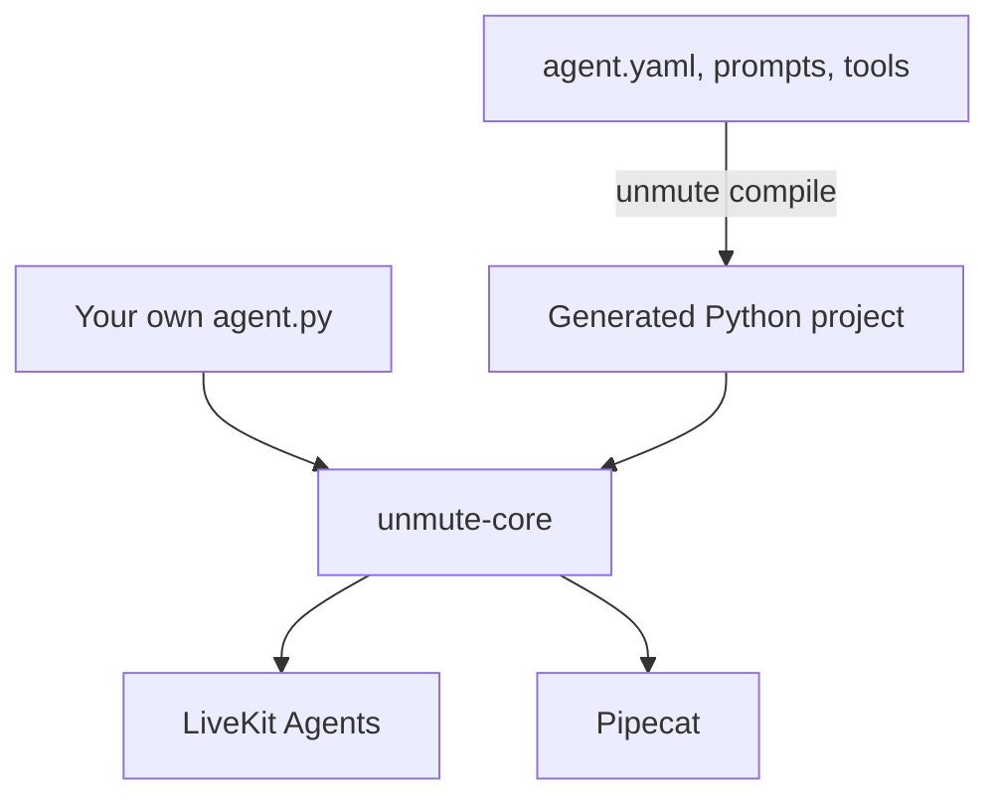

unmute-core is a Python library. It holds the voice-agent behaviour that must be
the same on every framework: typed call state, tasks, tools, handoffs, the model
call and telemetry.

You keep LiveKit or Pipecat, your speech and model plugins, and your pipeline.
The library adds what a real call needs on top. [Why Unmute Core](/core/start/why-unmute-core)
follows one salon call and shows what each part fixes.

## Unmute and unmute-core

1. **Unmute** is a compiler. You describe an agent in `agent.yaml`, and Unmute
   writes a Python project for LiveKit or Pipecat.
2. **unmute-core** is the library that project imports. It runs the call: it
   saves values, steps through tasks, runs tools and sends spans.
3. **Your own agent** can import the same library. You build the pipeline in
   your `agent.py`, and call the library where you need it.
4. The library never reads `agent.yaml` and never builds the pipeline. The
   framework still owns speech, turn detection and the model plugins.

A fix in the library reaches every agent: the ones Unmute generates and the
ones you write by hand. [How Unmute uses the library](/core/start/unmute-and-core)
shows which `agent.yaml` key turns into which class.

## Plug points

Four interfaces let your code add a capability without changing the library.

| Plug point | What you replace | Page |
|---|---|---|
| `ModelCall` | how one model request is sent | [Model call](/core/models/model-call) |
| `ToolExecutor` | how one kind of tool runs | [Tools](/core/build/tools) |
| `Sink` | where spans go | [Telemetry](/core/observe/telemetry) |
| `Hooks` | code before, around and after prompts, model requests and tools | [Hooks](/core/build/hooks) |

A plug point may add a capability. It never changes how the rest of the
library behaves.

## How to read these docs

1. **[Quickstart](/core/start/quickstart).** Run the smallest agent in a few minutes.
2. **[Build a salon agent](/core/tutorial/overview).** Grow one agent, one piece per page. Each page says what the piece is, why it is there, and how to use it.
3. **[On your framework](/core/frameworks/standalone).** Already have a LiveKit or Pipecat agent? Add one piece at a time.
4. **Guides.** One section per topic, such as [State](/core/build/state) or [Tasks](/core/build/tasks). Each starts with what the topic is and when to use it, then goes deeper one page at a time.
5. **[Example agents](/core/examples/overview).** Four whole agents with a different shape of call each: a finder, a long intake, an outbound reminder and a bilingual tutor. Each runs on both frameworks.
6. **Reference.** Every argument of every class, such as the [Tasks reference](/core/reference/tasks).

## Where to go next

<CardGroup cols={2}>
  <Card title="Quickstart" icon="rocket" href="/core/start/quickstart">
    Run the smallest agent on LiveKit or Pipecat.
  </Card>
  <Card title="Build a salon agent" icon="scissors" href="/core/tutorial/overview">
    Grow one agent, one piece per page.
  </Card>
  <Card title="Add one piece to your agent" icon="puzzle" href="/core/frameworks/standalone">
    Use only the parts you need on a plain agent.
  </Card>
  <Card title="How Unmute uses it" icon="workflow" href="/core/start/unmute-and-core">
    Which `agent.yaml` key becomes which library class.
  </Card>
  <Card title="Example agents" icon="layout-grid" href="/core/examples/overview">
    Four whole agents, each a different shape of call.
  </Card>
  <Card title="Type the path" icon="route" href="/core/examples/typed-path">
    Let the model understand, and let code decide and speak.
  </Card>
</CardGroup>
