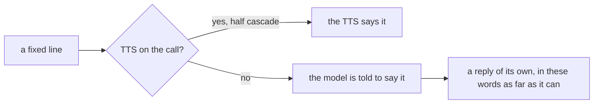

A realtime model hears the caller, thinks and speaks over one connection to its own server. There is no STT, LLM or TTS. The library's greeting, tools, values and handoffs still work on it.

On this page:

- [What it gives you](#what-it-gives-you) - what goes wrong without it
- [Quickstart](#quickstart) - an agent on a realtime model
- [What is supported](#what-is-supported) - features by framework and model kind
- [How a fixed line is said](#how-a-fixed-line-is-said) - lines with no TTS
- [Instructions and values](#instructions-and-values) - what the model reads
- [Handoffs](#handoffs) - keep the whole conversation
- [What is refused](#what-is-refused-and-why) - and the words you will see
- [Turn detection](#turn-detection) - set in your own code
- [On Pipecat](#on-pipecat) - extra wiring
- [What is not here](#what-is-not-here) - gaps
- [Where to go next](#where-to-go-next)

## What it gives you

| On a call without it | What the library does |
|---|---|
| A realtime model has no voice to say a fixed line, like the greeting or an apology. | The model is asked to say the line. [How a fixed line is said](#how-a-fixed-line-is-said) |
| The model keeps the prompt from before a value was saved. | Instructions are sent again after each save. [Instructions and values](#instructions-and-values) |
| A feature the model cannot run does nothing, silently. | The agent refuses to start and names what to remove. [What is refused](#what-is-refused-and-why) |

## Quickstart

<CodeGroup>

```python LiveKit
from livekit.agents import AgentSession, JobContext
from livekit.plugins import openai
from pydantic import BaseModel

from unmute_core.agent import AgentSpec
from unmute_core.call import CallHooks
from unmute_core.greeting import Greeting
from unmute_core.livekit import UnmuteAgent, open_call
from unmute_core.state import CallState
from unmute_core.tools import ToolRegistry, local_tool

PROMPT = "You answer calls for a corner shop. Keep replies short: they are spoken aloud."


class State(BaseModel):
    order_id: str | None = None


class OrderStatus(BaseModel):
    order_id: str
    status: str


def order_status(order_id: str) -> OrderStatus:
    """Look up an order by its id and return where it is."""
    return OrderStatus(order_id=order_id, status="out for delivery")


async def entrypoint(ctx: JobContext) -> None:
    session = AgentSession(llm=openai.realtime.RealtimeModel(voice="marin"))
    state = CallState(State)
    call = CallHooks(state)
    tools = ToolRegistry([local_tool(order_status)])
    spec = AgentSpec(PROMPT, tools=tools, save_values=True)
    agent = UnmuteAgent(spec, state=state, call=call)
    await session.start(agent=agent, room=ctx.room)
    await open_call(session, Greeting(text="Hi, how can I help?"), call)
```

```python Pipecat
import os

from pipecat.pipeline.pipeline import Pipeline
from pipecat.pipeline.worker import PipelineWorker
from pipecat.processors.aggregators.llm_context import LLMContext
from pipecat.processors.aggregators.llm_response_universal import LLMContextAggregatorPair
from pipecat.services.openai.realtime.llm import OpenAIRealtimeLLMService
from pydantic import BaseModel

from unmute_core.agent import AgentSpec
from unmute_core.call import CallHooks
from unmute_core.greeting import Greeting
from unmute_core.pipecat import UnmuteFlows, open_call
from unmute_core.state import CallState
from unmute_core.tools import ToolRegistry, local_tool

PROMPT = "You answer calls for a corner shop. Keep replies short: they are spoken aloud."


class State(BaseModel):
    order_id: str | None = None


class OrderStatus(BaseModel):
    order_id: str
    status: str


def order_status(order_id: str) -> OrderStatus:
    """Look up an order by its id and return where it is."""
    return OrderStatus(order_id=order_id, status="out for delivery")


async def run_call(transport) -> None:
    # transport comes from your own Pipecat runner
    llm = OpenAIRealtimeLLMService(api_key=os.environ["OPENAI_API_KEY"])
    context = LLMContext()
    aggregators = LLMContextAggregatorPair(context)
    state = CallState(State)
    call = CallHooks(state)
    tools = ToolRegistry([local_tool(order_status)])
    spec = AgentSpec(PROMPT, tools=tools, save_values=True)
    flows = UnmuteFlows(
        spec, llm=llm, context=context, aggregators=aggregators, state=state, call=call
    )
    flows.install()
    pipeline = Pipeline(
        [transport.input(), aggregators.user(), llm, transport.output(), aggregators.assistant()]
    )
    worker = PipelineWorker(pipeline)

    @transport.event_handler("on_client_connected")
    async def greet(transport, client) -> None:
        await open_call(
            worker, Greeting(text="Hi, how can I help?"), call, context=context, llm=llm
        )

    # run the worker with your own WorkerRunner, then: await call.end("ended")
```

</CodeGroup>

On LiveKit, any `RealtimeModel` is the session's LLM. On Pipecat, OpenAI's realtime service takes the place of STT, LLM and TTS. The full examples are `examples/minimal/livekit/realtime.py` and `examples/minimal/pipecat/realtime.py`.

## What is supported

A live model is one that fixes its instructions when the session starts. On LiveKit that is any `RealtimeModel` whose capabilities say `mutable_instructions=False`, like OpenAI's GPT-Live. On Pipecat it is `OpenAILiveLLMService`.

| Feature | LiveKit, realtime | LiveKit, live | Pipecat, realtime | Pipecat, live |
|---|---|---|---|---|
| Models | any `RealtimeModel`: OpenAI, Gemini, xAI and others | any model whose instructions are fixed | `OpenAIRealtimeLLMService` and its Azure subclass | `OpenAILiveLLMService` |
| Fixed greeting | yes, the model says it | yes | yes | yes, in its own words |
| Tools | yes | yes | yes | yes |
| A tool's announce line | skipped, the model words its own | skipped | skipped | skipped |
| A registry `ToolReply` line | yes, the model says it | yes | skipped, the model words its own reply | skipped |
| `{{placeholders}}` in the prompt | yes, filled again after each save | yes, filled once, as the agent starts | yes, filled again after each save | yes, filled once, as the agent is built |
| Tools on events at the caller's first message | yes, beside the reply | yes, beside the reply, no note | yes, beside the reply | yes, beside the reply, no note |
| `save_values` | yes | refused | yes | refused |
| Handoffs | yes, with `history="full"` | refused | yes, with `history="full"` | refused |
| Tasks | refused | refused | refused | refused |
| `prompt` hooks | yes | yes | yes | yes |
| `before_model`, `wrap_model`, `after_model` hooks | refused | refused | refused | refused |
| Idle nudges | yes | yes | yes, with `IdleNudgeObserver(llm=...)` | yes, as commentary, with `llm=...` |
| Failure line | yes | yes | yes, with `open_call(llm=...)` | yes, with `open_call(llm=...)` |
| `llm` span with tokens | yes, with time to first token | yes | yes | yes |
| `ModelCall` and the SLNG Context Router | no, the model talks to its own server | no | no | no |

## How a fixed line is said



1. The library has fixed lines: the greeting, an idle nudge, the failure line, the goodbye of `end_call_tool`, a handoff's line, and the lines a transfer says once it is over.
2. With a TTS on the call, as in a half cascade, the TTS says them. Nothing changes from a cascade call.
3. A realtime model with no TTS beside it speaks itself. LiveKit's `session.say` would raise, and Pipecat's `TTSSpeakFrame` would play nothing.
4. So the model is told to say the line: "Say this to the caller now, in these words as far as you can: ...". This text is `SAY_LINE` in `unmute_core.realtime`.
5. The line is a reply of the model's own. It joins the model's conversation.

A line can come out a little different from the text. A live model says it in its own words.

A worded greeting waits for the background lookups on both frameworks, and for the instructions they change, so the model words it from the filled prompt. A fixed greeting does not wait.

A tool's announce line is the one fixed line a realtime model does not say, a transfer's "Putting you through" among them. The model words its own line as it calls the tool. A second reply with the library's line would come while the tool's result is still out, and the result would wait for it.

On Pipecat, a realtime model does not say a registry `ToolReply` line either, even with a TTS after it. A tool's result starts the model's own reply there, and a second spoken line would talk over it. The model reads the result and words its reply. See [Save a result and speak it](/core/build/tools#save-a-result-and-speak-it).

## Instructions and values

The model reads one text: the prompt, filled, then the notes of the tools on events, then the values block with `save_values`. The values block is a system message that lists the State values. A cascade request sends the notes and the values as messages of their own. A realtime model has no requests, so they follow the prompt. `realtime_instructions` builds that text.

- The `prompt` hooks run on the prompt before it is filled, as on a cascade call. See [Hooks](/core/build/hooks).
- After each save, the model gets the instructions again: LiveKit's `update_instructions`, or Pipecat's `LLMUpdateSettingsFrame`. A value a background prefetch saves arrives the same way.
- Each caller message runs the call's tools on events. The model answers that message meanwhile and nothing waits for them. Their notes reach the model with the next instructions. See [The call's life](/core/build/call-lifecycle).
- A live model gets the instructions once. On LiveKit that is as the agent starts. On Pipecat it is as `UnmuteFlows` or `attach_realtime` is set up. A value saved later never reaches it, prefetch included, and neither do the notes of tools on events.
- A plain Pipecat pipeline without `UnmuteFlows` gets the same with `attach_realtime`, before the pipeline runs.

### attach_realtime

Runs OpenAI's realtime or live service as the agent on Pipecat. Await it before the pipeline runs. It refuses what the model cannot do, then queues the filled instructions on the service.

<ParamField path="service" type="LLMService[Any]" required>
  The call's realtime or live service.
</ParamField>
<ParamField path="worker" type="PipelineWorker" required>
  The call's worker. Its end stops following the state.
</ParamField>
<ParamField path="prompt" type="str" required>
  The agent's prompt, placeholders still in it.
</ParamField>
<ParamField path="state" type="CallState | None" default="None">
  The call state the placeholders read.
</ParamField>
<ParamField path="call" type="CallHooks | None" default="None">
  The call's hooks. Its `prompt` hooks and the notes of its tools on events apply.
</ParamField>
<ParamField path="save_values" type="bool" default="False">
  The agent has the `save_values` tool. Its values follow the prompt.
</ParamField>
<ParamField path="owners" type="Mapping[str, str] | None" default="None">
  Value name to the task that saves it, for the values block.
</ParamField>

```python
await attach_realtime(llm, worker, PROMPT, state, call=call)
```

## Handoffs

A realtime model keeps the whole conversation on its own server. A handoff keeps it too. The [Handoffs page](/core/build/handoffs) covers handoffs in general.

```python
return await self.hand_off(
    UnmuteAgent(billing, state=self.state), context=HandoffContext(history="full")
)
```

1. Pass `HandoffContext(history="full")`. Any other history is refused, because the library cannot reshape what the model holds. Tool calls must stay in, which is the default.
2. The model says the handoff's line first.
3. The next agent's instructions and tools replace the first agent's, on the same connection.
4. The next agent speaks first.

A live model refuses every handoff, because its instructions are fixed.

## What is refused and why

Each refusal has the same words on both frameworks. `UnmuteFlows` refuses when it is built. `UnmuteAgent` refuses as it enters the session, and closes the session, because the agent would run without what was refused. Each message names what to remove or what to run instead.

- **Tasks.** A step needs its own history and a finish check. Both are requests the library sends, and a realtime model has none.
- **`before_model`, `wrap_model` and `after_model` hooks.** No model request passes through the library, so they would never run. The `prompt` hooks do run.
- **`save_values` on a live model.** Its instructions are fixed.
- **A handoff on a live model, or one without `history="full"`.** See above.

## Turn detection

Turn detection is part of building the model, so it stays in your code. These are the settings for OpenAI's models. On LiveKit, `ServerVad` and `SemanticVad` come from `openai.types.realtime.realtime_audio_input_turn_detection`.

| Mode | LiveKit | Pipecat |
|---|---|---|
| `server_vad` | `RealtimeModel(turn_detection=ServerVad(type="server_vad"))` | `events.AudioInput(turn_detection=events.TurnDetection())` |
| `semantic` | `RealtimeModel(turn_detection=SemanticVad(type="semantic_vad"))` | `events.AudioInput(turn_detection=events.SemanticTurnDetection())` |
| `local` | `RealtimeModel(turn_detection=None)`, with a VAD and `turn_handling` on the session | `events.AudioInput(turn_detection=False)`, with a VAD on the user aggregator |
| left out | semantic VAD | server VAD |

When the model decides the turn, some [turn-taking](/core/build/turn-taking) settings do nothing:

- `endpointing()`, `vad_params()` and `smart_turn_params()`. The model's own VAD sets the pace.
- `interruption(enabled=False)` on LiveKit. It raises when the session starts, because LiveKit cannot stop the model from being cut off.
- Pipecat's interruption strategies, like `Backchannels`. They act on local VAD frames, and the server cancels its reply itself.

## On Pipecat

- Pass the service to `open_call(llm=...)`, with `UnmuteFlows` too, and to `IdleNudgeObserver(llm=...)`. They then say the greeting, the failure line and the nudges through the model. Left out, these lines become `TTSSpeakFrame`s that nothing plays, and nothing reports it.
- Any other realtime service, like Gemini Live, is taken for a cascade LLM. Its fixed lines are not said.
- A greeting goes to the model as a developer message. Pipecat drops a first system message when the service has its own instructions.
- When the caller speaks first, `open_call` gives the service its context and tools at once. Without that, Pipecat sets the conversation up in the middle of the caller's first turn. It sends the turn again as a "previously saved conversation", asks for a second reply, and the model gets its tools only then.
- A live service opens its session on a first request. When the caller speaks first, `open_call` still sends one.
- A line said while the model replies waits for the reply to end. The server refuses a second reply while one runs.
- `TelemetryObserver` records one `llm` span per reply. Pipecat starts a realtime reply twice, and starts none for a reply that only calls a tool. The observer handles both.

## What is not here

- Gemini Live, Nova Sonic, Ultravox, Grok and Inworld on Pipecat. Their services take instructions, tools and replies in other ways. On LiveKit any `RealtimeModel` works.
- The SLNG Context Router. It has no realtime endpoint.
- Building the model. Its voice, its turn detection and its transcription stay in your code.

## Where to go next

<CardGroup cols={2}>
  <Card title="Handoffs" icon="git-branch" href="/core/build/handoffs">
    Give the call to another agent.
  </Card>
  <Card title="Turn taking" icon="timer" href="/core/build/turn-taking">
    Pace, interruption and idle nudges on a cascade call.
  </Card>
  <Card title="The model call" icon="brain" href="/core/models/model-call">
    The plug point a realtime model does not use.
  </Card>
  <Card title="How Unmute builds realtime agents" icon="workflow" href="/build/architecture/realtime">
    The compiler side, on the Unmute tab.
  </Card>
</CardGroup>
