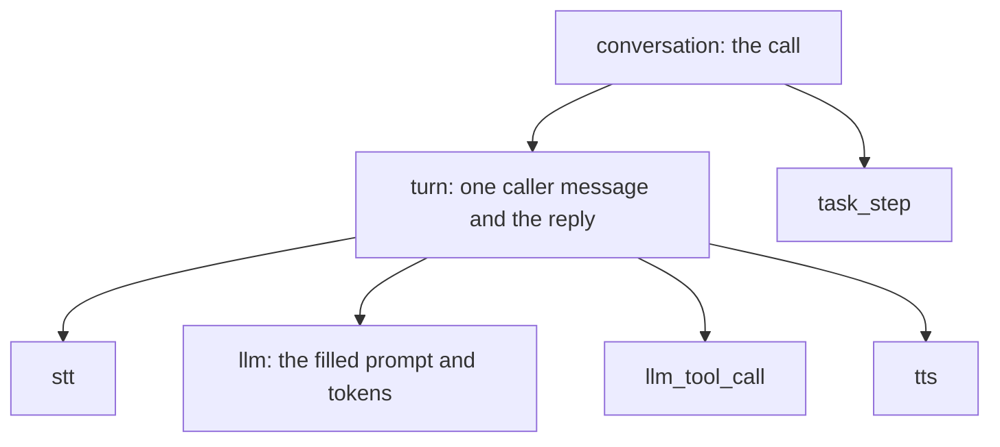

The library traces each call the same way on LiveKit and Pipecat. A call is one trace. Each caller turn is a span, with the speech, the model requests and the tool calls under it. You pick where the spans go.

In the salon tutorial, [See every call](/core/tutorial/see-every-call) builds this step by step.

## Turn it on

Build one `Telemetry` for every call, and give it to the agent.

<CodeGroup>

```python LiveKit
from unmute_core.livekit import UnmuteAgent
from unmute_core.telemetry import Langfuse, Telemetry

telemetry = Telemetry(Langfuse.from_env(), agent="salon", call_id=state.call.session_id)
agent = UnmuteAgent(spec, state=state, telemetry=telemetry)
```

```python Pipecat
from pipecat.pipeline.worker import PipelineParams, PipelineWorker
from unmute_core.pipecat import TelemetryObserver, UnmuteFlows
from unmute_core.telemetry import Langfuse, Telemetry

telemetry = Telemetry(Langfuse.from_env(), agent="salon", call_id=state.call.session_id)
flows = UnmuteFlows(
    spec, llm=llm, context=context, aggregators=aggregators, state=state, telemetry=telemetry
)
worker = PipelineWorker(
    pipeline,
    params=PipelineParams(enable_metrics=True, enable_usage_metrics=True),
    observers=[TelemetryObserver(telemetry, model="gpt-5.6-terra", provider="openai", flows=flows)],
)

telemetry.start_call()
try:
    await runner.run()
finally:
    await telemetry.close(state=state, reason="ended")
```

</CodeGroup>

On LiveKit, the trace ends and is sent when the session closes. On Pipecat, `close` does it. Leave Pipecat's own `enable_tracing` off, or the call is traced twice.

## Pick where the spans go

Change the sink. The rest of your code stays the same.

### Langfuse

```bash
export LANGFUSE_PUBLIC_KEY=pk-... LANGFUSE_SECRET_KEY=sk-... LANGFUSE_BASE_URL=https://cloud.langfuse.com
```

```python
telemetry = Telemetry(Langfuse.from_env(), agent="salon", call_id=state.call.session_id)
```

### Logfire

```bash
export LOGFIRE_TOKEN=...
```

```python
telemetry = Telemetry(Logfire.from_env(), agent="salon", call_id=state.call.session_id)
```

### Coval

```bash
export COVAL_API_KEY=...
```

```python
from unmute_core.livekit import correlate_coval  # or unmute_core.pipecat

coval = Coval.from_env()
telemetry = Telemetry(coval, agent="salon", call_id=state.call.session_id)
correlate_coval(ctx, coval, telemetry)  # LiveKit: the JobContext
correlate_coval(runner_args, coval, telemetry)  # Pipecat: the runner's arguments
```

A call that Coval placed joins its simulation. Any other call is filed as a Coval conversation when it ends.

### Datadog

Send the spans to an OpenTelemetry Collector. The Collector sends them to Datadog.

```python
telemetry = Telemetry(
    Otlp(endpoint="http://collector:4318/v1/traces"), agent="salon", call_id=state.call.session_id
)
```

```yaml collector.yaml
receivers:
  otlp:
    protocols:
      http:
        endpoint: 0.0.0.0:4318
exporters:
  datadog:
    api:
      key: ${env:DD_API_KEY}
      site: datadoghq.com
service:
  pipelines:
    traces:
      receivers: [otlp]
      exporters: [datadog]
```

### Any OpenTelemetry endpoint

```python
Otlp(endpoint="https://otlp.example.com/v1/traces", headers={"x-api-key": key})
```

## Send to several at once

Pass more than one sink. Each one gets every span.

```python
telemetry = Telemetry(
    Langfuse.from_env(), Coval.from_env(), agent="salon", call_id=state.call.session_id
)
```

## Keep transcripts out

Add `filter=MetadataOnly()` to a sink. It then gets timings and names, and no transcript or prompt. The other sinks still get everything.

```python
Otlp(endpoint="http://collector:4318/v1/traces", filter=MetadataOnly())
```

## What you see



1. The call span holds the transcript and why the call ended.
2. Each turn holds what the caller said, what the agent said and how long the reply took.
3. Each model span holds the prompt the model really read, the tools and the tokens.
4. A missing time is left out, never sent as 0.

## Where to go next

<CardGroup cols={2}>
  <Card title="Telemetry reference" icon="book" href="/core/reference/telemetry">
    Every helper, sink argument, span and attribute.
  </Card>
  <Card title="Dev records" icon="monitor" href="/core/reference/dev-records">
    What one call did, for the local dev page.
  </Card>
  <Card title="Settings" icon="settings" href="/core/reference/settings">
    Every Langfuse, Logfire and Coval variable.
  </Card>
  <Card title="Tracing on Unmute" icon="activity" href="/tracing/overview">
    The `tracing` key of `agent.yaml`, on the Unmute tab.
  </Card>
</CardGroup>
