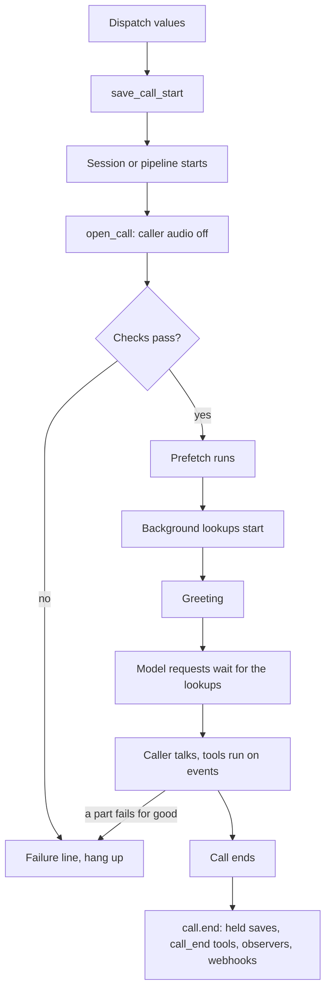

This page is the full detail behind [The call's life](/core/build/call-lifecycle). Start there to open, greet and end a call. Come here for every argument, the exact order and each rule.

`unmute_core.call` and `unmute_core.greeting` run what happens around a call. `CallHooks` runs the call's [hooks](/core/build/hooks). The checks, the failure and the end below are hooks too.

## What it gives you

| On a call without it | What the library does |
|---|---|
| The caller talks during setup, and that audio mixes into the first turn. | Caller audio waits until the greeting starts, for at most 20 s. [Holding the caller's audio](#holding-caller-audio) |
| A service is down. The agent greets the caller, then dies. | Checks run before the greeting. A failure plays a short line and hangs up. [Checks before the greeting](#checks-before-the-greeting) |
| The model or speech service fails, and the caller hears silence. | A short apology plays once, then the call ends. A voice error alone keeps the call going. [When a part fails](#when-a-part-fails) |
| Late saves, end tools and webhooks are cut off when the process exits. | The end runs once and waits for them. [The end](#the-end) |
| "Why did the call end?" has a different answer on each framework. | Seven reasons, the same on both. [Why the call ended](/core/build/call-lifecycle#why-the-call-ended) |

## A whole call

Both tabs share this setup. It holds the State, one webhook tool for the call end and one background lookup.

```python setup.py
from pydantic import BaseModel

from unmute_core.call import CallHooks, EventTool
from unmute_core.hooks import Hooks
from unmute_core.prefetch import Lookup, Prefetch
from unmute_core.state import CallState
from unmute_core.tools import Done, Transcript, local_tool, webhook_tool

PROMPT = "You answer the phone for {{brand}}. The shop closes at {{closes_at}}."


class CallLog(BaseModel):
    customer_id: str
    transcript: list[dict[str, str]]


class Hours(BaseModel):
    close: str


class State(BaseModel):
    customer_id: str | None = None
    brand: str | None = None
    closes_at: str | None = None


def store_hours() -> Hours:
    """Return when the shop closes."""
    return Hours(close="18:00")


def new_call() -> tuple[CallState, CallHooks]:
    """Build the state and the hooks of one call."""
    state = CallState(State, call_start={"customer_id": "required", "brand": "optional"})
    log_call = webhook_tool(
        "log_call",
        "Send the call to the CRM.",
        "https://crm.example.com/calls",
        input=CallLog,
        output=Done,
        locked={"customer_id": "{{customer_id}}", "transcript": Transcript(max_messages=50)},
    )
    prefetch = Prefetch(
        [Lookup("hours", local_tool(store_hours), {"closes_at": "close"}, background=True)]
    )
    hooks = Hooks(EventTool(log_call, on=["call_end"]))
    return state, CallHooks(state, hooks=hooks, prefetch=prefetch)
```

<CodeGroup>

```python LiveKit
import json

from livekit.agents import AgentSession, JobContext

from unmute_core.agent import AgentSpec
from unmute_core.call import save_call_start
from unmute_core.greeting import Greeting
from unmute_core.livekit import UnmuteAgent, open_call


async def entrypoint(ctx: JobContext) -> None:
    state, call = new_call()
    metadata = json.loads(ctx.job.metadata or "{}")
    save_call_start(state, metadata.get("call_start"))

    session = AgentSession(...)  # your STT, LLM, TTS and VAD
    agent = UnmuteAgent(AgentSpec(PROMPT), state=state, call=call)
    await session.start(agent=agent, room=ctx.room)
    await open_call(session, Greeting(text="Hi, thanks for calling."), call)
```

```python Pipecat
from pipecat.frames.frames import EndFrame

from unmute_core.call import save_call_start
from unmute_core.greeting import Greeting
from unmute_core.pipecat import GreetingHold, fill_prompt, open_call

# runner_args, transport, llm, context, worker and runner are the objects your own bot builds.
state, call = new_call()
save_call_start(state, runner_args.body.get("call_start"))
hold = GreetingHold()  # also give it to the user aggregator: user_mute_strategies=[hold]
await fill_prompt(llm, worker, PROMPT, state)  # the prompt reads the values, each time they change


@transport.event_handler("on_client_connected")
async def on_connected(transport, client):
    await open_call(
        worker,
        Greeting(text="Hi, thanks for calling.", interruptible=False),
        call,
        context=context,
        llm=llm,
        hold=hold,
        transport=transport,
    )


@transport.event_handler("on_client_disconnected")
async def on_disconnected(transport, client):
    await worker.queue_frame(EndFrame())


await runner.run()
end = await call.end("ended")
```

</CodeGroup>

## The order



1. The dispatch brings values. `save_call_start` saves them into the state.
2. The session or pipeline starts.
3. `open_call` holds the caller's audio, then runs the `before_call` hooks in order. A failed check says the failure line and hangs up. No lookup runs.
4. When the checks pass, it runs the prefetch with `prefetch.run`.
5. Then the background lookups start with `prefetch.run_background`. The call's end, or a failure, stops them.
6. The greeting plays. A fixed line plays at once. A worded greeting on a realtime model waits for the background lookups and for the instructions they change.
7. Every model request waits for the background lookups, up to `first_request_timeout_s` (10 seconds).
8. During the call, tools run on events: the first caller message, the call end, and the success or failure of a tool.
9. If STT or the model fails for good, the call says the failure line and hangs up. A TTS failure only logs a warning, and the call stays open. On LiveKit the session still closes at the fourth unrecoverable TTS error. Pipecat has no such limit: a voice that stays broken keeps the line open until the idle hang-up, the call's limit or the caller ends it.
10. When the call ends, `call.end` settles the held saves, runs the `call_end` tools, tells the `call.ended` observers and drains the webhooks.

## CallHooks

The call's own object. Build one per call. See [Open a call](/core/build/call-lifecycle#open-a-call).

<ParamField path="state" type="CallState | None" default="None">
  The call's state. Tools read it and the end reports its values. Each save reaches the `state.changed` observers. None builds `CallState()`. `UnmuteAgent` takes `call.state`, so a call has one state and one `session_id`.
</ParamField>
<ParamField path="hooks" type="Hooks | None" default="None">
  The call's hooks, with its tools on events. None runs none.
</ParamField>
<ParamField path="prefetch" type="Prefetch | None" default="None">
  What the call reads as it starts. It needs a state.
</ParamField>
<ParamField path="ready_timeout_s" type="float" default="10.0">
  The longest the `before_call` hooks may take together.
</ParamField>
<ParamField path="first_request_timeout_s" type="float" default="10.0">
  The longest a model request waits for tools on events and background lookups.
</ParamField>
<ParamField path="failure_line" type="str | None" default="FAILURE_LINE">
  Said before hanging up on a failure. None says nothing.
</ParamField>
<ParamField path="end_timeout_s" type="float" default="5.0">
  The longest the held saves and the `call_end` tools may take. It is also the longest the `call.ended` observers and the webhook drain may take.
</ParamField>

`FAILURE_LINE` is `I'm sorry, something went wrong on our side. Please call back later. Goodbye.`

## open_call

`open_call` differs by framework.

<CodeGroup>

```python LiveKit
from unmute_core.livekit import open_call

handle = await open_call(session, greeting, call)
```

```python Pipecat
from unmute_core.pipecat import open_call

greeted = await open_call(worker, greeting, call, context=context, hold=hold, transport=transport)
```

</CodeGroup>

On LiveKit it takes `session`, `greeting` and `call`, then the keyword `max_hold_s` (default `GREETING_HOLD_SECONDS`). It returns the greeting's speech, or None when the caller speaks first or a check failed.

On Pipecat it takes `worker`, `greeting` and `call`, then the keywords `context` (required), `llm`, `hold` and `transport`. It returns True once the greeting is queued, and False after a failed check.

## save_call_start

Saves the values a dispatch sends. See [Start values](/core/build/call-lifecycle#start-values).

<ParamField path="state" type="CallState" required>
  The call's state.
</ParamField>
<ParamField path="dispatched" type="Mapping[str, object] | None" required>
  The dispatch's `call_start` object. None when there is none.
</ParamField>
<ParamField path="env" type="bool" default="True">
  Also read `UNMUTE_CALL_START`. `False` reads only `dispatched`. Pass it by keyword.
</ParamField>

Call it before the session starts, so a bad dispatch fails at once. [State](/core/build/state#values-the-call-starts-with) shows how these values read in prompts and tools.

### Start value rules

1. `dispatched` is the `call_start` object of the dispatch. On LiveKit it is `json.loads(ctx.job.metadata or "{}").get("call_start")`. On Pipecat it is `runner_args.body.get("call_start")`.
2. For a local run, set `UNMUTE_CALL_START` to a JSON object. The dispatch's values win over it. Pass `env=False` to read only the dispatch.
3. `CallState(call_start=...)` names the values and says if each is `required` or `optional`. Every one is a State value.
4. With a mapping, only those names are taken. A missing required name raises `CallStartError`: `Missing call_start fields: customer_id`.
5. Without a mapping, any State value may be set and none is required.
6. Names the State does not hold are dropped, and the log names them.
7. A value that does not fit its type raises `CallStartError` with `call_start: <field>: <message>`. Nothing is saved.
8. A value of `None` is left out. It keeps its default.
9. The saved values have the origin kind `call_start`.
10. The function returns the values it saved.
11. A `call` object in `dispatched` sets what the call carries. On a web call every field applies. On a phone call the line's own fields win, and the dispatch fills only the empty ones. `agent_id` and `session_id` always apply. See [State](/core/build/state#values-the-call-carries-state-call).

## Work at call start

```python
from unmute_core.prefetch import Lookup, Prefetch

prefetch = Prefetch(
    [
        Lookup("customer", find_customer, {"customer_name": "name"}),
        Lookup("hours", local_tool(store_hours), {"closes_at": "close"}, background=True),
    ],
    state=State,
)
call = CallHooks(state, prefetch=prefetch)
```

Work at call start is a [prefetch](/core/build/prefetch). A tool on a `call_start` event is not possible.

1. `CallHooks(state, prefetch=...)` takes the prefetch. A prefetch needs a state.
2. `open()` runs the `before_call` hooks first, then `prefetch.run`. The prefetch holds the greeting until it ends or its budget (2 seconds) runs out.
3. Then `open()` starts `prefetch.run_background`. It runs each `background=True` lookup beside the greeting.
4. Every model request waits for the background lookups, up to `first_request_timeout_s` (10 seconds). So a fixed greeting plays at once.
5. `call.results` holds each lookup's result as JSON, by entry name. `UnmuteAgent(call=call)` and `UnmuteFlows(call=call)` give it to their tasks, so a step with a `tool` input reads it. In your own host, pass it to `CallTasks(call_start=call.results)`. See [Tasks](/core/build/tasks).
6. `EventTool(..., on=["call_start"])` raises `ValueError`. It points you to `Lookup(..., background=True)`.

## Checks before the greeting

```python
hooks.before_call(check_crm)
hooks.before_call(check_calendar)
call = CallHooks(state, hooks=hooks, ready_timeout_s=10)
```

1. Each check is a `before_call` hook. The checks run in order, before `prefetch.run`.
2. All checks share `ready_timeout_s`, 10 seconds by default.
3. A check that raises, or runs out of time, is a terminal failure with the component `ready`.
4. `open_call` returns `None` (LiveKit) or `False` (Pipecat) in that case. The caller's audio stays off.

## Greeting

How the call opens. See [Greet the caller](/core/build/call-lifecycle#greet-the-caller).

```python
from unmute_core.greeting import GREETING_INSTRUCTION, Greeting

Greeting(text="Hello {{customer.name}}, how can I help?")
Greeting()
Greeting(speaks_first="user")
```

| Greeting | What happens |
|---|---|
| `Greeting(text="...")` | The agent says that fixed line. |
| `Greeting()` | The model words a greeting from `instruction`. |
| `Greeting(speaks_first="user")` | The agent waits for the caller. |

<ParamField path="speaks_first" type="agent | user" default="agent">
  `agent` opens the call. `user` waits for the caller.
</ParamField>
<ParamField path="text" type="str | None" default="None">
  The line the agent says. None has the model word the greeting. It needs `speaks_first="agent"`, and it may not be blank.
</ParamField>
<ParamField path="instruction" type="str" default="GREETING_INSTRUCTION">
  What the model is told when it words the greeting.
</ParamField>
<ParamField path="interruptible" type="bool" default="True">
  False keeps the caller from cutting the greeting off. It also holds the caller's audio until the greeting has played.
</ParamField>

### Greeting rules

1. A fixed line may name State values as `{{name}}` or `{{name.field}}`.
2. Only values that prefetch or `call_start` fills before the greeting can be named. Any other value is still empty when the call opens.
3. `greeting.check(prefetch, call_start)` raises `ValueError` for a line that names a value neither fills. `call_start` is the `CallState(call_start=...)` mapping, or its names. Background lookups do not count.
4. If a named value is empty at the moment of greeting, or still waits for the caller to confirm it, the line is not said. The model words the greeting instead. The log says why.
5. `GREETING_INSTRUCTION` is what the model is told when it words the greeting: `Greet the caller and offer to help.`
6. `Greeting` is a frozen Pydantic dataclass. A value of the wrong type raises a `ValidationError` in Pydantic's wording, like `Input should be 'agent' or 'user'`. A blank `text` raises one too.
7. A `text` with `speaks_first="user"` raises `ValueError`: `greeting text requires speaks_first: agent`. So does a `{{` or `}}` that is not a `{{name}}` or `{{name.field}}` placeholder.

### Open a call with it

`open_call` is the usual way. It runs the checks and the prefetch, then greets. To greet by hand, after the session or pipeline runs and prefetch has filled the state:

<CodeGroup>

```python LiveKit
from unmute_core.livekit import greet

greet(session, greeting, state)
```

```python Pipecat
from unmute_core.pipecat import greeting_frames

await worker.queue_frames(greeting_frames(greeting, state))
```

</CodeGroup>

## Holding caller audio

The rule is the same on both frameworks. The caller's audio stays off until the agent starts to speak, so the greeting is not talked over.

1. `open_call` turns the caller's audio off, runs the checks, and greets.
2. By default, the audio comes back when the agent starts to speak. The caller can cut the greeting off.
3. With `Greeting(interruptible=False)`, the audio comes back when the greeting ends. The caller cannot cut it off.
4. If the caller speaks first, the audio comes back at once.
5. After a failed check, the audio stays off.
6. The hold has a limit on both frameworks: `GREETING_HOLD_SECONDS` (20 seconds). A greeting that never starts or never ends gives the audio back after that, so the caller is never held for ever. Import it from `unmute_core.greeting`.

LiveKit does this inside `open_call`, and `open_call(max_hold_s=...)` sets the limit. See [LiveKit](/core/frameworks/livekit). Pipecat needs a `GreetingHold` on the user aggregator, and `open_call(hold=hold)` sets `hold.interruptible` from the greeting. `GreetingHold(max_hold_s=...)` defaults to `GREETING_HOLD_SECONDS`. See [Pipecat](/core/frameworks/pipecat).

## EventTool

Runs a tool without the model. See [Tools on events](/core/build/call-lifecycle#tools-on-events).

```python
from unmute_core.call import EventTool

EventTool(
    load_booking,
    on=["tool_succeeded:book_slot"],
    assign={"booking_ref": "ref"},
    note=True,
)
```

Add it to the call's hooks with `hooks.add(EventTool(...))`, or pass it to `Hooks(...)`. These are the events:

| Event | When |
|---|---|
| `first_user_message` | The first model request that has a caller message. |
| `call_end` | The call ends. |
| `tool_succeeded:<tool>` | The named tool succeeded. |
| `tool_failed:<tool>` | The named tool failed. |

<ParamField path="tool" type="ToolSpec" required>
  The tool to run.
</ParamField>
<ParamField path="on" type="Sequence[str]" required>
  Its events. At least one.
</ParamField>
<ParamField path="assign" type="Mapping[str, str]" default="{}">
  State value name to the top-level result key it gets. Saved when the tool succeeds.
</ParamField>
<ParamField path="note" type="bool" default="False">
  True also shows the result to the model as a note.
</ParamField>

### Saving the result

1. `assign={"state_value": "result_key"}` saves a top-level key of the result into the State.
2. It saves only when the tool succeeds. The origin kind is `event`.
3. A value that does not fit its type is only logged. The call goes on.
4. The names are checked against the state when you build `CallHooks`. An unknown value raises `ValueError`.
5. `call_end` tools save before the `call.ended` observers run.

### Rules

1. Every required argument must be locked: a constant, `{{value}}`, `{{call.name}}` or `Transcript(...)`. The model never fills one.
2. The tool reads these call values besides the usual ones: `{{call.first_user_message}}` and `{{call.end_reason}}`. The library saves each one just before the tools of that event run. For the transcript, lock `Transcript()`. `trigger_event` exists only in the webhook envelope.
3. A tool on an event has no announce line. Nobody waits for it.
4. Tools of one event run in list order.
5. A tool that follows another tool starts after it. A chain is at most 8 tools deep. A loop is refused when you build `CallHooks`.
6. Each of `first_user_message` and `call_end` fires once a call.
7. An event tool that is refused starts no tool after it.
8. `tool_succeeded` and `tool_failed` follow the tools of the agent. On a plain agent, pass `hooks=call` to `function_tools` or `tools_schema`.

### Transcript

`Transcript` is a locked argument that reads the call's transcript so far.

```python
from unmute_core.tools import Transcript

webhook_tool(
    ..., locked={"transcript": Transcript(max_messages=50), "reason": "{{call.end_reason}}"}
)
```

1. `max_messages` is the newest messages to send. The default is 200. It must be 1 or more. The result is also capped at `TRANSCRIPT_MAX_BYTES` (32 KiB). Over that, the oldest messages go first, and the newest message is always kept.
2. `text=False` (default) sends a list of `{"role", "content"}` messages. `text=True` sends one text with a `role: content` line per message.
3. The model never sees a locked argument.

### What the model reads

```text
Results of tools that ran on their own in this call. Use them, but never read them aloud or share the raw data:
- load_booking ran on its own after book_slot succeeded. Use the result like this: Tell the caller the booking code. Result: {"ref": "B-17"}
```

1. A note is opt-in. Set `note=True` on the `EventTool`. By default the model reads nothing.
2. With `note=True`, every main-agent request ends with one system message that starts with `NOTES_HEADER`. It holds all notes so far.
3. It sits just before the values block, the system message that lists the State values. A step's request gets no notes.
4. A tool with `show_result=False` that succeeded leaves no note.
5. A `call_end` tool leaves no note. The call is over.
6. With `note=True`, a failure is noted too, even for a tool with `show_result=False`.
7. The tool's `result_instructions` come first in the note, after "Use the result like this:". A note cut to its length limit never loses them. A tool that failed gets no instructions.
8. A note has at most 15,000 characters. Its `{{` is broken, so the model call never fills it.

### The wait before the first reply

Each model request waits for the tools on events and for the background lookups, up to `first_request_timeout_s`. So a fixed greeting plays at once. The first model request, and a greeting the model words, wait for them.

A plain native LLM on LiveKit with no `traced_llm` gets no wait and no notes. Wrap the LLM with `traced_llm`, or use `ModelCallLLM(call=call)`. On a Pipecat pipeline with no `UnmuteFlows`, pass `llm=` to `open_call`. See [Add one piece to your agent](/core/frameworks/standalone).

## When a part fails

```python
@hooks.wrap_failure
async def page_then_hang_up(component: str, error: BaseException, handler) -> None:
    await pager.notify(component, error)
    await handler()


call = CallHooks(
    state, hooks=hooks, failure_line="Sorry, we have a problem. Please call back. Goodbye."
)
```

A part fails for good when LiveKit reports an unrecoverable `error` event, or Pipecat reports a fatal error or an unusable processor. A `ModelCall` that raises inside `UnmuteAgent` or `ModelCallLLMService` before its reply began fails the call too. A short error of a native Pipecat LLM does not.

A model error after the reply began does not fail the call. The caller already heard the start. The reply ends as it stands, the error is logged, and the call goes on. The next turn runs as usual.

`ModelCallLLMService.failure_is_final` decides this on Pipecat. `attach_call(llm=...)` and `UnmuteFlows(call=...)` set it. Without them, a model failure stays recoverable, as Pipecat reports it.

1. Only the first failure counts.
2. The `call.failed` observers hear it first. The component is `stt`, `llm`, `pipeline` or `ready`. A `tts` failure is logged and tells the `call.tts_failed` observers, with `{component, error}`: the framework's own retry or fallback may still speak, and a failure line would need the voice that failed. The call stays open and no line plays. An observer may switch voices.
3. The `wrap_failure` hooks run around the failure line. `handler()` says `failure_line` and hangs up. `handler(line=None)` only hangs up, for a hook that plays a recording first. A hook that returns without calling `handler` keeps the call going. The call is no longer failed, the `call.recovered` observers hear it with `{component}`, and a later failure counts again. Use this to switch to a backup service.
4. The line is `failure_line`. The default is `FAILURE_LINE`. None says nothing.
5. Then the call hangs up. The line has at most 15 seconds.
6. The call's end reason becomes `error`.
7. A failure before the adapter binds waits. The line plays once it binds.
8. A failure after the end started changes nothing.
9. A failure after the end was requested changes nothing too. No line plays and no `call.failed` fires. See [The end](#the-end).

On Pipecat, keep the worker's `processor_unusable_policy` at `CONTINUE`, so the line can play.

## The end

```python
@hooks.on("call.ended")
async def save_summary(event: str, ended: CallEnd) -> None:
    await crm.save(ended.reason, ended.values, ended.transcript)


call = CallHooks(state, hooks=hooks, end_timeout_s=5)
```

`call.end(reason)` runs once. Every caller waits for the same run. It does these steps:

1. It settles the held saves. See [Tasks](/core/build/tasks).
2. It runs the `call_end` tools. They save their `assign` values.
3. It tells the `call.ended` observers, with a `CallEnd`: `reason`, `values`, `confirmed`, `transcript` and `duration_s`. It waits for each.
4. It drains the webhooks of every watched registry.

Each step that fails is logged. Steps 1 and 2 share `end_timeout_s`, 5 seconds by default. Steps 3 and 4 get their own `end_timeout_s`. So a slow tool never skips the observers.

| Framework | Who calls `call.end` |
|---|---|
| LiveKit | The session's close. The job's shutdown waits for it. See [LiveKit](/core/frameworks/livekit#open-and-end-the-call). |
| Pipecat | `on_pipeline_finished`. After `runner.run()`, call `await call.end(...)` again. It returns the same result. |

Then close the telemetry. See [Telemetry](/core/observe/telemetry). On Pipecat, `call.end` replaces `flows.settle()`. `settle()` still works.

`CallEnd` is a frozen Pydantic dataclass. A wrong type in a field raises a `ValidationError`.

### Reading a transcript from a chat

```python
from unmute_core.call import transcript_messages

transcript_messages(chat)  # [{"role": "user", "content": "Hi"}, ...]
transcript_messages(chat, drop_empty=True)  # also leaves out empty replies
```

`transcript_messages` is how both adapters build the call's transcript from a chat. It keeps only the `user` and `assistant` messages with text. It leaves out prompts, tool calls and tool results. It works on an OpenAI-format history from either framework. Pipecat passes `drop_empty=True`.

<ParamField path="messages" type="Iterable[object]" required>
  A chat history in OpenAI format. Anything that is not a dict is left out.
</ParamField>
<ParamField path="drop_empty" type="bool" default="False">
  True also leaves out a message whose text is empty. Pass it by keyword.
</ParamField>

### The goodbye line

```python
from unmute_core.call import GOODBYE_LINE
```

`GOODBYE_LINE` is the English line `Thank you for your time. Have a great day. Goodbye.` Pipecat's `end_call_tool` says it when the model said nothing and you gave no line of your own. For another language, pass your own `goodbye` in that language. See [Tools](/core/build/tools#end-the-call).

## End reasons

The reasons and their causes are in [Why the call ended](/core/build/call-lifecycle#why-the-call-ended).

```python
call.caller_left()  # your own transport code
call.end_requested("agent_ended")  # your own code, before it ends the call
```

1. The words are constants in `unmute_core.call`: `CALLER_HUNG_UP`, `AGENT_ENDED`, `TRANSFERRED`, `MAX_DURATION`, `IDLE`, `ERROR` and `ENDED`.
2. `call.end_requested(reason)` notes why the call is about to end. The first request wins. Every adapter calls it before it ends the call. Call it yourself before you end a call in your own code.
3. `call.caller_left()` is `end_requested("caller_hung_up")`. LiveKit reads the caller leaving from the session's close. On Pipecat, pass `transport=` to `attach_call` or `open_call`, and the transport's `on_client_disconnected` event notes it. For a Daily dial-out, pass `call=` to `dial_out`: the callee hanging up reads `caller_hung_up`. Call `call.caller_left()` yourself only for a transport the library does not see. Your own handler still ends the pipeline.
4. A failure that comes first wins: the reason is `error`. A failure after a requested end changes nothing. No failure line plays and no `call.failed` fires.
5. Pass `call=` to `max_duration`, `idle_nudges` (LiveKit) or `IdleNudgeObserver` (Pipecat), `end_call_tool` and `voicemail_tool` (Pipecat) and `SipLine` (LiveKit). Without it, the call's end reads `ended`.
6. Code that read LiveKit's own words, like `participant_disconnected` or `user_initiated`, must read these words instead.

## Troubleshooting

### CallStartError: Missing call_start fields

The dispatch left out a value that `call_start` marks `required`.

**Fix:** send the value in the dispatch's `call_start` object, or mark it `optional`.

```python
state = CallState(State, call_start={"customer_id": "optional"})
```

### ValueError from CallHooks

A tool on an event assigns a value the state lacks. It can also name a loop of tools, or a chain deeper than 8. A prefetch with no state raises it too.

**Fix:** read the message. It names the tool or the value to change.

### The call hangs up before the greeting

A `before_call` check raised, or ran past `ready_timeout_s`. The call failed with the component `ready`.

**Fix:** find the check in the log. Make it faster, or raise `ready_timeout_s`.

### The failure line never plays on Pipecat

The worker's `processor_unusable_policy` is not `CONTINUE`.

**Fix:** set it to `CONTINUE`.

## Where to go next

<CardGroup cols={2}>
  <Card title="The call's life" icon="phone-call" href="/core/build/call-lifecycle">
    Open, greet and end a call, the short way.
  </Card>
  <Card title="Prefetch reference" icon="zap" href="/core/reference/prefetch">
    Every entry and argument of the work at call start.
  </Card>
  <Card title="LiveKit" icon="boxes" href="/core/frameworks/livekit">
    How `open_call` and the end work on a LiveKit session.
  </Card>
  <Card title="Pipecat" icon="boxes" href="/core/frameworks/pipecat">
    How `open_call`, `GreetingHold` and the end work in a pipeline.
  </Card>
</CardGroup>
