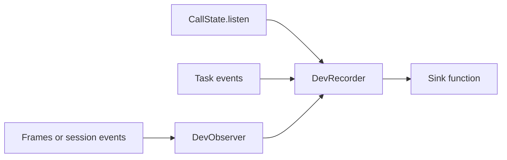

`unmute_core.dev` sends what one call did as records that `unmute dev` reads. Each record is one JSON object on a line that starts with `UNMUTE_METRIC`. Build one `DevRecorder` for every call. Its default sink prints the lines to stdout, so a bot built on this library shows on the dev page with no other change.



1. The `DevObserver` of your framework turns pipeline frames or session events into records.
2. `watch_state` sends a record for each change to the call's state.
3. `task_event` sends a handoff operation for each task or group run.
4. The recorder sends each record to the sink function.

<CodeGroup>

```python Pipecat
from unmute_core.dev import DevRecorder, call_id_from, metrics_enabled
from unmute_core.pipecat import DevObserver

recorder = DevRecorder(call_id_from(runner_args.body) or room_id)  # or sink=my_function
recorder.watch_state(state)
flows.listen(recorder.task_event)  # every agent's task events, after a handoff too
observer = DevObserver(
    recorder,
    handoffs={t["name"] for t in flows.tasks.delegate_tools()},
    controls=["transfer_to_sales"],  # agent handoff and human transfer tools
)
worker = PipelineWorker(pipeline, observers=[observer, TelemetryObserver(...)])
```

```python LiveKit
from unmute_core.dev import DevRecorder, metrics_enabled
from unmute_core.livekit import DevObserver

if metrics_enabled():
    recorder = DevRecorder(ctx.room.name, target="livekit")
    recorder.watch_state(state)
    DevObserver(recorder, controls=["transfer_to_sales"]).attach(session)
```

</CodeGroup>

Send records only when the dev loop asked for them. `metrics_enabled()` reads `UNMUTE_DEV_METRICS` through `DevSettings`, with the on/off words of `env_flag`. So `1` turns it on, and `0` or `false` turns it off. A word that is neither logs a warning and counts as off, so a typo in this dev-only variable never breaks a call. See [Settings](/core/reference/settings).

## DevRecorder

<ParamField path="call_id" type="CallId" required>
  The call's id, 1 to 128 letters, digits, `-` or `_`. Anything else raises `ValueError`.
</ParamField>
<ParamField path="sink" type="DevSink" default="stdout_sink">
  Receives each record. A `DevSink` is any function that takes one record dict. The default prints `UNMUTE_METRIC` lines. A sink that raises is logged and the record is lost. A record never fails the call.
</ParamField>
<ParamField path="target" type="pipecat | livekit" default="pipecat">
  The framework the call runs on.
</ParamField>
<ParamField path="model_calls" type="known | partial" default="known">
  `partial` when some model calls are not seen.
</ParamField>

## DevObserver

The same arguments on both frameworks. On LiveKit, call `.attach(session)` before or after `session.start`.

<ParamField path="recorder" type="DevRecorder" required>
  The call's recorder. On LiveKit, build it with `target="livekit"`.
</ParamField>
<ParamField path="handoffs" type="Collection[str]" default="()">
  The tools that start a task or a group, like `flows.tasks.delegate_tools()` on Pipecat.
</ParamField>
<ParamField path="controls" type="Collection[str]" default="()">
  Tools that hand the call over and return no result.
</ParamField>

A control is a tool that hands the call over and returns no result. An agent handoff tool and a human transfer tool are controls. Each run gets a `handoff` operation and no `tool_duration`, because its call time is the time of whatever it started. On Pipecat, pass every control name. On LiveKit, `UnmuteAgent` adds its own handoff tools, so pass only the transfer tools.

`call_id_from(body)` reads the dev call id from a Pipecat runner's body. It returns `None` when there is none that is valid.

## The call id and the dev settings

```python
from unmute_core.dev import CallId, DevSettings

DevSettings().metrics  # True when UNMUTE_DEV_METRICS is on
```

<ParamField path="DevSettings" type="EnvSettings">
  One field, `metrics`, read from `UNMUTE_DEV_METRICS`. An unset or empty variable reads as off. A word that is not an on/off word raises `SettingsError`. `metrics_enabled()` catches that error and returns `False`.
</ParamField>
<ParamField path="CallId" type="type">
  The type of a dev call id: text of 1 to 128 letters, digits, `-` or `_`. Use it for a field of your own Pydantic model. `DevRecorder(call_id)` raises `ValueError` for an id that does not fit. `call_id_from(body)` returns `None` instead.
</ParamField>
<ParamField path="METRICS_ENV" type="str">
  The variable name, `UNMUTE_DEV_METRICS`.
</ParamField>
<ParamField path="SENTINEL" type="str">
  The word that starts each stdout line, `UNMUTE_METRIC`.
</ParamField>

## Building records in your own adapter

`DevObserver` is the way to feed a recorder. An adapter of your own can call the recorder's methods. All of them are on `DevRecorder`.

<ParamField path="operation" type="method">
  `operation(kind, name, ...)`.
  Opens an `llm`, `stt`, `tts`, `tool` or `handoff` operation. It returns the operation's id.
</ParamField>
<ParamField path="pending_request" type="method">
  `pending_request(operation, exchange_id, source)`.
  Sends the two timings of a model request, a transcript or a piece of speech as pending.
</ParamField>
<ParamField path="settle_request" type="method">
  `settle_request(operation, state, timings=, source=, unavailable=, ...)`.
  Ends the operation and sends its timings. A timing that was not measured is sent as unavailable.
</ParamField>
<ParamField path="measure_operation" type="method">
  `measure_operation(operation, metric, value, source, ...)`.
  Sends one timing of an operation.
</ParamField>
<ParamField path="append_text" type="method">
  `append_text(row, exchange_id, text)`.
  Adds words to the text row of a model request. The row stays provisional until `settle_request`.
</ParamField>
<ParamField path="user_text" type="method">
  `user_text(input_id, text, final=)`.
  Records what the caller said. It is provisional until `final`.
</ParamField>
<ParamField path="typed_text" type="method">
  `typed_text(input_id, text)`.
  Records words the caller typed, as final text. Blank text is ignored.
</ParamField>
<ParamField path="tool_started" type="method">
  `tool_started(name, exchange_id=, parent=, control=)`.
  Opens the operation of a tool call. It returns the operation's id. A control tool gets a `handoff`.
</ParamField>
<ParamField path="tool_ended" type="method">
  `tool_ended(operation, state, duration=, source=, control=, reason=)`.
  Ends that operation.
</ParamField>
<ParamField path="settle_exchange" type="method">
  `settle_exchange(exchange_id, cut=, spoke=)`.
  Ends a response: ended, or interrupted when the caller cut it off.
</ParamField>
<ParamField path="breakdown" type="method">
  `breakdown(measured_from, total_secs, parts)`.
  Sends where the wait for a reply went. Nothing is sent when a part cannot sit in a record.
</ParamField>
<ParamField path="close_response" type="method">
  `close_response()`.
  Says no response is open now, so a task's handoff belongs to none. Use it instead of setting `recorder.response = None`.
</ParamField>

`DevRecorder.measure` treats a `bool` as unavailable and never sends it as a number.

## How the LiveKit observer works

1. It reads public session events only. The session's close ends the call's records.
2. `UnmuteAgent` reports each model request, with its streamed text and tool calls, and the lines it says outside the chat, like a handoff's line. The observer follows each agent's tasks as the agent enters, also after a handoff.
3. A plain `Agent` and a realtime model get one `llm` operation per request from LiveKit's metrics, once the request is over.
4. A request seen only through LiveKit's metrics sets `model_calls` to `partial` on the call record. A reply whose text no streamed request carried sets `generated_text` to `limited`.
5. A tool that ends in an error while the session closes is `cancelled`, not `failed`. It is the hang-up.
6. LiveKit may log that `metrics_collected` is deprecated when the observer subscribes. It is still the only source for each piece of synthesis.

## Record kinds

Each record has `version`, `call_id`, `id`, `revision`, `order` and `kind`, and one object named after the kind. Sending an `id` again with a higher `revision` replaces the record, and it keeps its place.

| Kind | What it holds |
|---|---|
| `call` | Open, then ended or error, with the reason when there is one. |
| `exchange` | One input (the caller speaking or typing) or one response (what the agent did next). |
| `text` | What was said. Provisional while it grows, then final, or incomplete if it was cut off. |
| `operation` | One `llm`, `stt`, `tts` or `tool` run, or a `handoff` for a task, a group, an agent handoff tool or a transfer tool. |
| `measurement` | A time in seconds. Pending, measured, or unavailable. A time that was not measured is never zero. |
| `breakdown` | Pipecat only. Where the wait for one reply went, part by part, with the parts summing to the total. |
| `state` | A change to the call's state: each value, who set it, and whether the caller confirmed it. |

An `llm` operation is one model request that answers the caller, the agent's or a step's. It names the model the request went to, also after a handoff gives the next agent its own model. A side request, a handoff's summary or a step's finish check, gets no `llm` operation on either framework. Its `llm` span is still in the trace.

The save tool's and an event tool's state changes go out as `step` and `prefetch`, the nearest origins the Unmute CLI reads.

A `state` record carries the caller's own values. A value over 4 KiB is cut, with `truncated` set. Do not send these records anywhere but the local dev page.

<Accordion title="Measurements by framework">

| Measurement | Of | Pipecat | LiveKit |
|---|---|---|---|
| `first_response`, `request_duration` | each model request and piece of synthesis | the services' metrics | `llm_node`'s own clock, LiveKit's metrics |
| `first_response` | each reply | not sent | the reply's `llm_node_ttft` and `tts_node_ttfb` |
| `first_response`, `request_duration` | each transcript | the STT service's metrics | `request_duration` only, of an STT that does not stream, from LiveKit's metrics |
| `tool_duration` | each tool call | the function call frames | `tool_execution_updated` |
| `reply_latency` | each reply | caller silence to the agent's first audio | the reply's `e2e_latency` |
| `turn_detection` | each reply | the latency observer's user turn | the caller message's `end_of_turn_delay` |
| `transcription_delay` | each reply | not sent | the caller message's `transcription_delay` |
| `speech_duration` | each reply | the bot's speaking frames | the reply's speaking times |
| `text_aggregation` | each reply | the TTS service's metrics | the reply's `llm_node_ttfs` less `llm_node_ttft` |
| `playback_delay` | each reply | not sent | the reply's `playback_latency` |
| `first_speech` | the call | client connected to the first speech | session start to the earliest `playback_started` of the audio output, or to the agent first speaking when there is no audio output |

Not sent, and why:

- `breakdown` on LiveKit. LiveKit reports timings that overlap, like synthesis that starts while the model still streams. A split of the total would be made up.
- `playback_delay` on Pipecat. The transport marks the agent speaking as it writes the first audio, so there is no later playback start to measure to.
- A tool a step runs in code as it opens. No framework tool call shows it, on either side.
- A transcript's `first_response` on LiveKit. LiveKit's STT metrics carry no first response. A streaming STT's metrics carry no duration either, so its `request_duration` is not sent.

</Accordion>

## Watch the state

`CallState.listen(callback)` is the hook behind `watch_state`. After each save that changed something, the callback gets one `StateEvent`. It holds an `origin` and its `changes`. Each change has the `field`, the new `value` as JSON, `confirmed` (or `None` for a value that never waits for the caller) and `by`.

```python
stop = state.listen(lambda event: print(event.origin.kind, [c.field for c in event.changes]))
state.save({"count": 2}, step="book")  # step book
stop()
```

- The origin is a `StateOrigin`. Its `kind` is one of nine words: `step`, `prefetch`, `call`, `call_start`, `tool`, `event`, `withdraw`, `start` or `reset`. `call` is the library saving `state.call`. Any other kind raises a validation error. `save` takes `origin=` to name it. Without it, the origin is the `step`, or a `prefetch` when `inputs` is given.
- A save that changed nothing sends nothing. A value that went back to its default because an input changed is listed with the origin `reset`. A confirmation that changed is listed too.
- `listen(callback, replay=True)` first sends the values already set, as one event of origin `start`.
- A listener that raises is logged and removed. It never fails the save.

See [State](/core/build/state) for how values are saved.

## Where to go next

<CardGroup cols={2}>
  <Card title="Telemetry" icon="activity" href="/core/observe/telemetry">
    Send a call's spans to Langfuse, Logfire, Coval or Datadog.
  </Card>
  <Card title="Telemetry reference" icon="book" href="/core/reference/telemetry">
    Every span and attribute.
  </Card>
</CardGroup>
