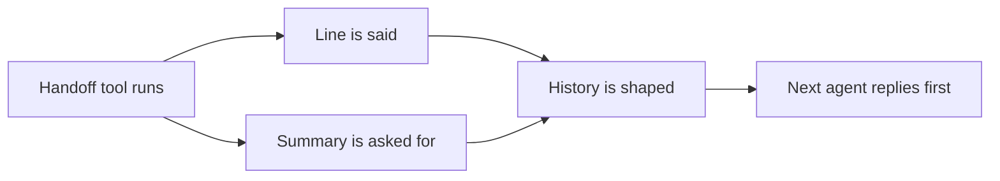

This page is the full detail behind [Handoffs](/core/build/handoffs). Start there to hand the call to another agent.

## What it gives you

| On a call without it | What the library does |
|---|---|
| The new agent hands the call straight back before it says a word. | Handoff tools are hidden on its first reply. [The first reply after a handoff](#the-first-reply-after-a-handoff) |
| The next agent rereads old prompts and tool calls, and gets confused. | You choose what it hears: messages, everything, the last few, a summary, or nothing. [What the next agent hears](/core/build/handoffs#what-the-next-agent-hears) |
| A cut history starts on a tool result, and the provider refuses the request. | Tool calls and results stay together. Calls to tools the new agent lacks are dropped. |
| A slow summary holds up the handoff. | The summary runs while the handoff line plays. After 8 s it falls back to messages. [The summary](#the-summary) |
| Every specialist must use the same model and voice. | Each agent can have its own. [Model and voice on each framework](#model-and-voice-on-each-framework) |

## How it works



1. The model calls the handoff tool. Its handler calls `hand_off`.
2. The `announce` line is said, and the handoff waits for it to play.
3. With `history="summary"`, the summary request runs while the line plays.
4. The next agent gets its history, its prompt and its tools, and its own model and voice when it has them.
5. The next agent replies first. That reply offers none of its handoff tools.

The two specs are the same on both frameworks. LiveKit makes the new agent the session's agent. Pipecat swaps the prompt, tools, tasks and model to the new spec's.

The announce line differs by framework:

- **LiveKit** says it with `allow_interruptions=False`, so the caller cannot cut it off.
- **Pipecat** has no such flag for one line. It says the line while the handoff call still runs, so `user_mute_strategies(protect=["tool_calls"])` keeps the caller from cutting it. Without that strategy, a cut line counts as played. Pipecat waits at most 30 seconds for the line.

## HandoffContext

What the agent that takes the call hears of it. Import it from `unmute_core.handoff`.

<ParamField path="history" type="messages | full | last_n | summary | reset" default="messages">
  What the next agent hears. See [What the next agent hears](/core/build/handoffs#what-the-next-agent-hears) and [History rules](#history-rules).
</ParamField>
<ParamField path="max_messages" type="int | None" default="None">
  How many items `last_n` keeps. Required with `last_n`, at 1 or more. Refused with any other history. A `max_messages` of 0 raises a Pydantic `ValidationError`.
</ParamField>
<ParamField path="include_tool_calls" type="bool" default="True">
  `False` leaves tool calls and results out of `full` and `last_n`.
</ParamField>
<ParamField path="summarizer" type="ModelCall | None" default="None">
  The model that writes a `summary`. `None` asks the agent's own model. Refused with any history but `summary`.
</ParamField>

`HandoffContext` is a frozen Pydantic dataclass. A wrong `history`, a `max_messages` of 0, or a `max_messages` or `summarizer` that does not fit the history raises a `ValidationError` when you build it. The message names the argument and the fix. An unknown argument raises `TypeError`.

## UnmuteAgent.hand_off

LiveKit. Call it from a `@function_tool` method of an `UnmuteAgent`, and return what it returns.

<ParamField path="agent" type="UnmuteAgent" required>
  The agent that takes the call: `UnmuteAgent(spec, state=self.state)`. Build it on this agent's `CallState`, and without `telemetry`, since it records into this agent's spans. Another state raises `ValueError`. A plain `Agent` raises `TypeError`.
</ParamField>
<ParamField path="announce" type="str | None" default="None">
  A line said first, which the caller cannot cut off. The handoff waits for it to play.
</ParamField>
<ParamField path="context" type="HandoffContext | None" default="None">
  What the agent hears. `None` keeps what was said, without tool calls.
</ParamField>
<ParamField path="opens_with" type="OpeningTool | None" default="None">
  A tool of the new agent's own, run in code as it takes the call. See [Open the next agent on a tool](/core/build/handoffs#open-the-next-agent-on-a-tool). A tool the agent lacks, or a realtime model, raises `ValueError`.
</ParamField>

It returns the new agent, which LiveKit switches to. It returns a refusal while a task runs.

## UnmuteFlows.hand_off

Pipecat. Call it from the handoff tool's handler.

<ParamField path="params" type="FunctionCallParams" required>
  The handoff call's params. `hand_off` reports its result.
</ParamField>
<ParamField path="spec" type="AgentSpec" required>
  The agent that takes the call. Its tasks run on this call's `CallState`. Its `model` needs the call's LLM to be a `ModelCallLLMService`. With no model, it runs on the model call the service was built with. Its `name` is the name the `handoff` event shows, else the call's `agent_id`. See [AgentSpec](/core/reference/agent-spec).
</ParamField>
<ParamField path="native_tools" type="Sequence[FunctionSchema]" default="()">
  The new agent's Pipecat tools, like its own handoffs. Pass it by keyword.
</ParamField>
<ParamField path="tts" type="FrameProcessor | None" default="None">
  The new agent's voice, one of the services of `UnmuteFlows(tts=...)`. `None` goes back to that switcher's first service.
</ParamField>
<ParamField path="announce" type="str | None" default="None">
  A line said first, while the handoff call still runs. The handoff waits for it to play.
</ParamField>
<ParamField path="context" type="HandoffContext | None" default="None">
  What the new agent hears. `None` keeps what was said, without tool calls.
</ParamField>
<ParamField path="opens_with" type="OpeningTool | None" default="None">
  A tool of the new agent's own, run in code as it takes the call. See [Open the next agent on a tool](/core/build/handoffs#open-the-next-agent-on-a-tool). A tool the agent lacks, or a realtime model, raises `ValueError`.
</ParamField>

The new spec's tools, tasks, `save_values` and `summarizer` replace the old agent's. They do not carry over. The line is said in the old voice, and a summary is written by the old agent's summarizer or model. The new model, voice and summarizer take over after both.

`hand_off` raises `ValueError` in these cases. The agent that holds the call keeps it.

- The spec lists a handoff that is not one of `native_tools`.
- A task names a model, or transfers to an agent `then_targets` lacks.
- The spec has a model without a `ModelCallLLMService`.
- `tts` is not one of the call's voices.
- `opens_with` names a tool the spec lacks, or the model is a realtime one.

## History rules

`HandoffContext.history` takes one of five values. A task's `history` takes the same values, for what a task step opens on.

| `history` | What the next agent hears |
|---|---|
| `messages` (default) | What the caller and the agent said. No tool calls, no prompts. |
| `full` | Everything, with tool calls and their results. No prompts. Tool calls to tools the next agent does not have, and their results, are dropped, on both frameworks. |
| `last_n` | The newest `max_messages` items. A reply's text and its tool call count apart. A call and its result stay together. Tool calls to tools the next agent does not have, and their results, are dropped, on both frameworks. The window is counted before the drop. |
| `summary` | One message: "Summary of the conversation so far: ..." |
| `reset` | Nothing. The next agent answers on its prompt alone. |

- The `announce` line is the last thing the next agent hears, in `messages`, `full` and `last_n`.
- A step's `finish` calls and the step-start cue never cross. The step-start cue is the short line `(The call continues.)` that opens a step when the caller has said nothing in it yet. The next agent would read them as its own work, or as the caller.
- On a realtime model, only `full` works. The model keeps the whole conversation on its server. Pass `HandoffContext(history="full")`. Any other value is refused. See [Realtime models](/core/models/realtime).

## History helpers

`shape_history(messages, context, tools=None)` applies one `HandoffContext` to an OpenAI-format chat. It uses smaller helpers, and `unmute_core.handoff` exports them for your own code. Each one takes a list of messages and returns a new list. The input does not change.

| Helper | What it returns |
|---|---|
| `shaped(messages, history, max_messages=, include_tool_calls=, tools=)` | The same as `shape_history`, from a `history` word and not a context. |
| `without_instructions(messages)` | The chat without system and developer messages. |
| `speech_only(messages)` | What was said out loud. No tool call and no tool reply. |
| `last_n(messages, limit)` | The newest `limit` messages. It drops a tool reply whose call fell outside the window. |
| `without_calls_to(messages, names)` | The chat without calls to `names` and their replies. |
| `without_unknown_calls(messages, tools)` | The chat without calls to any tool outside `tools`, and their replies. |
| `without_text_signatures(messages)` | Earlier spoken replies without provider data like a Gemini thought signature. A tool call keeps its own. |

Two more read a single message:

```python
from unmute_core.handoff import call_name, newest_caller

newest_caller(chat, skip_cue=True)  # the caller's newest message, or None
call_name(call)  # the function name of one tool_calls entry, or None
```

1. `newest_caller(messages, skip_cue=)` returns the caller's newest message. It returns the message itself, not a copy.
2. With `skip_cue=True`, it passes over the step-start cue, which the caller never said. It returns the turn before the cue.
3. `call_name(call)` reads the name from one entry of a message's `tool_calls`.

## The summary

```python
HandoffContext(history="summary", summarizer=my_model_call)
```

1. The library sends one model request at the `summary` site, with no tools. It holds a fixed prompt and the conversation as `role: text` lines. Prompts, tool calls and tool results are left out.
2. `summarizer` is any `ModelCall`, like a LiveKit plugin in `LiveKitModel`. Without one, the agent spec's `summarizer` answers. Without that, the model of the agent that hands off answers, by the path the finish check uses.
3. On Pipecat, the agent's own model can answer only through a `ModelCallLLMService`, an OpenAI-compatible service or a `GoogleLLMService`. Give any other service a `summarizer`.
4. A summary that fails, comes back empty, or takes longer than 8 seconds is dropped. The next agent then hears `messages`. The call goes on.
5. The request is traced as an `llm` span in the open turn, with site `summary`.
6. On the SLNG Context Router, the request goes out under the agent's own id, with prompt site `task:summary`. The router accepts only `task:<name>` as a prompt site, so no task or group may be named `summary`. See [SLNG](/core/models/slng).

The spec's `summarizer` writes the summaries for every handoff from that agent that has no summarizer of its own. It is the same `AgentSpec(summarizer=...)` on both frameworks.

## Model and voice on each framework

Each agent may have its own model and voice, as Unmute's `think:` and `speak:` per agent. The guide shows the code in [Give the next agent its own model and voice](/core/build/handoffs#give-the-next-agent-its-own-model-and-voice).

1. The `announce` line plays in the old voice, and a `summary` is written by the old model.
2. Then the new model and voice take over. The new agent's first reply, its steps, finish checks and summaries all use them.
3. An agent whose spec has no `model` runs on the call's first model. That is the session's LLM on LiveKit, and the model call the `ModelCallLLMService` was built with on Pipecat. The same holds for the voice.
4. The `llm` spans name the model each request went to. The `tts` spans name the voice.

On LiveKit:

1. The spec's `model` takes a LiveKit plugin as `LiveKitModel(plugin)`, or any other `ModelCall`, like the SLNG Context Router. Without it, the agent runs on the session's LLM.
   - A `ModelCall` is retried as the session retries its own LLM. It uses the session's `conn_options`. It retries only before the first event, and only when the call does not retry itself (`retries_itself`).
   - When the session closes, the agent closes its `ModelCall`s, like the router's HTTP client. A LiveKit LLM plugin stays open. LiveKit owns it.
2. A plugin answers as the session's LLM does. The library fills the prompt, and the plugin's chunks pass through unchanged.
3. `UnmuteAgent(tts=...)` is the agent's voice. Without it, the agent speaks with the session's TTS.
4. The agent's steps run on its model and speak with its voice. A task's own `model` still wins for its steps.
5. The spec's `summarizer` and `task_models` take a plugin the same way, as `LiveKitModel(plugin)`.
6. `LiveKitModel(plugin)` is the plugin as a `ModelCall`. It also fits `HandoffContext(summarizer=LiveKitModel(openai.LLM(model="gpt-5.6-luna")))` and a `FallbackModelCall`. A tool call's provider data, like a Gemini thought signature, comes back as `ToolCall.extra`, and the plugin sends it back when the call is replayed.

On Pipecat:

1. The spec's `model` needs a `ModelCallLLMService`. The service swaps the model call it sends through. A native Pipecat service runs one model, and a spec with a `model` is refused there. For an agent on its own native model, give its spec `model=OpenAIModelCall("gpt-5.6-terra")`. See [OpenAIModelCall](/core/reference/model-call#openaimodelcall). The service closes each model call it was given when the pipeline ends.
2. A spec with no `model` goes back to the model call the service was built with. A handoff back to the first agent passes its spec, with no model.
3. `hand_off(tts=...)` is one of the services of the `VoiceSwitcher`, the voice that speaks next. `tts=None` goes back to the switcher's first service.
4. Two voices of one provider are two instances of its service. Each opens its own connection as the pipeline starts.
5. `VoiceSwitcher` is Pipecat's `ServiceSwitcher` with one fix. A plain one lets each frame out once, so Pipecat's flush probe is lost on its way back, and every handoff and task waits out the flush timeout. `UnmuteFlows(tts=...)` refuses a plain one.

## The first reply after a handoff

An agent that could hand the call on before it said anything would ping-pong. So three first replies leave out the agent's handoff tools:

- The first reply after a handoff.
- A greeting the model words, which answers no caller turn.
- The opening reply of a task step that offers handoffs.

<CodeGroup>

```python LiveKit
billing = AgentSpec(BILLING_PROMPT, name="billing", handoffs=("to_front_desk",))
await self.hand_off(Billing(billing, state=self.state, native_tools=[...]))
```

```python Pipecat
billing = AgentSpec(BILLING_PROMPT, name="billing", handoffs=("to_front_desk",))
await flows.hand_off(params, billing, native_tools=[...])
```

</CodeGroup>

1. The spec's `handoffs` names the agent's handoff tools. Neither framework can tell a handoff tool from any other. On LiveKit they are `native_tools` or `@function_tool` methods.
2. The first reply after the agent takes the call offers every other tool. A tool it calls is answered with the handoffs still left out.
3. The first request after the caller speaks offers them again.
4. A realtime model keeps every tool.
5. For a greeting, give the first agent's spec its `handoffs` too. It is the same `AgentSpec(handoffs=...)` on both frameworks. A greeting you write yourself makes no model request, so it needs none of this.

## Step handoff rules

The rules for a handoff a task step offers. The guide shows the task in [A handoff from a task step](/core/build/handoffs#a-handoff-from-a-task-step).

1. The step offers `to_notes` after its own tools, with the same name and description as the main agent's. Its opening reply leaves `to_notes` out. It comes back on the first request after the caller speaks in the step.
2. The handoff tool must be one of the agent's own tools: a `native_tools` entry, or a LiveKit `@function_tool` method. The agent refuses a task that names any other tool.
3. When the step's model calls it, the step ends with `task.handed_off`. Its task or group ends with it, and nothing is saved.
4. The next agent hears the step's own chat, shaped by the handoff's `context`.
5. A handoff in the same reply as another call of the step is refused, and asks for no reply. The other call runs. A handoff in a later reply of the same turn, after the step's own tool returned, is not refused.
6. The step ends only once the next agent is ready. A handoff tool that raises, or returns no agent, leaves the step running.

## Group transfer rules

A task group with `then="transfer"` gives the call to the agent its `then_target` names, once its last step completes:

```python
TaskGroupSpec(
    name="take_payment",
    when="The caller is ready to pay.",
    steps=("confirm_amount", "take_card"),
    context_scope="shared",
    then="transfer",
    then_target="billing",
)
```

The agent runs the handoff you would write for a handoff tool. `then_targets` maps
each target name to it.

<CodeGroup>

```python LiveKit
billing = AgentSpec(BILLING_PROMPT, name="billing", tasks=billing_plan)


# The agent that ran the group comes in, its hand_off goes out
UnmuteAgent(
    front_desk,
    state=state,
    then_targets={
        "billing": lambda agent: agent.hand_off(
            UnmuteAgent(billing, state=agent.state), announce="One moment."
        )
    },
)
```

```python Pipecat
billing = AgentSpec(BILLING_PROMPT, name="billing", tasks=billing_plan)


# The same handler a handoff tool has
async def to_billing(params: FunctionCallParams) -> None:
    await flows.hand_off(params, billing, announce="One moment.")


flows = UnmuteFlows(front_desk, ..., state=state, then_targets={"billing": to_billing})
```

</CodeGroup>

1. A group whose target `then_targets` does not name is refused when the agent is built. On Pipecat, so is a `hand_off` to a spec with such a group, because one `then_targets` serves every agent of the call.
2. The last step's words play first. Then the handoff runs as from a tool: its `announce` line, its `context`, and the next agent replies first. The main agent is not asked for a reply.
3. The next agent hears the main agent's history as the group left it. That is what was said before the group, the caller turn a step carried back, and the step's spoken closing line. The steps' own talk stays in the group, as it does when the group returns. Saved values reach the next agent through its prompt.
4. The group's own tool call never crosses, as a handoff tool's call does not.
5. A group that hands the caller back, or fails, returns to the main agent instead. So does a transfer whose handoff raises, or hands nothing over. The caller is never left in silence.
6. The main agent's tool description says that the flow does not return: "This flow does not return to you: when it finishes the caller is handed to the billing."

## A handoff on a plain agent

On Pipecat, `UnmuteFlows` works without tasks. A spec with only a prompt is enough.

On LiveKit, `UnmuteAgent.hand_off` does the full handoff. A plain `Agent` hands off the LiveKit way, by returning a new agent from a tool. `shape_chat_ctx` gives the next agent the history the library's rules keep. Pass its result as `chat_ctx`. The guide shows both in [Hand off from a plain agent](/core/build/handoffs#hand-off-from-a-plain-agent).

`shape_chat_ctx(chat_ctx, context=None)` returns a LiveKit `ChatContext`. With no `context`, it keeps what was said, without tool calls. With `history="summary"`, it keeps what was said too. Ask your own model for a summary if you want one. `UnmuteAgent.hand_off(plain_agent)` raises `TypeError` and names this recipe.

For OpenAI-format messages, `shape_history(messages, context, *, tools=None)` does the same and returns a new list. With `tools`, it drops any call to a tool not in that collection, and its reply. A full handoff on LiveKit, with the announce line, the model and voice switch and the summary, needs `UnmuteAgent.hand_off`.

## Troubleshooting

### A handoff is refused while a task runs

A handoff beside a running task is refused, unless that task's step made it. A task called in the same reply as a handoff that went first is refused too.

**Fix:** let the task finish, or offer the handoff from the step with `TaskSpec.handoffs`.

### `hand_off needs an agent built on the same CallState.`

LiveKit raises `ValueError` when the new agent holds another state. It raises `TypeError` when the new agent is not an `UnmuteAgent`.

**Fix:** build the new agent on the first agent's state. For a plain `Agent`, return it from the tool and build it with `chat_ctx=shape_chat_ctx(...)`.

```python
return await self.hand_off(UnmuteAgent(specialist, state=self.state))
```

### A spec with a `model` is refused on Pipecat

A native Pipecat service runs one model.

**Fix:** build the LLM as a `ModelCallLLMService`, and pass the voices through a `VoiceSwitcher`.

### The next agent hands the call straight back

Neither framework can tell a handoff tool from any other.

**Fix:** name the new agent's handoff tools in its spec's `handoffs`.

## How Unmute uses handoffs

Unmute's `handoffs:` block (`to`, `when`, `announce`, `context`) and a task's `handoffs:` map to this API. [How Unmute uses unmute-core](/core/start/unmute-and-core) shows which key becomes which class.

Where Unmute's LiveKit and Pipecat code differ, the library does one thing on both:

- `summary` works on Pipecat too. Unmute refuses it there.
- A failed summary falls back to `messages`. In Unmute, the handoff tool raises.
- `last_n` keeps a tool call whose result is in the window. LiveKit's `truncate` drops it. Unmute's Pipecat code keeps it.
- A step handoff beside another call is refused at once. Unmute waits for the other call, then refuses when it ended the step or failed.
- A group's `then: transfer` and `then_target` map to `TaskGroupSpec`, and the target to `then_targets`. Unmute's LiveKit code transfers a group that stopped unserved too. The library returns it to the main agent, as for `then: end`. Unmute's handoff has no line and keeps the whole history. Here the handoff in `then_targets` decides both.
- The first reply after a handoff leaves out the new agent's handoffs on Pipecat too. Unmute's Pipecat code offers them.
- On Pipecat, one pipeline runs every agent. The model switches inside a `ModelCallLLMService`, and the voice through a `VoiceSwitcher`. Unmute builds one worker per agent, each with its own LLM and TTS.

## Where to go next

<CardGroup cols={2}>
  <Card title="Handoffs" icon="git-branch" href="/core/build/handoffs">
    Hand the call to another agent, with its own model and voice.
  </Card>
  <Card title="AgentSpec reference" icon="book" href="/core/reference/agent-spec">
    The `AgentSpec` each agent of a call is built from.
  </Card>
  <Card title="Tasks reference" icon="list-checks" href="/core/reference/tasks">
    `TaskSpec.handoffs` and `TaskGroupSpec`.
  </Card>
  <Card title="Unmute handoffs" icon="git-branch" href="/build/orchestration/handoffs">
    How `agent.yaml` declares a handoff.
  </Card>
</CardGroup>
