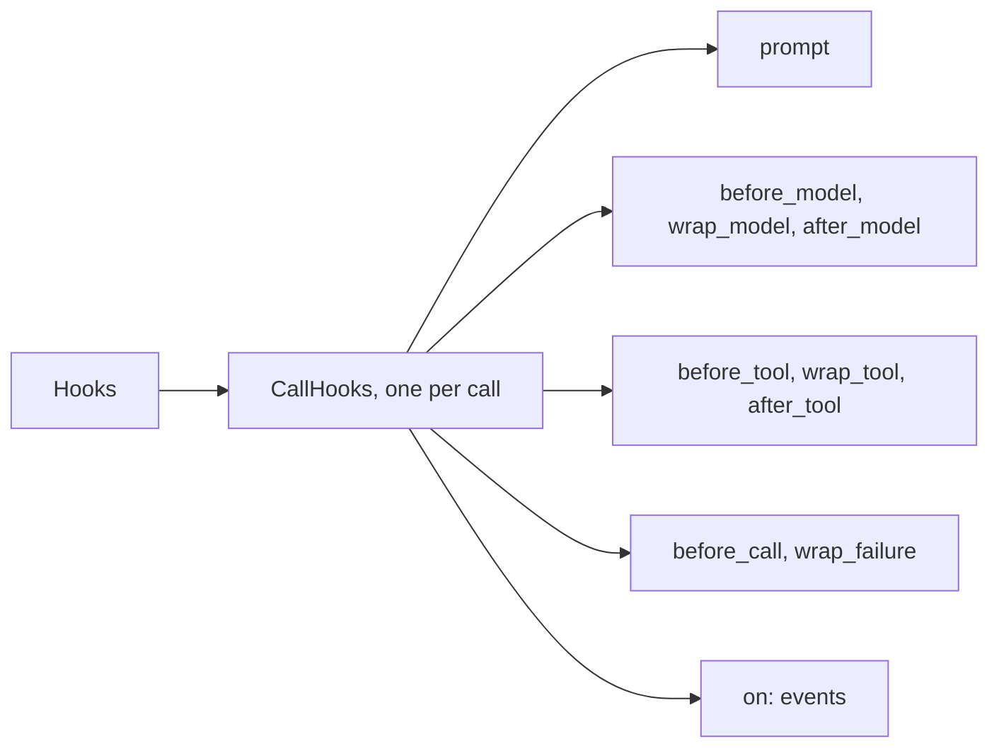
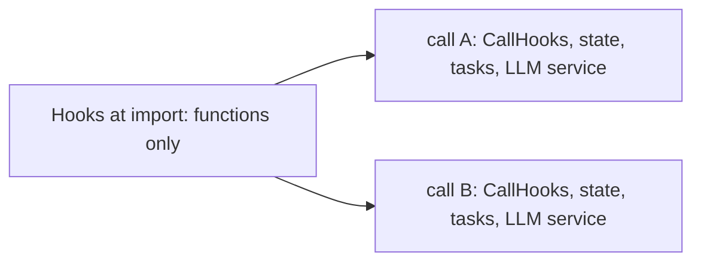

This page is the full detail behind [Hooks](/core/build/hooks). Start there to add hooks to a call.

## What it gives you

| On a call without it | What the library does |
|---|---|
| A rule about prompts or tools is written twice, once per framework. | One set of hooks runs on both. |
| A buggy hook breaks the tool or the call. | A failed hook is logged. The model reads that the tool did not run. [Hooks around a tool call](#hooks-around-a-tool-call) |
| One model needs `/no_think` on every prompt, summary and check. | `PromptSuffix` adds it everywhere that model reads. [A suffix after every prompt](#a-suffix-after-every-prompt) |
| A tweak for one model changes all of them. | Rules can read the model name per request. [Rules for one model](#rules-for-one-model) |
| Hooks silently do nothing on an agent that cannot run them. | The call logs one warning that names the fix. [Where the model hooks run](/core/build/hooks#where-the-model-hooks-run) |

## How it works



1. `prompt` hooks change each system prompt the library builds: the agent's, each task step's, a finish check's and a summary's.
2. `before_model` hooks change the request about to go out. `wrap_model` hooks run around it. `after_model` hooks hear the answer.
3. `before_tool` hooks change or refuse a tool call. `wrap_tool` hooks run around it. `after_tool` hooks may replace its result.
4. `before_call` hooks run before the greeting. `wrap_failure` hooks run around the failure line.
5. `on` observers watch events. They never change anything.

Define `hooks` once, at import. Build one `CallHooks` per call. Every adapter already takes `call=`, so the hooks reach every request and tool of the call. See [Many calls at once](#many-calls-at-once) for what calls share.

## The points

| Point | Signature | What it may do |
|---|---|---|
| `prompt` | `(text, PromptInfo) -> str` | Return the new prompt. It is still unfilled. |
| `before_model` | `(ModelRequest) -> ModelRequest \| None` | Change messages and `params`. None keeps the request. |
| `wrap_model` | async generator `(request, handler)` | Call `handler(request)` and yield its events, or not. |
| `after_model` | `(ModelRequest, ModelResponse) -> None` | Watch the reply. The caller has heard it already. |
| `before_tool` | `(ToolRun) -> ToolRun \| Refuse \| None` | Change the arguments, or refuse the call. |
| `wrap_tool` | `async (ToolRun, handler) -> result` | Call `await handler(run)`, or not. |
| `after_tool` | `(ToolRun, result) -> result \| None` | Replace what the model reads. None keeps it. |
| `before_call` | `() -> None` | Raise to fail the call before the greeting. |
| `wrap_failure` | `async (component, error, handler)` | Call `handler()` for the failure line, `handler(line=None)` to only hang up, or neither. Returning without calling `handler` keeps the call going. |
| `on(*patterns)` | `(event, data) -> None` | Watch. |

1. `before_*` and `prompt` hooks run first to last.
2. `wrap_*` hooks nest. The first one added is the outermost.
3. `after_*` hooks run last to first.
4. Any hook may be sync or async, except `prompt`, which must be a plain function, and `wrap_*`, which must be async.
5. A hook that raises fails its own request or tool call. A model request that fails this way fails the call, as a failed model call does. A tool call becomes a `ToolError` the model reads.
6. An `after_tool` hook that raises is logged, and the model reads the tool's own result, because the tool already ran. An `after_model` hook or an observer that raises is only logged.
7. On Pipecat, an `after_model` hook reads each tool call's arguments as UTF-8 JSON, like `{"name": "José"}`. It never sees `é` escapes. The Pipecat span and LiveKit show the same text.
8. `ModelRequest` and `ToolRun` are frozen Pydantic dataclasses. `dataclasses.replace(request, ...)` builds a new object and checks it again. A wrong type, like `site=5`, raises a `ValidationError`. An unknown argument raises `TypeError`. `messages`, `tools` and `params` are not checked, so a hook may put any JSON in them.

## Hooks around a tool call

Every tool call of a call passes the tool hooks. The `before_tool`, `wrap_tool` and `after_tool` points are the home for this.

```python
result = await registry.call("refund", {"order_id": "A-1"}, state, hooks=call)
```

1. `ToolRegistry.call(..., hooks=...)` runs the call's tool hooks in this order: `before_tool`, then the checks and the locked values, then `wrap_tool` around the tool, then `after_tool`.
2. A `before_tool` hook that returns `Refuse(message)` stops the call. The model reads `{"refused": message}`, as for a value not set yet.
3. A hook that changes the arguments gets them checked against the schema again.
4. Every adapter passes the call's `CallHooks`. So the hooks reach every tool of `UnmuteAgent` and `UnmuteFlows` with no more wiring.
5. A `ToolRun` holds `name`, `arguments` as the model wrote them, and `source`. The source is `model`, or `event` for a [tool on an event](/core/build/call-lifecycle#tools-on-events).

On a plain agent, pass the call's hooks to the tools yourself, as in [Run tool hooks on a plain agent](/core/build/hooks#run-tool-hooks-on-a-plain-agent). Pass `hooks=call` so the tool hooks run, and so `tool_succeeded` and `tool_failed` events fire for your tools. A `CallHooks` also drains the registry's webhooks when the call ends. You do not call `call.watch` yourself.

Framework tools skip the tool hooks: end call, handoffs and `native_tools`. So do prefetch lookups. See [Known limits](#known-limits).

## Writing hooks as a class

```python
class Audit:
    events = ("tool.*",)

    def before_model(self, request: ModelRequest) -> ModelRequest:
        return replace(request, params={"temperature": 0})

    def on_event(self, event: str, data: dict) -> None:
        log.info("%s %s", event, data["name"])


hooks = Hooks(Audit(), EventTool(log_call, on=["call_end"]))
```

1. `hooks.add(obj)`, or `Hooks(obj, ...)`, hooks the object in with each method named after a point.
2. An `on_event(event, data)` method watches the patterns in its `events` attribute. All events when it has none.
3. An `EventTool` is a hook too. See [The call's life](/core/build/call-lifecycle#tools-on-events).
4. An object with none of these raises `ValueError`.

## Events

| Event | Data |
|---|---|
| `call.first_user_message` | `{"text": ...}` |
| `call.failed` | `{"component": ..., "error": ...}` |
| `call.recovered` | `{"component": ...}`. A `wrap_failure` hook kept the call going. |
| `call.tts_failed` | `{"component": ..., "error": ...}`. The voice failed. The call stays open. |
| `call.ended` | `CallEnd`. The end waits for these observers, up to `end_timeout_s`. |
| `tool.started`, `tool.succeeded`, `tool.failed`, `tool.refused` | `{"name", "source", "ms", "error"}` |
| `state.changed` | `StateEvent` |
| `task.*`, `group.*` | The task event's data. See [Tasks](/core/build/tasks). |

1. A pattern may hold `*`, like `task.*`.
2. A pattern that matches no event raises `ValueError` when you register it.
3. A sync observer runs at once. An async one runs as a task of its own, except for `call.ended`, which the end waits for. Another async observer still running when the process stops is cut off.

## A suffix after every prompt

```python
hooks.add(PromptSuffix("/no_think"))
hooks.add(PromptSuffix("/no_think", model="qwen/qwen3-32b"))
```

Some models take an instruction no parameter carries, like Qwen3's `/no_think`. `PromptSuffix` adds it after every prompt, after a blank line. It follows Unmute's `prompt_suffix`.

1. It reaches the agent's prompt, every task step's, the finish checks' and the summaries'.
2. With `model=`, only prompts that model reads get it. A summarizer of another model keeps its prompt as it is.
3. It refuses blank text, more than 512 characters, and a `{{...}}` placeholder. Each refusal says what to do instead.
4. The native path and a `ModelCall` give the model the same final prompt.

## Rules for one model

```python
@hooks.before_model
def no_think(request: ModelRequest) -> ModelRequest | None:
    if "nemotron" not in request.model:
        return None
    return replace(request, params=request.params | {"temperature": 0})
```

1. `request.model` names the model that answers, like `gpt-5.6-luna`.
2. `request.params` are extra body fields for this request only.
3. `RouterModelCall` sends them. A request's `params` win over the router call's `body`. See [SLNG](/core/models/slng).
4. A native LLM gets them as `extra_body`, when it is OpenAI compatible.

## Many calls at once



1. A `Hooks` object holds only your functions. Many calls may share it, in one process or across threads.
2. Everything a call changes lives in its own objects: `CallHooks`, `CallState`, the adapter with the `CallTasks` it builds and, on Pipecat, the LLM service. Each call builds its own. Build the `AgentSpec` per call too when it holds a model, because the adapter closes its models when the call ends.
3. The library refuses a second call on the same object. A `CallHooks` binds once. `CallTasks.use` takes one call's hooks. A Pipecat LLM service runs one call's hooks.
4. A hook that keeps state, or needs to know its call, belongs to that call. Build it per call, together with the shared hooks:

```python
SHARED = Hooks(PromptSuffix("/no_think"))


async def entrypoint(ctx: JobContext) -> None:
    hooks = Hooks(SHARED, RoomLog(ctx.room.name))  # your class, one per call
    call = CallHooks(state, hooks=hooks)
```

`Hooks(SHARED, ...)` copies the shared hooks in as they are at that moment. A hook added to `SHARED` later reaches only the calls built after it.

## Hooks

Import it from `unmute_core.hooks`.

<ParamField path="*hooks" type="object" default="none">
  Objects to add at once, each as for `hooks.add`. A function, a class instance, an `EventTool` or another `Hooks`.
</ParamField>

## PromptSuffix

<ParamField path="text" type="str" required>
  The suffix, like `/no_think`. It is stripped. It may not be blank, longer than 512 characters, or hold a `{{...}}` placeholder.
</ParamField>
<ParamField path="model" type="str | None" default="None">
  Only prompts this model reads get the suffix. None adds it for every model. Pass it by keyword.
</ParamField>

## Refuse

<ParamField path="message" type="str" required>
  Why the tool did not run, in words the model can pass on.
</ParamField>

## PromptInfo

<ParamField path="kind" type="agent | step | finish_check | summary" required>
  Which prompt a `prompt` hook is filling.
</ParamField>
<ParamField path="site" type="str" required>
  An empty string for the main prompt, `task:<name>` in a step, `summary` for a summary.
</ParamField>
<ParamField path="model" type="str" required>
  The model that will read the prompt, like `gpt-5.6-luna`, or `unknown`.
</ParamField>

## ModelResponse

What an `after_model` hook gets. Import it from `unmute_core.hooks`.

<ParamField path="text" type="str" required>
  The text the agent said.
</ParamField>
<ParamField path="tool_calls" type="tuple[ToolCall, ...]" default="()">
  The tools the model called.
</ParamField>
<ParamField path="error" type="str | None" default="None">
  The error's type name when the request failed. A Pipecat pipeline request reports its failure through `call.failed` instead.
</ParamField>
<ParamField path="interrupted" type="bool" default="False">
  True when the caller cut the reply off.
</ParamField>

## Known limits

1. `wrap_model` reaches only requests a `ModelCall` answers. A framework's own LLM keeps its own retries and fallback.
2. On native Pipecat:
   - a hook that changes the tools is ignored, with one warning.
   - the system prompt must stay the first message, and a hook sees the service's own prompt, without the guidance Pipecat adds to it.
   - `params` reach only OpenAI-compatible services.
3. On native LiveKit, `params` need an OpenAI-compatible plugin, and the plugin's own `extra_kwargs` win.
4. Framework tools (end call, handoffs, `native_tools`) and prefetch lookups skip the tool hooks.
5. Under `FallbackModelCall`, `before_model` runs once. Every fallback gets the same `params`, and `request.model` names the first.
6. With `slng/auto`, the client does not know which model the router picks. A rule for one model then belongs in the router.

## Troubleshooting

### ValueError: matches no event

An `on(...)` pattern matches nothing. The message lists every event.

**Fix:** use a name from [Events](#events), or a pattern like `task.*`.

```python
@hooks.on("tool.*")
def watch(event: str, data: dict) -> None: ...
```

### ValueError: hooks in nowhere

`hooks.add(obj)` got an object with no method named after a point and no `on_event`.

**Fix:** give it a method such as `before_model`, or an `on_event` method.

### TypeError: a prompt hook is async

A `prompt` hook must be a plain function. Adapters build prompts where nothing can wait.

**Fix:** do async work in `before_model` instead.

### A second call refuses the same CallHooks

A `CallHooks` binds to one call.

**Fix:** build a `CallHooks` per call from the shared `Hooks`.

```python
call = CallHooks(state, hooks=Hooks(SHARED, RoomLog(room_name)))
```

## Where to go next

<CardGroup cols={2}>
  <Card title="Hooks" icon="webhook" href="/core/build/hooks">
    Add hooks to a call, and change prompts, requests and tool calls.
  </Card>
  <Card title="The call's life" icon="phone-call" href="/core/build/call-lifecycle">
    `CallHooks`, tools on events, the failure line and the end.
  </Card>
</CardGroup>
