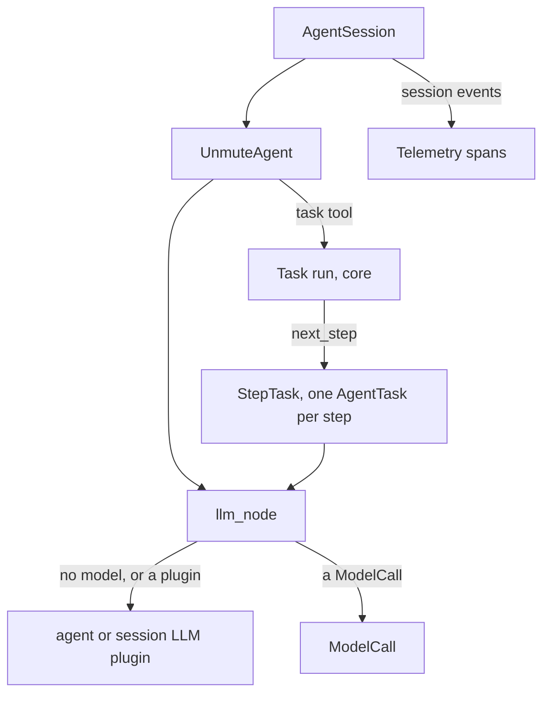
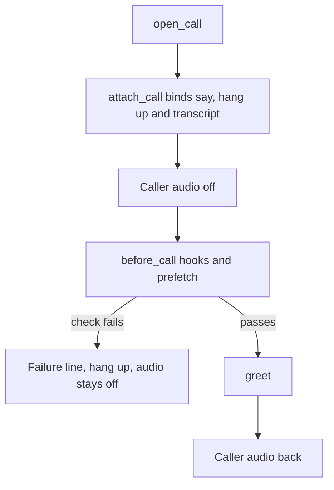

This page is the full detail behind [LiveKit](/core/frameworks/livekit). Start there to run the library in your own LiveKit agent.

## How it works



1. The main agent gets its tools, plus one tool per task and group.
2. A task tool starts a run in the core. The run hands out one step at a time.
3. Each step is a LiveKit `AgentTask`, awaited inside the tool call. It opens on the history the core's rule gives it.
4. When the run ends, the main agent gets its own history back. A caller turn a step answered for it comes too.
5. Every model request goes through one `llm_node`. It puts the prompt of the agent or step into the request as it reads now.
6. With no `model`, or a `LiveKitModel` plugin, the library fills the prompt from the call state and the plugin answers. Its output passes through unchanged.
7. With a `ModelCall`, the request goes to it in OpenAI format, with the prompt site (the place where the prompt is used) and the variables. A native call fills the prompt. The SLNG router fills it on its side.
8. Session events become spans. The names are in the [Telemetry reference](/core/reference/telemetry#span-contract).

## UnmuteAgent

```python
from unmute_core.livekit import UnmuteAgent
```

`UnmuteAgent` is a LiveKit `Agent`. `spec` is the only positional argument. The others are keyword only.

<ParamField path="spec" type="AgentSpec" required>
  The agent: its prompt, tools or tasks, models, language and handoff tools. Its `name` is the LiveKit id a `handoff` event shows. With no name, the id is the call's `agent_id`. With no name and no state, LiveKit derives the id from the class name. Every field is on [AgentSpec](/core/reference/agent-spec).
</ParamField>
<ParamField path="state" type="CallState | None" default="None">
  The call state that prompts and tools read. None takes the state of `call`, so the call keeps one state and one `session_id`. The spec's `tasks` and `save_values` need one.
</ParamField>
<ParamField path="call" type="CallHooks | None" default="None">
  The call's hooks: tools on events, the failure line and the end of the call. Each model request waits for the tools on events. Give every agent of one call the same object. See [The call's life](/core/build/call-lifecycle).
</ParamField>
<ParamField path="telemetry" type="Telemetry | None" default="None">
  The call's telemetry, new for this call. Spans start when the agent enters. It closes when the session closes.
</ParamField>
<ParamField path="native_tools" type="Sequence[llm.Tool | llm.Toolset]" default="()">
  LiveKit tools the main agent gets as they are, like `EndCallTool`. A `@function_tool` method of a subclass is one too. A step gets the ones its task lists in `handoffs` or `native_tools`.
</ParamField>
<ParamField path="then_targets" type="Mapping[str, ThenTarget] | None" default="None">
  The agents a group goes to when its `then` is `transfer`, by `then_target`. Each one returns `agent.hand_off(...)`. See [Handoffs](/core/build/handoffs).
</ParamField>
<ParamField path="tts" type="tts.TTS | None" default="None">
  The agent's voice. Its steps speak with it too. None uses the session's TTS.
</ParamField>
<ParamField path="**agent_options" type="Any">
  LiveKit's own `Agent` options, passed on as they are. For example `chat_ctx`, `stt`, `vad`, `turn_handling` and `allow_interruptions`.
</ParamField>

`AgentSpec` refuses `tools` beside `tasks`, and a task model that `task_models` does not name. `UnmuteAgent` raises `ValueError` in these cases:

- The spec has `tasks` or `save_values`, and there is no state.
- The spec's timezone is unknown.
- A task lists a handoff the agent has no tool for.
- A group transfers to an agent `then_targets` lacks.
- The spec's `handoffs` names a tool the agent does not have.
- A task's tool input names a prefetch lookup the call's `prefetch` lacks.
- A placeholder makes a key longer than the model call takes. The router takes 64 characters. A native model has no limit.
- A task or group has the same name as another tool of the agent, like `end_call`.

### UnmuteAgent attributes

<ParamField path="spec" type="AgentSpec">
  The spec the agent was built with.
</ParamField>
<ParamField path="state" type="CallState | None">
  The call state the agent was built with. With none, it is the `state` of the agent's `call` hooks. `state.call` holds what the call carries.
</ParamField>
<ParamField path="tasks" type="CallTasks | None">
  The call's task runs, built from the spec. None for an agent without `tasks`.
</ParamField>
<ParamField path="handoffs" type="tuple[str, ...]">
  The names of the agent's handoff tools, from the spec.
</ParamField>

### UnmuteAgent.hand_off

A handoff tool returns `await self.hand_off(UnmuteAgent(other_spec, state=self.state), announce=..., context=...)`. Build the next agent on this agent's `CallState`, and without `telemetry`: it records into this agent's spans. The model, voice, history and announce rules are on [Handoffs](/core/build/handoffs). An agent built on another state raises `ValueError`. For a plain `Agent`, `hand_off` raises `TypeError`. Return the plain agent from the tool instead, built with `shape_chat_ctx`.

## The model

With no `model` in the spec, the agent runs on the session's LLM. To give the agent its own plugin, pass `AgentSpec(model=LiveKitModel(plugin))`. A LiveKit plugin answers as it does on a plain agent. The library fills the prompt and passes the plugin's chunks through unchanged. A value reaches the model whole.

To use another provider, give the spec a `ModelCall`. `OpenAIModelCall` reaches any OpenAI-compatible endpoint. See [Model call](/core/models/model-call). The SLNG Context Router is one more `ModelCall`. Leave `llm` out of the session when you give one. Each router request carries your own router config, so the model runs on your own OpenAI key. See [SLNG](/core/models/slng) for the router.

1. A `ModelCall` is retried as the session retries its own LLM. It uses the session's `conn_options`. It retries only before the first event, and only when the call does not retry itself (`retries_itself`).
2. When the session closes, the agent closes its `ModelCall`s, like the router's HTTP client. A LiveKit LLM plugin stays open. LiveKit owns it.
3. A model that fails after its reply began does not fail the call. The reply ends as it stands, and the next turn runs.

### ModelCallLLM

`ModelCallLLM` runs a `ModelCall` as the session's LLM. Use it on a plain agent.

```python
from unmute_core.livekit import ModelCallLLM

session = AgentSession(llm=ModelCallLLM(router, state=state), ...)
```

<ParamField path="model" type="ModelCall" required>
  The model call that answers.
</ParamField>
<ParamField path="state" type="CallState | None" default="None">
  The call state the prompt's placeholders read.
</ParamField>
<ParamField path="trace" type="SessionTrace | None" default="None">
  The session's trace from `trace_session`. Each request is then an `llm` span in its turn.
</ParamField>
<ParamField path="site" type="str" default='""'>
  The prompt site of each request. `""` is the main prompt, and `task:<name>` is a step.
</ParamField>
<ParamField path="call" type="CallHooks | None" default="None">
  The call's hooks. Each request waits for the tools on events and ends with their notes. None uses the trace's hooks.
</ParamField>

### filled_llm

`filled_llm` is for a plain `Agent` that keeps its own LLM plugin. Call it from the agent's `llm_node`. It fills the prompt from the call state on each request. It needs no `Telemetry`.

```python
from livekit.agents import Agent

from unmute_core.livekit import filled_llm


class Desk(Agent):
    async def llm_node(self, chat_ctx, tools, model_settings):
        async for chunk in filled_llm(self, chat_ctx, tools, model_settings, state=state, call=call):
            yield chunk
```

<ParamField path="agent" type="Agent" required>
  The agent whose session LLM answers.
</ParamField>
<ParamField path="chat_ctx" type="llm.ChatContext" required>
  The chat LiveKit sends.
</ParamField>
<ParamField path="tools" type="list[llm.Tool]" required>
  The tools LiveKit offers.
</ParamField>
<ParamField path="model_settings" type="ModelSettings" required>
  LiveKit's settings for this reply.
</ParamField>
<ParamField path="state" type="CallState | None" required>
  The state the prompt's `{{placeholders}}` read. Pass it by keyword.
</ParamField>
<ParamField path="call" type="CallHooks | None" default="None">
  The call's hooks. The request then waits for the background prefetch, ends with the tools' notes, and runs the `prompt`, `before_model` and `after_model` hooks.
</ParamField>
<ParamField path="save_values" type="bool" default="False">
  End the request with the current values block, for `values_tool`.
</ParamField>

`traced_llm` does the same and adds an `llm` span. See [On a plain agent](/core/reference/telemetry#on-a-plain-agent).

When the call has model hooks and the agent keeps LiveKit's default `llm_node` with a plain plugin, the hooks cannot run. `attach_call` logs one warning at the first reply. See [Hooks](/core/build/hooks#where-the-model-hooks-run).

### LiveKitModel

`LiveKitModel(plugin)` turns a LiveKit LLM plugin into a `ModelCall`. Its `llm` attribute is the plugin. Use it wherever a model goes: the spec's `model`, `summarizer` and `task_models`, `HandoffContext(summarizer=...)` or a `FallbackModelCall`. Inside an `UnmuteAgent`, LiveKit holds the plugin itself. The plugin keeps its own client, settings and retries. Outside an `UnmuteAgent`, it sends the request through the plugin's `chat`. A tool call's provider data, like a Gemini thought signature, comes back as `ToolCall.extra`. The plugin sends it back when the call is replayed. So a `FallbackModelCall` of Gemini plugins keeps its signatures.

## How the call opens and ends

Without a `CallHooks`, open the call step by step:

```python
import json

from unmute_core.greeting import Greeting
from unmute_core.livekit import greet, max_duration, sip_call_info

participant = await ctx.wait_for_participant()
info = sip_call_info(participant, json.loads(ctx.job.metadata or "{}"))
state = CallState(State, call=info)
await prefetch.run(state)

agent = UnmuteAgent(AgentSpec(PROMPT, tasks=plan), state=state)
await session.start(agent=agent, room=ctx.room)
greet(session, Greeting(text="Hi {{customer_name}}, thanks for calling."), state)
max_duration(session, 20 * 60)
```

With a `CallHooks`, `open_call` opens the whole call:



1. `open_call` attaches the hooks and turns the caller's audio off.
2. It runs the `before_call` hooks and the prefetch, and starts the background lookups.
3. It greets. A failed check says the failure line and hangs up instead.
4. The caller's audio comes back when the agent starts to speak. With `interruptible=False`, it comes back when the greeting ends. Either way it comes back after `GREETING_HOLD_SECONDS` (20 seconds) at the latest, or `max_hold_s`, so a greeting that never starts cannot hold the caller for ever.
5. A greeting the model words, on a realtime model, waits for the background lookups and for the instructions they change. That is at most the prefetch's background budget for the lookups (`BACKGROUND_BUDGET_S`, 10 seconds by default), then at most `SETTLE_WAIT_SECONDS` (5 seconds) for the instructions.
6. If the caller leaves while the checks or the prefetch run, `open_call` returns None and greets no one.
7. `idle_nudges(session, config, call=call)` and `SipLine(session, call=call)` take the hooks too. The idle hang-up is then noted as `idle`. A dial that ends on a voicemail is noted as `agent_ended`.
8. The caller leaving closes the session with LiveKit's reason `participant_disconnected`. The call's end reads `caller_hung_up`. A tool that ends the call, a group with `then: end` and a step's ending tool read `agent_ended`. See [Why the call ended](/core/build/call-lifecycle#why-the-call-ended).

The events, the failure line and the end are in [The call's life](/core/build/call-lifecycle). The greeting's own rules are there too.

### sip_call_info

<ParamField path="participant" type="rtc.RemoteParticipant | None" required>
  The SIP participant, or None before it has joined.
</ParamField>
<ParamField path="metadata" type="Mapping[str, object]" required>
  The job's metadata, parsed. Its `direction`, when it says `inbound` or `outbound`, sets the direction.
</ParamField>
<ParamField path="trunk_number" type="str | None" default="None">
  The agent's own number, when the participant does not report it. Pass it by keyword.
</ParamField>
<ParamField path="direction" type="inbound | outbound | None" default="None">
  The direction, when your dispatch knows it. It wins over everything else. Pass it by keyword.
</ParamField>
<ParamField path="agent_id" type="str | None" default="None">
  The agent's id, the same on every framework. Pass it by keyword.
</ParamField>
<ParamField path="session_id" type="str | None" default="None">
  The call's id, when your dispatch gives one. A new one otherwise. Pass it by keyword.
</ParamField>

It returns a `CallInfo`: the direction, the two numbers and the SIP call id as `carrier_call_id`. The room name is not stored. The direction is `direction`, else the metadata's `direction`. Else a SIP participant with the `sip.ruleID` attribute came in through a dispatch rule, so it is inbound. Else a job that names `phone_number` dials out. Any other call is inbound. A participant without `sip.ruleID` does not mean outbound by itself. A contradiction between these is no longer refused.

### greet

`greet(session, greeting, state)` says the line, has the model word a greeting, or waits for the caller. It returns the greeting's `SpeechHandle`, or None when the caller speaks first. Call it after the session has started and prefetch has run.

<ParamField path="session" type="AgentSession" required>
  The call's session.
</ParamField>
<ParamField path="greeting" type="Greeting" required>
  How the call opens.
</ParamField>
<ParamField path="state" type="CallState | None" required>
  The call state the line's values come from.
</ParamField>

### open_call

`await open_call(session, greeting, call)` returns the greeting's `SpeechHandle`, or None when the caller speaks first or a check failed.

<ParamField path="session" type="AgentSession" required>
  The call's session, already started.
</ParamField>
<ParamField path="greeting" type="Greeting" required>
  How the call opens.
</ParamField>
<ParamField path="call" type="CallHooks" required>
  The call's hooks, with the checks to pass.
</ParamField>
<ParamField path="max_hold_s" type="float" default="GREETING_HOLD_SECONDS">
  The longest the caller's audio stays off once the greeting is queued, in case its speech never starts. Pass it by keyword.
</ParamField>

### attach_call

`attach_call(session, call)` does only the attaching, once per call. It binds say, shutdown and the transcript. The first unrecoverable `error` event fails the call. LiveKit counts these errors per part and closes the session on its own only at the fourth of one part, so this is sooner. A TTS error is only logged, and the call stays open. LiveKit still closes the session at the fourth unrecoverable TTS error. The session's close runs `call.end`, and the job's shutdown waits for it.

<ParamField path="session" type="AgentSession" required>
  The call's session.
</ParamField>
<ParamField path="call" type="CallHooks" required>
  The call's hooks.
</ParamField>

### max_duration

`max_duration(session, seconds, call=call)` closes the session after that many seconds, with no closing line. It stops counting when the session closes first. Give it `call=call` and the call's end reads `max_duration`. It returns the running `CallLimit`.

<ParamField path="session" type="AgentSession" required>
  The call's session.
</ParamField>
<ParamField path="seconds" type="float" required>
  The longest the call may run. It must be above zero.
</ParamField>
<ParamField path="call" type="CallHooks | None" default="None">
  The call's hooks. With them, the call's end reads `max_duration`.
</ParamField>

### At the end of the call

When the session closes, the agent settles the steps' held saves and closes its models before the telemetry closes. Inside a LiveKit job, the job's shutdown waits for all of it. The library stops waiting after 15 seconds. LiveKit kills the job process after `shutdown_process_timeout`, which is 10 seconds by default. So raise it in `WorkerOptions` if the saves or the telemetry need longer. See [Tasks](/core/build/tasks).

### Phone legs

`SipLine` is a SIP call's phone leg. It transfers the caller and dials out. See [Phone calls](/core/telephony).

## Native tools and MCP

`native_tools` gives the main agent LiveKit tools as they are. A LiveKit MCP toolset is one. A step gets only the toolsets its task lists, by id. It borrows the tools inside a toolset and never the toolset itself. So a step that ends cannot close the main agent's toolset.

```python
TaskSpec(name="look_up_customer", native_tools=("crm",), ...)
```

See [Tasks](/core/build/tasks) for a step that offers the agent's native tools.

## Rules to know

- A subclass that overrides `on_enter` must call `super().on_enter()`, or no span starts.
- A subclass that overrides `tts_node` must call `super().tts_node(...)`, or the `tts` spans stop.
- Build one `AgentSpec`, one `UnmuteAgent` and one `Telemetry` per call. Build the `ModelCall` per call too, after the state. The agent closes the models it was given when the call ends, after the call's end has finished, so a `RouterModelCall` or `OpenAIModelCall` shared across calls is closed under the others.
- Give the spec `tools` or `tasks`, not both. The task plan holds every tool.
- A `ModelCall` that raises inside `UnmuteAgent` fails the call. LiveKit alone only logs a failed `llm_node`. A model that fails after its reply began does not fail the call.
- Gemini's OpenAI-compatible endpoint keeps only the last system message. `OpenAIModelCall` folds the library's several into one for a Gemini model. A native OpenAI-compatible plugin pointed at that endpoint sends them as they are, so use the native Gemini plugin there. See [Gemini and several system messages](/core/reference/model-call#gemini-and-several-system-messages).
- With LiveKit preemptive generation, `{{call.first_user_message}}` can be a partial transcript.
- LiveKit's own spans stay off. The adapter does not call `set_tracer_provider`.
- A request a `ModelCall` answers through `UnmuteAgent` emits LiveKit's `LLMMetrics`, with the tokens and the time to the first token. `metrics_collected` and `session.usage` count it as they count an LLM plugin.
- LiveKit's AEC warm-up (`AgentSession(aec_warmup_duration=...)`, 3 seconds by default, off on an outbound SIP call) turns the caller's audio into silence while the agent speaks during that time. The caller cannot cut in on the greeting then, even though `open_call` turns their audio back on when the agent starts to speak.
- `EndCallTool` asks the model for a goodbye reply, then ends the call. With `delete_room=True`, its default, it deletes the room, which drops a phone caller. A `ToolSpec(effect="ends_conversation")` says only its `announce` line and closes the session. Set `room_io.RoomOptions(delete_room_on_close=True)` so the phone caller is dropped then too.
- LiveKit always lets a running tool finish. Tool fields and webhooks are in [Tools](/core/build/tools).
- A tool that ends the call, beside another tool in the same reply, makes no second reply. The library cancels the reply for all of them.
- A line a tool waits for (`announce_wait=True`) and the lines a `SipLine` says on a transfer cannot be cut off by the caller.
- In `record` mode, a reply that spoke and called nothing can be followed by a short finish check of up to 8 seconds. See [Tasks](/core/build/tasks).

## Where to go next

<CardGroup cols={2}>
  <Card title="LiveKit" icon="boxes" href="/core/frameworks/livekit">
    Run the library in your own LiveKit agent.
  </Card>
  <Card title="AgentSpec" icon="book" href="/core/reference/agent-spec">
    Every field of the agent, the same on both frameworks.
  </Card>
  <Card title="Telemetry reference" icon="activity" href="/core/reference/telemetry">
    Every span and attribute the adapter writes.
  </Card>
  <Card title="Pipecat adapter reference" icon="book" href="/core/reference/pipecat">
    The same detail for Pipecat.
  </Card>
</CardGroup>
