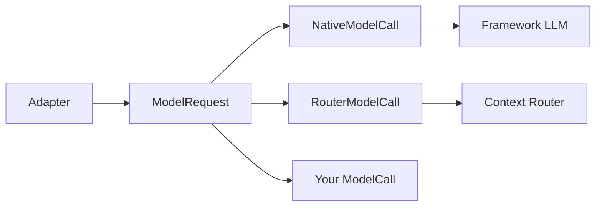

This page is the full detail behind [The model call](/core/models/model-call). Start there to pick a model call and give it to your agent.

## What it gives you

`ModelCall` is the one plug point for model requests. An adapter builds a `ModelRequest`, streams it through a `ModelCall`, and turns the events back into framework output.

| On a call without it | What the library does |
|---|---|
| A provider fails and the caller hears silence. | `FallbackModelCall` moves to the next model. [FallbackModelCall](#fallbackmodelcall) |
| A bad key is tried on every model while the caller waits. | Errors every model would give, like 401 or 422, stop the chain at once. |
| A retry after the reply started gives a doubled sentence. | The chain moves on only before the first word. |
| A rate limit sends the call to a worse model when 1 s of waiting would work. | A short `Retry-After` waits on the same model. |
| Gemini refuses several system messages. | They are folded into one. [Gemini and several system messages](#gemini-and-several-system-messages) |
| A `<think>` block is read aloud. | Reasoning tags are removed from the stream. |
| The model sees a different prompt depending on how you reach it. | Placeholders are filled once, the same way on every path. [The same final prompt](#the-same-final-prompt) |

## Stream one request

```python agent.py
import asyncio

from unmute_core.model import ModelRequest, OpenAIModelCall, TextDelta

model = OpenAIModelCall("gpt-5.6-terra")  # reads OPENAI_API_KEY

request = ModelRequest(
    messages=[
        {"role": "system", "content": "Help {{customer.name}}."},
        {"role": "user", "content": "Hi."},
    ],
    variables={"customer__name": "Ana"},
)


async def main() -> None:
    async for event in model.stream(request):
        if isinstance(event, TextDelta):
            print(event.text, end="")


asyncio.run(main())
```

`OpenAIModelCall` fills the prompt, then sends it to any OpenAI-compatible endpoint. A framework's own LLM plugin works the same way through `NativeModelCall`. Another provider is another `ModelCall`. For example, the [SLNG page](/core/models/slng) shows `RouterModelCall`, which sends the unfilled prompt and lets the router fill it.

## How a request flows



1. The adapter builds a `ModelRequest`. On LiveKit it is `ModelCallLLM`. On Pipecat it is `ModelCallLLMService`.
2. The adapter calls `stream(request)` on the `ModelCall`.
3. The call sends the request to a model.
4. The call yields `TextDelta` and `ToolCall` events. It yields a `Usage` event last when it knows the token counts.
5. The adapter turns the events into LiveKit chunks or Pipecat frames.

## ModelCall

A protocol with one method, `stream`. Any class that has it is a `ModelCall`.

### stream

Streams the model's text and tool calls for one request.

<ParamField path="request" type="ModelRequest" required>
  The request to send. The prompt is still unfilled.
</ParamField>

It returns an `AsyncIterator[ModelEvent]`.

## ModelRequest

A frozen Pydantic dataclass. It holds one request, with the prompt still unfilled. A value of the wrong type, like `site=1`, raises a `ValidationError`. An unknown argument raises `TypeError`. To change a request, build a new one with `dataclasses.replace`, which checks it again.

<ParamField path="messages" type="list[dict[str, Any]]" required>
  The chat in OpenAI format. Placeholders like `{{name}}` are not filled.
</ParamField>
<ParamField path="tools" type="list[dict[str, Any]]" default="[]">
  The tools the model may call, as OpenAI function schemas.
</ParamField>
<ParamField path="site" type="str" default='""'>
  The prompt site: the place where the prompt is used. An empty string for the main prompt, or `task:<name>` while a task runs.
</ParamField>
<ParamField path="variables" type="dict[str, str]" default="{}">
  Placeholder name to its text, from `template_variables`.
</ParamField>
<ParamField path="headers" type="dict[str, str]" default="{}">
  Extra HTTP headers for this request only, like `traceparent`.
</ParamField>
<ParamField path="tool_choice" type="ToolChoice | None" default="None">
  `required` makes the model call a tool. `none` forbids one. `auto` and `None` leave it to the model.
</ParamField>
<ParamField path="model" type="str" default='""'>
  The name of the model that answers, like `gpt-5.6-luna`. A `before_model` hook can read it. Under `FallbackModelCall` it is the first call's name. It is empty when unknown.
</ParamField>
<ParamField path="params" type="dict[str, Any]" default="{}">
  Extra body fields for this request only, like `{"temperature": 0}`. `RouterModelCall` sends them. An OpenAI compatible framework LLM gets them as `extra_body`.
</ParamField>

The call's `before_model` hooks may change a request. `wrap_model` hooks run around a `ModelCall`. See [Hooks](/core/build/hooks).

## Events

A call streams three kinds of event.

| Event | Fields | What it is |
|---|---|---|
| `TextDelta` | `text` | The next piece of the answer. |
| `ToolCall` | `id`, `name`, `arguments`, `extra` | One whole tool call. `arguments` is the JSON text the model wrote. |
| `Usage` | `input_tokens`, `output_tokens` | The token counts, once, at the end. |

1. `extra` on a `ToolCall` holds provider data sent with the call, like a Gemini thought signature. It is empty when there is none. See [Thought signatures](/core/reference/slng#gemini-thought-signatures).
2. Both adapters put `Usage` on the `llm` span. Code that reads events skips a `Usage` it has no use for.
3. Every event is a frozen Pydantic dataclass. A value of the wrong type, like `ToolCall(id=1, ...)`, raises a `ValidationError`. Token counts in `Usage` pass through unchecked, as a provider sends them.

### ToolCall

A frozen Pydantic dataclass.

<ParamField path="id" type="str" required>
  The call id the model gave.
</ParamField>
<ParamField path="name" type="str" required>
  The tool's name.
</ParamField>
<ParamField path="arguments" type="str" required>
  The JSON text the model wrote.
</ParamField>
<ParamField path="extra" type="Mapping[str, Any]" default="{}">
  Provider data sent with the call, like a Gemini thought signature in `{"google": {"thought_signature": "..."}}`.
</ParamField>
<ParamField path="to_openai" type="method">
  `to_openai()`.
  Returns the call as an OpenAI `tool_calls` entry: `{"id", "type": "function", "function": {"name", "arguments"}}`. It leaves `extra` out. A span records the calls the model chose in this shape.
</ParamField>

## Reading a whole answer

`collect(events)` reads a stream to the end and returns a `ModelAnswer`. It works on a `ModelCall`'s stream and on the stream a `wrap_model` hook sees. Use it for a side request, like a summary, where you want the whole answer and not each piece. The guide shows it in [Read a whole answer](/core/models/model-call#read-a-whole-answer).

### ModelAnswer

<ParamField path="text" type="str" default='""'>
  Every text piece, joined.
</ParamField>
<ParamField path="calls" type="tuple[ToolCall, ...]" default="()">
  The tool calls, in the order the model made them.
</ParamField>
<ParamField path="usage" type="Usage | None" default="None">
  The token counts, when the model gave them.
</ParamField>

## Site and variables

A prompt holds placeholders like `{{customer.name}}`. The call state gives their values.

```python
from unmute_core.model import template_variables

messages = [{"role": "system", "content": "Help {{customer.name}}."}]
variables = template_variables(messages, state, site="")
```

1. `site` says which prompt reads the values. A value that waits for the caller to confirm it reads as empty, except at its own task.
2. `template_variables` renders every placeholder the system and developer messages use. A dotted name `a.b` becomes the key `a__b`.
3. A placeholder the state does not have raises `MissingVariablesError`. Its message reads `Missing required template variables:` followed by the names.

User and assistant messages are never filled.

### template_variables

<ParamField path="messages" type="list[dict[str, Any]]" required>
  The chat in OpenAI format.
</ParamField>
<ParamField path="state" type="CallState | None" required>
  The call state. Pass `None` for an agent without state.
</ParamField>
<ParamField path="site" type="str" default='""'>
  The prompt reading the values, like `task:verify_customer`.
</ParamField>

### fill_messages

Fills the placeholders of the system and developer messages, as the router does. It returns a new list and raises `MissingVariablesError` when a value is missing.

<ParamField path="messages" type="list[dict[str, Any]]" required>
  The chat in OpenAI format.
</ParamField>
<ParamField path="variables" type="dict[str, str]" required>
  The placeholder key to its text.
</ParamField>

### render_prompt

Fills one prompt text from the call state. Use it to give a plain framework LLM a filled prompt.

<ParamField path="text" type="str" required>
  The prompt, like `"Help {{customer.name}} with their order."`.
</ParamField>
<ParamField path="state" type="CallState | None" required>
  The call state.
</ParamField>
<ParamField path="site" type="str" default='""'>
  The prompt reading the values.
</ParamField>

```python
from unmute_core.model import render_prompt

prompt = render_prompt("Help {{customer.name}}.", state)
```

Render it again after a save, so the prompt shows the new values.

## NativeModelCall

A framework's own LLM. The library fills the prompt. The LLM keeps its own client, settings and retries.

```python
from unmute_core.model import NativeModelCall

native = NativeModelCall(stream_framework_llm)
```

### NativeModelCall arguments

<ParamField path="stream" type="Callable[[ModelRequest], AsyncIterator[ModelEvent]]" required>
  Takes a filled request and yields events. You rarely write one.
</ParamField>

On LiveKit, `LiveKitModel` wraps any LLM plugin:

```python
from livekit.plugins import openai
from unmute_core.livekit import LiveKitModel

model = LiveKitModel(openai.LLM(model="gpt-5.6-terra"))
```

Give it to an `AgentSpec` as its `model`, `summarizer` or one of its `task_models`, or to a `FallbackModelCall`. Inside `UnmuteAgent` the plugin's chunks pass through unchanged. See [LiveKit](/core/frameworks/livekit).

## OpenAIModelCall

A native call for any OpenAI-compatible chat endpoint. It works on LiveKit and Pipecat. It needs the `openai` package, which comes with the `slng` extra and with Pipecat.

```python
import os

from unmute_core.model import OpenAIModelCall

model = OpenAIModelCall("gpt-5.6-terra")
gemini = OpenAIModelCall(
    "gemini-2.5-flash",
    base_url="https://generativelanguage.googleapis.com/v1beta/openai/",
    api_key=os.environ["GEMINI_API_KEY"],
)
```

### OpenAIModelCall arguments

<ParamField path="model" type="str" required>
  The model name sent with each request. It may not be blank.
</ParamField>
<ParamField path="base_url" type="str | None" default="None">
  The endpoint, ending in `/v1` or the like. It must start with `http://` or `https://`. `None` means OpenAI.
</ParamField>
<ParamField path="api_key" type="str | None" default="None">
  The key. `None` reads `OPENAI_API_KEY`.
</ParamField>
<ParamField path="client" type="AsyncOpenAI | None" default="None">
  A ready client. `base_url`, `api_key` and `timeout` are then unused.
</ParamField>
<ParamField path="params" type="Mapping[str, object] | None" default="None">
  Body fields for every request, like `{"temperature": 0}`. A request's own `params` win. It may not set `stream_options`.
</ParamField>
<ParamField path="timeout" type="openai.Timeout | float | None" default="None">
  The client timeout: seconds above zero, or an `openai.Timeout`. `0` raises `ValueError`. The default is 15 seconds to connect and 5 seconds for each read.
</ParamField>

1. The library fills the prompt, as with any native call. The model sees the same final prompt as on the router.
2. The request carries no SLNG header and no SLNG body field.
3. The events are the same as the router's: `TextDelta`, `ToolCall` and `Usage`.
4. The client never retries. Put the call in a `FallbackModelCall` to fail over.
5. `provider` is `openai`, or the host name of `base_url`.
6. A missing `openai` package raises an `ImportError` that names the fix.

## FallbackModelCall

Tries several calls in order. It moves on when a call fails before it answers. It is itself a `ModelCall`, so it can nest.

```python
from unmute_core.model import FallbackModelCall

model = FallbackModelCall([router, backup], first_event_timeout_s=10)
```

### FallbackModelCall arguments

<ParamField path="calls" type="Sequence[ModelCall]" required>
  The calls, first choice first. An empty list raises `ValueError`. So does a call with no `stream` method.
</ParamField>
<ParamField path="first_event_timeout_s" type="float | None" default="None">
  How long a call may take to start answering, its same-model retries included. `None` waits as long as the call does. `FIRST_EVENT_TIMEOUT_S` is 45 seconds and clears slow reasoning models.
</ParamField>
<ParamField path="max_wait_s" type="float" default="2.0">
  The longest `Retry-After` worth waiting for. A longer one fails over. A value below zero raises `ValueError`.
</ParamField>
<ParamField path="same_model_retries" type="Sequence[float]" default="()">
  The pause before each retry of the same call after a short failure. A short failure has no status, or is a 408, a 429 or a 5xx. A 429 with a usable `Retry-After` waits that long once instead. Empty moves to the next call at once. `SAME_MODEL_RETRIES_S` is `(0.25, 0.75)`. It is off by default because the Context Router retries by itself.
</ParamField>
<ParamField path="stop_statuses" type="Set[int]" default="STOP_STATUSES">
  Statuses that end the chain at once. The default is 400, 401, 402, 413 and 422.
</ParamField>
<ParamField path="stop_codes" type="Set[str] | None" default="None">
  Error codes that end the chain at once, whatever their status. `None` reads the `stop_codes` of each wrapped call. A call may have none. `RouterModelCall` has `project_mode_forbidden`. `STOP_CODES` is empty.
</ParamField>
<ParamField path="sticky" type="bool" default="False">
  `True` starts each request with the call that answered last, then the others in the given order. A dead first call is then tried once and not on every request. `False` always starts with the first call. LiveKit's `FallbackAdapter` works the same way.
</ParamField>
<ParamField path="on_fail_over" type="Callable[[FailOver], None] | None" default="None">
  Called at each move to the next call. A callback that raises is logged and the chain goes on.
</ParamField>

### How it fails over

1. It never retries or fails over once the caller has part of the answer.
2. No other model fixes a stop status or a stop code, so the chain ends there.
3. `error_code(error)` reads the code of an error. `http_status(error)` reads its status.
4. `retries_itself` is `True`. On LiveKit, `ModelCallLLM` then marks the call's errors as final, so LiveKit does not walk the chain again. A plain `RouterModelCall` does not set it, so LiveKit still retries a router it cannot reach. Another call can set the attribute, and `retries_itself(model)` reads it.
5. It remembers which call answered last, so build one for each call of the agent.
6. `.model` and `.provider` name the call the next request starts with. That is the first call, or with `sticky=True` the one that answered last. `.answered` names the call that answered last, the first before any answer. `answered_model(model)` reads it, and falls back to the model's own name. Spans carry both: `gen_ai.request.model` is the call the request started with, and `gen_ai.response.model` is the call that answered.
7. `aclose()` closes every call that has an `aclose`. `close_model(model)` calls `aclose` on any model that has one and does nothing for the rest.
8. The agent closes the models it was given when the call ends. Build a `RouterModelCall` or an `OpenAIModelCall` for each call. Never share one across calls in a process, or the first call to end closes it under the others.

### FailOver

The object `on_fail_over` receives.

<ParamField path="index" type="int" required>
  The position of the call that failed.
</ParamField>
<ParamField path="failed" type="str" required>
  The model name of the call that failed, or `unknown`.
</ParamField>
<ParamField path="next" type="str" required>
  The model name of the call tried next, or `unknown`.
</ParamField>
<ParamField path="status" type="int | None" required>
  The HTTP status of the failure, or `None`.
</ParamField>
<ParamField path="error" type="BaseException | None" required>
  The error the call raised. `None` when the call answered nothing.
</ParamField>

A framework's own fallback works without this class. Native LLM plugins keep their own retries and fallback.

## Write your own

Any class with `stream` is a `ModelCall`. The guide shows a small one in [Write your own ModelCall](/core/models/model-call#write-your-own-modelcall). Give it to an adapter the way you give it the router: `ModelCallLLM(Echo())` on LiveKit or `ModelCallLLMService(Echo())` on Pipecat.

1. `model`, `provider` and `aclose` are optional. Spans show `unknown` without a name. See [Naming a call](#naming-a-call).
2. A call that does not send the prompt to a router must call `fill_messages`. `variables` holds the values.
3. Raise the error of a failed request. `FallbackModelCall` reads its status and code from it.
4. Yield `Usage` last when you know the token counts. It is optional.

## Naming a call

`NamedModelCall` is the protocol for the optional members of a call. A framework LLM carries the same names. Functions read them and fall back when one is missing.

<ParamField path="model" type="str">
  The model name, like `gpt-5.6-luna`. `model_name(call)` returns `unknown` when it is missing.
</ParamField>
<ParamField path="provider" type="str">
  Who serves the model, like `openai`. `provider_name(call)` returns `unknown` when it is missing.
</ParamField>
<ParamField path="retries_itself" type="bool">
  `True` when the call retries and fails over on its own. `retries_itself(call)` returns `False` when it is missing.
</ParamField>
<ParamField path="variable_key_max" type="int">
  The longest placeholder key the call takes, for a call that fills the prompt on its own side. `RouterModelCall` has 64. `FallbackModelCall` has the smallest limit of its calls. `variable_key_max(*calls)` returns the smallest limit, or `None` when no call has one. A native call has none, so a key is never refused on it.
</ParamField>
<ParamField path="stop_codes" type="frozenset[str]">
  Error codes after which `FallbackModelCall` tries no other call.
</ParamField>

## The same final prompt

The model sees the same final prompt on every path.

- **Native.** The library fills the prompt with `fill_messages`. Then the framework LLM sends it.
- **Router.** The library sends the prompt unfilled with `variables`. The router fills it.

Both paths use the same placeholders, the same values and the same rule for a missing one. SLNG may add capabilities, like caching or failover. It never changes what the agent says.

One limit comes from the router, not the library. The router refuses a template variable over 4000 characters, so `RouterModelCall` cuts a longer one and logs a warning. A native call sends a value whole.

## Gemini and several system messages

Gemini's OpenAI-compatible endpoint keeps only the last system message. The library may send several, for example the prompt, the values block and notes. The values block is a system message that lists the State values. See [State](/core/build/state#saving-values-no-task-saves).

1. `OpenAIModelCall` folds every system and developer message into one system message at the front, for a Gemini model: one whose id, after any vendor prefix, starts with `gemini`. The host does not count, since a Google endpoint serves other models too. The texts join in order with a blank line. Other messages keep their order. A chat with one system message goes out unchanged.
2. SLNG's Context Router folds them too.
3. A native OpenAI-compatible plugin keeps its own client and sends the messages as they are. Pointed at that endpoint, the model may miss the earlier ones. Use the native Gemini plugin there.

## Where to go next

<CardGroup cols={2}>
  <Card title="The model call" icon="brain" href="/core/models/model-call">
    Pick a model call and give it to your agent.
  </Card>
  <Card title="SLNG reference" icon="book" href="/core/reference/slng">
    RouterModelCall, router config, thought signatures and router errors.
  </Card>
  <Card title="Hooks" icon="webhook" href="/core/build/hooks">
    Change or wrap a model request with your own code.
  </Card>
  <Card title="Context Router on Unmute" icon="zap" href="/optimization/context-router">
    The `agent.yaml` side of the router.
  </Card>
</CardGroup>
