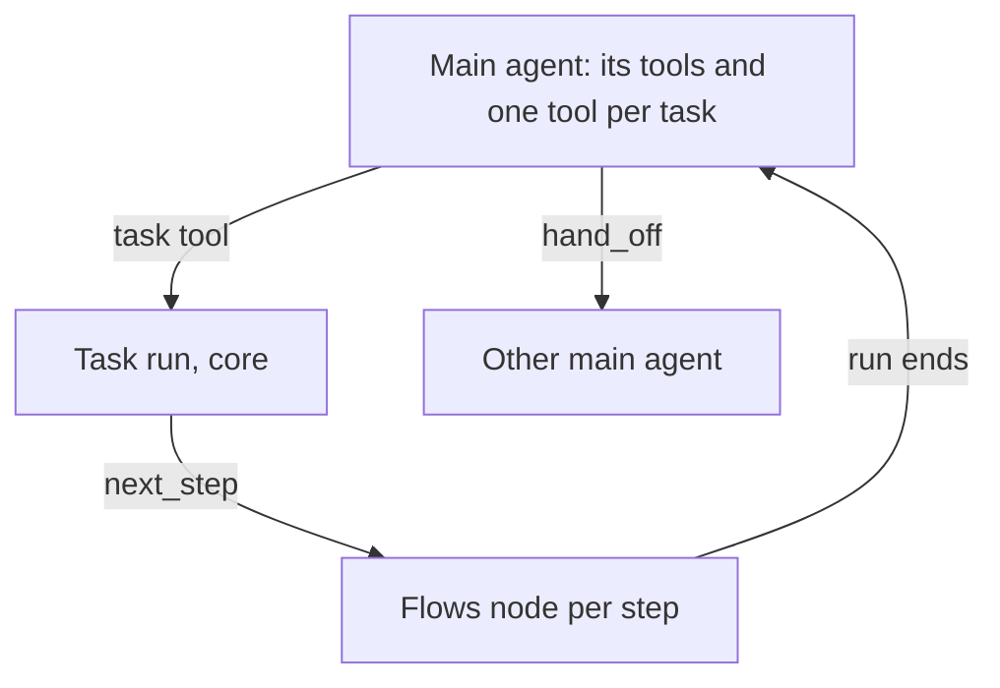
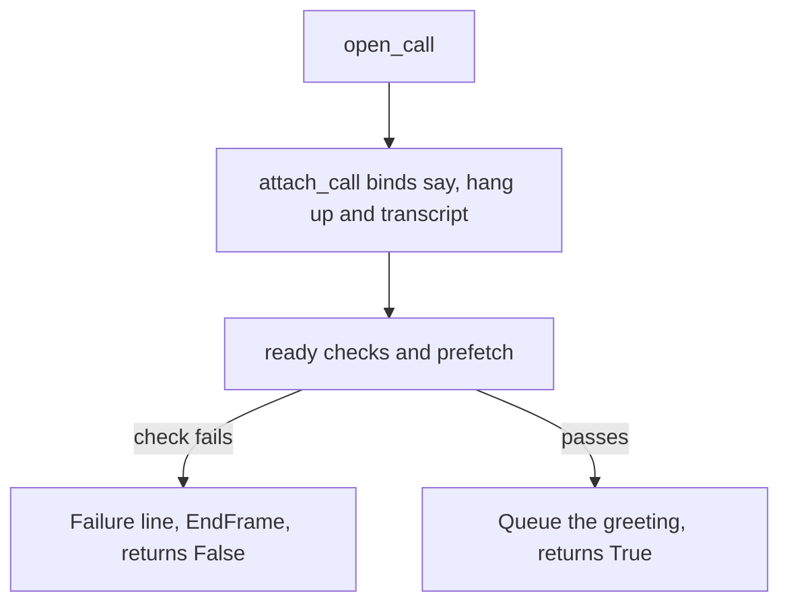

This page is the full detail behind [Pipecat](/core/frameworks/pipecat). Start there to run the library in your own Pipecat pipeline.

## How it works



1. `install()` puts the main agent's tools on the context, each with its handler.
2. A task tool starts a run in the core. The main agent's context is copied.
3. Each step becomes a node on the call's one `FlowManager`.
4. When the run ends, the copy comes back with the run's result.
5. `hand_off` gives the call to another main agent on the same context.

## UnmuteFlows

```python
from unmute_core.pipecat import UnmuteFlows
```

`UnmuteFlows` runs the tasks of one call. Build one per call, then call `install()` before the pipeline runs. `spec` is the only positional argument. The others are keyword only. `UnmuteFlows` builds the call's `CallTasks` itself, from the spec.

<ParamField path="spec" type="AgentSpec" required>
  The first agent: its prompt, tools or tasks, models, language and handoff tools. Its `model` needs `llm` to be a `ModelCallLLMService`. Its `name` is the name a `handoff` event shows. With no name, it is the call's `agent_id`. Every field is on [AgentSpec](/core/reference/agent-spec).
</ParamField>
<ParamField path="llm" type="LLMService" required>
  The LLM service, shared by every agent and every step.
</ParamField>
<ParamField path="context" type="LLMContext" required>
  The shared context.
</ParamField>
<ParamField path="aggregators" type="LLMContextAggregatorPair" required>
  The context's aggregator pair.
</ParamField>
<ParamField path="state" type="CallState | None" default="None">
  The call state. None takes the state of `call`, else a `CallState()` that keeps no values of its own. The spec's `tasks` and `save_values` need one.
</ParamField>
<ParamField path="call" type="CallHooks | None" default="None">
  The call's hooks. Each model request waits for the tools on events. A main agent request ends with their notes. Steps read the call start results. See [The call's life](/core/build/call-lifecycle).
</ParamField>
<ParamField path="telemetry" type="Telemetry | None" default="None">
  Records a `task_step` span per step, and each task event.
</ParamField>
<ParamField path="native_tools" type="Sequence[FunctionSchema]" default="()">
  Pipecat tools the first agent gets as they are, each with its handler, like a handoff or an end-call tool. A step gets the ones its task lists in `handoffs` or `native_tools`.
</ParamField>
<ParamField path="then_targets" type="Mapping[str, Handler] | None" default="None">
  The agents a group goes to when its `then` is `transfer`, by `then_target`: the handler of a handoff to that agent, which calls `hand_off`. One mapping serves every agent of the call. See [Handoffs](/core/build/handoffs).
</ParamField>
<ParamField path="tts" type="VoiceSwitcher | None" default="None">
  The call's voices. The first service speaks first. `hand_off(tts=...)` switches to another. A plain `ServiceSwitcher` is refused.
</ParamField>

On Pipecat, the spec's `summarizer` also answers each finish check when the call's LLM cannot be asked: one that is not OpenAI compatible and not a `ModelCallLLMService`. With no summarizer, such an LLM gets what was said instead, and no finish check.

`AgentSpec` refuses `tools` beside `tasks`, and a task model that `task_models` does not name. `UnmuteFlows` raises `ValueError` in these cases:

- The spec has `tasks` or `save_values`, and there is no state.
- A task lists a handoff that is not one of `native_tools`.
- A task names a model. Pipecat runs every task on the agent's LLM service.
- A group transfers to an agent `then_targets` lacks.
- The spec's `handoffs` names a tool `native_tools` lacks.
- The spec has a `model`, and `llm` is not a `ModelCallLLMService`.
- `tts` is a plain `ServiceSwitcher`.
- A native tool has the same name as a registry tool, a task, a group or `save_values`.
- A task or group has the same name as another tool of the agent, like `end_call`.
- A placeholder makes a key longer than the model call takes. The router takes 64 characters. A native service has no limit.

### UnmuteFlows attributes

<ParamField path="spec" type="AgentSpec">
  The spec of the agent that holds the call. Each handoff changes it.
</ParamField>
<ParamField path="tasks" type="CallTasks">
  The task runs of the agent that holds the call, built from its spec.
</ParamField>
<ParamField path="state" type="CallState">
  The call state of the agent that holds the call.
</ParamField>
<ParamField path="llm" type="LLMService">
  The service you passed as `llm=`, a `ModelCallLLMService` or a native one. Read it when a handler needs the service and holds only `flows`.
</ParamField>
<ParamField path="model" type="ModelCall | None">
  The model call a handoff gave the agent that holds the call. None for the first agent.
</ParamField>
<ParamField path="site" type="str">
  The prompt site of the next model request, the place where the prompt is used: `task:<name>` in a step, else `""`.
</ParamField>
<ParamField path="task_results" type="dict[str, str | None]">
  For `TelemetryObserver`: the result the main agent reads for each task call, by call id. None while the task runs.
</ParamField>
<ParamField path="closing_results" type="dict[str, Any]">
  For `TelemetryObserver`: what a step's closing tool returned, by tool name.
</ParamField>
<ParamField path="openings" type="list[Opening]">
  For `TelemetryObserver`: the tools steps ran in code as they opened.
</ParamField>
<ParamField path="request_spans" type="RequestSpans | None">
  Set by `TelemetryObserver`. It traces a finish check, a model request no frame shows.
</ParamField>

### UnmuteFlows.hand_off

`await flows.hand_off(params, spec, native_tools=..., tts=..., announce=..., context=...)` gives the call to another main agent, described by its own `AgentSpec`. Its arguments, and the model and voice that go with them, are on [Handoffs](/core/build/handoffs).

### UnmuteFlows.listen

`flows.listen(sink)` sends every later task event of the call to `sink`, from each agent the call is handed to as well. Use it for a dev recorder: `flows.listen(recorder.task_event)`. See [Telemetry](/core/observe/telemetry).

## The model

A native Pipecat LLM service, like `OpenAILLMService`, gets its prompts filled by `UnmuteFlows`. A value reaches the model whole. A `ModelCallLLMService` gets them unfilled, with the prompt site of each request, and the `ModelCall` decides who fills them. See [Model call](/core/models/model-call) for the interface and [SLNG](/core/models/slng) for the router, one `ModelCall` you can use.

### ModelCallLLMService

<ParamField path="model_call" type="ModelCall" required>
  Where the requests go.
</ParamField>
<ParamField path="state" type="CallState | None" default="None">
  The call state, read for each request's variables.
</ParamField>
<ParamField path="call" type="CallHooks | None" default="None">
  The call's hooks, run on each request. `attach_call(llm=...)` and `UnmuteFlows(call=...)` set it.
</ParamField>
<ParamField path="**kwargs" type="Any">
  `OpenAILLMService` arguments, like `settings`. A key or a base URL is not used.
</ParamField>

### ModelCallLLMService attributes

<ParamField path="model_call" type="ModelCall">
  Where the requests go.
</ParamField>
<ParamField path="site" type="str">
  The prompt site of the next request. `""` is the main agent, and `task:<name>` is a step. `UnmuteFlows` sets it.
</ParamField>
<ParamField path="failure_is_final" type="bool" default="False">
  True makes a failed model call leave the service unusable, so the call fails.
</ParamField>
<ParamField path="last_request" type="ModelRequest | None">
  The newest request as it went out, after the hooks.
</ParamField>
<ParamField path="trace_headers" type="Callable[[], Mapping[str, str]] | None">
  Returns the trace headers for the next request. `TelemetryObserver` sets it, so a router's spans join the turn's trace.
</ParamField>

The service marks itself unusable when a model call raises, but only when `failure_is_final` is set. `attach_call(llm=...)` and `UnmuteFlows(call=...)` set it. Otherwise a model failure stays recoverable, as Pipecat reports it. A short error of a native Pipecat LLM is not a failure. A model error after the reply began does not fail the call either. The reply ends as it stands, the error goes on the `llm` span, and the call goes on.

The service closes each model call it was given when the pipeline ends.

## How the call opens and ends

A full opening reads the phone call's details, holds the caller until the greeting, and sets a longest length:

```python
from unmute_core.agent import AgentSpec
from unmute_core.call import CallHooks
from unmute_core.greeting import Greeting
from unmute_core.pipecat import (
    GreetingHold,
    UnmuteFlows,
    max_duration,
    open_call,
    telephony_call_info,
)
from unmute_core.state import CallState, call_phone_region, use_phone_region

info = telephony_call_info(runner_args.call_data)
state = CallState(State, call=info)
call = CallHooks(state, prefetch=prefetch)
flows = UnmuteFlows(
    AgentSpec(PROMPT, tasks=plan), llm=llm, context=context, aggregators=aggregators, call=call
)
hold = GreetingHold()
# user aggregator: LLMUserAggregatorParams(user_mute_strategies=[hold])
greeting = Greeting(text="Hi {{customer_name}}.")


@transport.event_handler("on_client_connected")
async def on_connected(transport, client):
    await open_call(worker, greeting, call, context=context, hold=hold, transport=transport)
    max_duration(worker, 20 * 60, call=call)


@transport.event_handler("on_client_disconnected")
async def on_disconnected(transport, client):
    await worker.queue_frame(EndFrame())


await runner.add_workers(worker)
with use_phone_region(lambda: call_phone_region(state.call)):
    await runner.run()
end = await call.end("ended")
await telemetry.close(state=state, reason=end.reason)
```



1. `open_call` attaches the hooks, runs the `ready` checks and the prefetch, and starts the background lookups.
2. It queues the greeting and returns True. After a failed check it says the failure line, ends the call and returns False.
3. `call.end` makes the saves steps held, runs the `call_end` tools and drains the webhooks. Call it after `runner.run()` and before the telemetry closes, so the held saves' model request is traced in the last turn.
4. The end of the pipeline already starts `call.end`, and a second call waits for the same run. `flows.settle()` still works alone. See [Tasks](/core/build/tasks).
5. The reason does not come from the `EndFrame`. Pass `transport=` to `open_call` (or `attach_call`) and the transport's `on_client_disconnected` event notes the caller's hang-up, so the end reads `caller_hung_up`. On a Daily dial-out, `dial_out(..., call=call)` notes the callee hanging up the same way. Your own handler still ends the pipeline. `end_call_tool(call=call)`, `max_duration(call=call)` and `IdleNudgeObserver(call=call)` note their own reasons. Without a note, the end reads `ended`. See [Why the call ended](/core/build/call-lifecycle#why-the-call-ended).

Pass `telemetry.close(state=state, reason=...)` the reason `await call.end(...)` returns. Without hooks, pass one in the library's words: `caller_hung_up` when the caller leaves, `agent_ended` when the agent ends the call, or `ended` when you do not know.

The events, the failure line and the greeting's own rules are in [The call's life](/core/build/call-lifecycle).

### telephony_call_info

<ParamField path="call_data" type="CallData | Mapping[str, Any]" required>
  `runner_args.call_data`, as the Pipecat runner parsed the carrier's handshake. It reads Twilio, Telnyx, Plivo and Exotel.
</ParamField>
<ParamField path="trunk_number" type="str | None" default="None">
  The agent's own number, when the handshake does not carry it. Pass it by keyword.
</ParamField>
<ParamField path="agent_id" type="str | None" default="None">
  The agent's id, the same on every framework. Pass it by keyword.
</ParamField>
<ParamField path="session_id" type="str | None" default="None">
  The call's id, when your dispatch gives one. A new one otherwise. Pass it by keyword.
</ParamField>

It returns a `CallInfo`. It reads the carrier call id from the handshake. It reads the direction and the numbers from the handshake's body, the parameters your TwiML sends, and else from the handshake's own `from` and `to`. A call with no direction is inbound.

### greeting_frames

`greeting_frames(greeting, state, llm=None)` returns the frames that open the call: a `TTSSpeakFrame` with the line, a request for the model to word a greeting, or nothing when the caller speaks first. Queue them once the pipeline runs and prefetch has filled the state. A line whose value is still empty is worded by the model. The instruction for a worded greeting goes in as a developer message.

### open_call

`await open_call(worker, greeting, call, context=..., llm=..., hold=..., transport=...)` returns True once the greeting is queued, and False after a failed check.

<ParamField path="worker" type="PipelineWorker" required>
  The call's pipeline worker.
</ParamField>
<ParamField path="greeting" type="Greeting" required>
  How the call opens.
</ParamField>
<ParamField path="call" type="CallHooks" required>
  The call's hooks, with the checks to pass.
</ParamField>
<ParamField path="context" type="LLMContext" required>
  The shared context.
</ParamField>
<ParamField path="llm" type="LLMService | None" default="None">
  The LLM service of a pipeline without `UnmuteFlows`. Pass OpenAI's realtime or live service always, with `UnmuteFlows` too, because it says the greeting and the failure line itself.
</ParamField>
<ParamField path="hold" type="GreetingHold | None" default="None">
  The greeting hold on the user aggregator. It lets go when the caller speaks first.
</ParamField>

### GreetingHold

`GreetingHold` is a user mute strategy. It holds the caller's audio until the greeting starts. With `Greeting(interruptible=False)`, it holds until the greeting ends.

<ParamField path="interruptible" type="bool" default="True">
  True lets go as the greeting starts, so the caller can cut in. False lets go once it has played. `open_call(hold=hold)` sets it from the greeting. Pass it yourself only when you do not use `open_call`.
</ParamField>
<ParamField path="max_hold_s" type="float" default="20">
  Lets go after this many seconds, so a greeting that never starts or never ends cannot hold the caller for ever. The clock starts when `open_call` queues the greeting, with `hold.arm()`. The checks and the prefetch do not count. An uninterruptible greeting longer than this can be cut when the hold lets go, so raise it for a long greeting.
</ParamField>

`hold.release()` lets go at once. `open_call` calls it when the caller speaks first.

### attach_call

`attach_call(worker, call, context, llm=None, transport=None)` does only the attaching, once per call. It binds say, hang up and the transcript. A fatal error, or a processor that becomes unusable, fails the call: `TTSSpeakFrame(line)`, then `EndFrame()`. A TTS service that fails is logged and emits `call.tts_failed`, and the call stays open. The end of the pipeline runs `call.end`. With no `llm=` and no `UnmuteFlows`, a call that has model hooks logs one warning, because nothing sends the model request through the library. See [Hooks](/core/build/hooks#where-the-model-hooks-run).

<ParamField path="worker" type="PipelineWorker" required>
  The call's pipeline worker.
</ParamField>
<ParamField path="call" type="CallHooks" required>
  The call's hooks.
</ParamField>
<ParamField path="context" type="LLMContext" required>
  The shared context, for the transcript and the notes.
</ParamField>
<ParamField path="llm" type="LLMService | None" default="None">
  The LLM service of a pipeline without `UnmuteFlows`. Each request then waits for the tools on events, ends with their notes and runs the call's `prompt` and model hooks. A failed `ModelCallLLMService` request fails the call.
</ParamField>
<ParamField path="transport" type="BaseTransport | None" default="None">
  The call's transport. Its `on_client_disconnected` event notes that the caller hung up (`caller_hung_up`), unless the call already has an end reason. It does not end the pipeline: your own handler does that. `open_call` takes the same argument.
</ParamField>

Keep the worker's `processor_unusable_policy` at `CONTINUE`, so the failure line can play. Give a pipeline without `UnmuteFlows` its tools with `tools_schema(registry, state, hooks=call)`.

### fill_prompt

`await fill_prompt(llm, worker, prompt, state, save_values=False)` keeps a plain pipeline's prompt filled, for a cascade LLM service. A plain pipeline has no `UnmuteFlows`. Await `fill_prompt` before the pipeline runs. It sends the filled prompt as the service's system instruction now, and again after each save. So a value saved by prefetch or a tool reaches the next request. The call's `prompt` hooks still run through `attach_call(llm=)`.

<ParamField path="llm" type="LLMService" required>
  The call's LLM service. A realtime service raises `TypeError`: use `attach_realtime`.
</ParamField>
<ParamField path="worker" type="PipelineWorker" required>
  The call's worker. Its end stops following the state.
</ParamField>
<ParamField path="prompt" type="str" required>
  The agent's prompt, with placeholders still in it.
</ParamField>
<ParamField path="state" type="CallState" required>
  The call state the placeholders read.
</ParamField>
<ParamField path="save_values" type="bool" default="False">
  End the prompt with the current values block, for `values_tool`. Pass it by keyword.
</ParamField>

### attach_realtime

`await attach_realtime(service, worker, prompt, state=None, ...)` runs OpenAI's realtime or live service as the agent, for a pipeline without `UnmuteFlows`. Await it before the pipeline runs. See [Realtime](/core/models/realtime).

<ParamField path="service" type="LLMService" required>
  The call's realtime or live service. Anything else raises `TypeError`.
</ParamField>
<ParamField path="worker" type="PipelineWorker" required>
  The call's worker.
</ParamField>
<ParamField path="prompt" type="str" required>
  The agent's prompt, with placeholders still in it.
</ParamField>
<ParamField path="state" type="CallState | None" default="None">
  The call state the placeholders read.
</ParamField>
<ParamField path="call" type="CallHooks | None" default="None">
  The call's hooks: its `prompt` hooks and the notes of its tools on events.
</ParamField>
<ParamField path="save_values" type="bool" default="False">
  The agent has the `save_values` tool, so its values follow the prompt.
</ParamField>
<ParamField path="owners" type="Mapping[str, str] | None" default="None">
  Value name to the task that saves it, for the values block.
</ParamField>

### max_duration

`max_duration(worker, seconds, call=call)` queues an `EndFrame` after that many seconds, with no closing line. It stops counting when the pipeline ends first. It returns the running `CallLimit`.

<ParamField path="worker" type="PipelineWorker" required>
  The call's pipeline worker.
</ParamField>
<ParamField path="seconds" type="float" required>
  The longest the call may run. It must be above zero.
</ParamField>
<ParamField path="call" type="CallHooks | None" default="None">
  The call's hooks. With them, the call's end reads `max_duration`.
</ParamField>

## Observers

`TelemetryObserver` records STT, each model request with its prompt, tools and tool calls, TTS and every task event. A `handoff` event names each agent by its spec's `name`, else the call's `agent_id`. So give each `AgentSpec` its own `name`.

<ParamField path="telemetry" type="Telemetry" required>
  The call's telemetry, with its call span started.
</ParamField>
<ParamField path="model" type="str" required>
  The model name the `llm` spans carry. After a handoff that gave the next agent its own model call, its spans name that one.
</ParamField>
<ParamField path="provider" type="str" required>
  Who serves the model, like `openai`.
</ParamField>
<ParamField path="flows" type="UnmuteFlows | None" default="None">
  The call's tasks, which tell each request's prompt site.
</ParamField>

Without `enable_metrics` and `enable_usage_metrics`, Pipecat sends no time to first byte and no token counts. `TelemetryObserver` logs one warning when they are off.

`DevObserver` sends the same call as the records `unmute dev` shows. Span names are in the [Telemetry reference](/core/reference/telemetry), and dev records on [Dev records](/core/reference/dev-records). Keep Pipecat's own `enable_tracing` off, because `TelemetryObserver` writes the spans.

## Native tools and MCP

`native_tools` are Pipecat `FunctionSchema`s with their own handlers, like a handoff or an end-call tool. A Pipecat MCP client needs no new class.

1. `MCPClient.tools()` returns a `ToolsSchema`. Its `FunctionSchema`s carry their handlers.
2. The main agent gets every tool you pass in `native_tools`.
3. A step gets only the names its task lists. See [Tasks](/core/build/tasks).

### end_call_tool

`end_call_tool` ends the call after one model request. The goodbye rides in the reply that calls the tool.

<ParamField path="extra_description" type="str" required>
  What the model reads after the built-in end-call text: when this agent ends a call, and to say its goodbye in the same reply. The model reads LiveKit's `EndCallTool` text first, then yours, so both frameworks make the same choice.
</ParamField>
<ParamField path="goodbye" type="str | None" required>
  The line spoken when the reply that ends the call has no words. Write it in the call's language. `None` says `GOODBYE_LINE`, in English.
</ParamField>
<ParamField path="reply_text" type="Callable[[], str]" required>
  Returns the text of the reply that called the tool. `lambda: flows.reply_text` reads it when the tool runs, so the tool can be built before `flows`. Without `UnmuteFlows`, use `reply_text(llm)`.
</ParamField>
<ParamField path="call" type="CallHooks | None" default="None">
  The call's hooks. With them, the end is noted as `agent_ended`. A failure after that plays no line.
</ParamField>

1. The tool answers with `run_llm=False`, so the call ends after one model request.
2. When the reply has no words, the tool speaks the goodbye you give it.
3. Then `worker.end()` drains the pipeline, so the goodbye plays before the call ends.
4. The ending tool asks for no second reply, on a realtime service too, and also when another tool is called in the same reply.
5. `goodbye=None` says `GOODBYE_LINE` from `unmute_core.call`, in English. For another language, pass your own `goodbye`.

## VoiceSwitcher

`VoiceSwitcher` holds the TTS services of a call's agents, in the pipeline where the TTS goes. It is Pipecat's `ServiceSwitcher` with one fix. A plain one lets the flush probe get lost, so every handoff and task waits out the flush timeout.

```python
from unmute_core.pipecat import VoiceSwitcher

voices = VoiceSwitcher([front, billing])
flows = UnmuteFlows(..., llm=llm, tts=voices)
```

Put `voices` in the pipeline where one TTS would go. Two voices of one provider are two instances of its service, and each opens its own connection as the pipeline starts. Which agent uses which model and voice is on [Handoffs](/core/build/handoffs).

## Turn pace

```python
from pipecat.audio.turn.smart_turn.local_smart_turn_v3 import LocalSmartTurnAnalyzerV3
from pipecat.audio.vad.silero import SileroVADAnalyzer
from unmute_core.pipecat import smart_turn_params, vad_params
from unmute_core.turn import turn_window

window = turn_window("balanced", "pipecat")
vad = SileroVADAnalyzer(params=vad_params(window))
turn = LocalSmartTurnAnalyzerV3(params=smart_turn_params(window))
```

<ParamField path="window" type="TurnWindow" required>
  For `vad_params` and `smart_turn_params`: a window from `turn_window(pace, "pipecat")`.
</ParamField>

`vad_params(window)` returns `VADParams(stop_secs=window.vad_silence)`. `smart_turn_params(window)` returns `SmartTurnParams(stop_secs=window.max_delay)`. The paces, interruption and idle nudges are on [Turn taking](/core/build/turn-taking).

## Rules to know

- Build one `UnmuteFlows` and one `Telemetry` per call, and one `AgentSpec` per agent of the call. Build the `ModelCall` per call too, after the state. The service closes the models it was given when the pipeline ends, so a `RouterModelCall` or `OpenAIModelCall` shared across calls is closed under the others.
- Keep Pipecat's own `enable_tracing` off.
- `UnmuteFlows(call=...)` runs the `prompt` hooks on every prompt it builds, and the model and tool [hooks](/core/build/hooks) on every request and tool call. On a native LLM, a request borrows a hook's changes and gives them back once it ends.
- `UnmuteFlows` gives a native Pipecat LLM the main prompt as it reads now, before each main request. A value saved since shows.
- A tool's `interruption="continue"` makes it a background tool to Pipecat. The library keeps Pipecat's own guidance about background tools out of the prompt, so the model reads the same prompt as on LiveKit. Your own tool with `cancel_on_interruption=False` brings the guidance back. Tool fields and webhooks are in [Tools](/core/build/tools).
- In `record` mode, a reply that spoke and called nothing can be followed by a short finish check. Through a `ModelCallLLMService` it is a `ModelRequest`. A native OpenAI compatible service gets it on its own client. Any other service asks the spec's `summarizer` model. With none, it skips the check, and `UnmuteFlows` logs one warning at build. A `summary` history on such a service needs a `summarizer` too, and warns once.
- A tool that ends the call, or a tool beside it in the same reply, makes no second model request. The same holds on a realtime service.
- `TelemetryObserver` warns once when `PipelineParams(enable_metrics=True, enable_usage_metrics=True)` is not set, because the spans then miss tokens and the time to first byte.
- The greeting instruction and the idle nudge go in as developer messages.
- A step's first request never ends on its own announce line. The library adds a short cue after it, the step cue `(The call continues.)`, so a provider like Gemini does not answer with nothing.
- The caller can still cut off a transfer's announce line on Pipecat. To protect it, build the user aggregator with `user_mute_strategies(protect=["tool_calls"])`. See [Turn taking](/core/build/turn-taking#turn-off-interruption-or-protect-a-line).
- On a phone call over a carrier line, set the pipeline's audio in and out sample rates to 8000. The library does not build the pipeline, so it cannot do this for you. See [Phone calls](/core/reference/telephony#pipecat-on-a-carrier-websocket).
- A realtime model's worded greeting waits for the background lookups, as on LiveKit.
- Gemini's OpenAI-compatible endpoint keeps only the last system message. `OpenAIModelCall` folds the library's several into one for a Gemini model. A native OpenAI-compatible service pointed at that endpoint sends them as they are, so use `GoogleLLMService` or a `ModelCallLLMService` there. See [Gemini and several system messages](/core/reference/model-call#gemini-and-several-system-messages).
- A provider's own context messages, like Gemini's thought signatures, stay in the context and never count as caller turns.

## Where to go next

<CardGroup cols={2}>
  <Card title="Pipecat" icon="boxes" href="/core/frameworks/pipecat">
    Run the library in your own Pipecat pipeline.
  </Card>
  <Card title="AgentSpec" icon="book" href="/core/reference/agent-spec">
    Every field of the agent, the same on both frameworks.
  </Card>
  <Card title="Telemetry reference" icon="activity" href="/core/reference/telemetry">
    Every span and attribute the observer writes.
  </Card>
  <Card title="LiveKit adapter reference" icon="book" href="/core/reference/livekit">
    The same detail for LiveKit.
  </Card>
</CardGroup>
