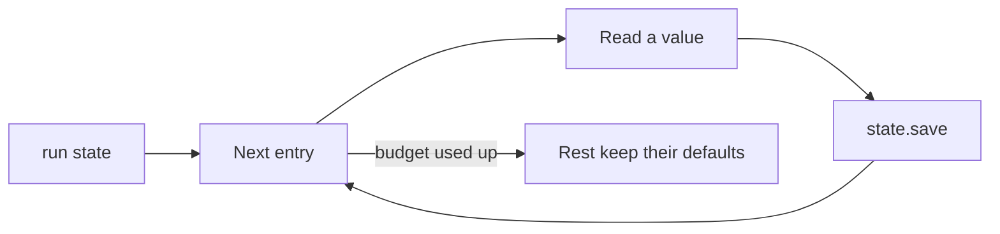

This page is the full detail behind [Prefetch](/core/build/prefetch). Start there to fill the call state before the greeting. Come here for every entry, argument, check and rule.

## What it gives you

| On a call without it | What the library does |
|---|---|
| The model spends call time asking for the date, or for a caller it could know. | The clock, call facts and lookups fill the state before the first word. [Prefetch](/core/build/prefetch#fill-values-before-the-greeting) |
| A slow lookup delays the greeting, or a failed one ends the call. | All lookups share a 2 s budget. A late or failed one keeps its default. [How it works](#how-it-works) |
| The server's time zone gives the wrong day. | The clock reads the zone you name. |
| "anonymous" is saved as a phone number and read aloud. | Withheld numbers count as absent. [CallValue](#callvalue) |
| The caller fixes their number. The name looked up from the old one stays. | Values looked up from the old number go back to empty. |

## How it works



1. `run` goes through the entries in order.
2. A `Clock` reads the time in one zone. A `CallValue` copies a value from `state.call`. A `Lookup` runs your function or tool.
3. Each entry saves its values with `state.save`. A listener sees them as origin `prefetch`.
4. The whole block has one budget, 2 seconds by default. Pass `budget=` to change it.
5. When the budget runs out, the rest of the entries are skipped. Their values keep their defaults.
6. `run` never raises. An entry that is skipped, times out or fails is logged and leaves its values at their defaults. The call greets on time.

In the [guide's example](/core/build/prefetch#fill-values-before-the-greeting), `find_customer` takes the call state and returns a mapping, like `{"name": "Ana Ruiz"}`. It may be a plain function or an `async` one. After `run`, `booking_date`, `weekday`, `caller_phone` and `customer_name` hold their values. The agent greets with them.

## Prefetch

The block of entries a call runs as it starts.

<ParamField path="entries" type="Sequence[Clock | CallValue | Lookup]" required>
  The entries, run in order. Names must be unique.
</ParamField>
<ParamField path="state" type="type[BaseModel] | None" default="None">
  The State model. With it, every entry is checked at build time against the types of the values it saves.
</ParamField>
<ParamField path="budget" type="float" default="2.0">
  Seconds the entries before the greeting may take together. Past it, the rest keep their defaults.
</ParamField>
<ParamField path="background_budget" type="float" default="10.0">
  Seconds each background lookup may take.
</ParamField>

`state`, `budget` and `background_budget` are keyword-only.

## Clock

`Clock(name, timezone, assign)` reads the clock once, at the start of the call. A call that crosses midnight keeps the day it started on.

<ParamField path="name" type="str" required>
  The entry name, used in log lines.
</ParamField>
<ParamField path="timezone" type="str" required>
  An IANA zone, like `Europe/Madrid`. It is never the container's clock.
</ParamField>
<ParamField path="assign" type="Mapping[str, str]" required>
  State value name to the clock field it gets, like `{"booking_date": "date"}`. It may not be empty.
</ParamField>

The fields are `date`, `time`, `datetime`, `day_of_week`, `year` and `timezone`. A `date` reads `2026-10-13`, a `time` reads `09:30`, and a `day_of_week` reads `Tuesday`. A wrong zone raises `ValueError` when you build the entry: `'Mars/Base' is not an IANA time zone`. So does a wrong field, like `'dat' is not a clock field`.

## CallValue

`CallValue(name, source, assign)` copies a value from `state.call` into a value of your own. `state.call` is read-only. A copy lets the caller confirm the number or correct it. See [State](/core/build/state#values-the-call-carries-state-call).

<ParamField path="name" type="str" required>
  The entry name, used in log lines.
</ParamField>
<ParamField path="source" type="str" required>
  The `state.call` field to read: `calling_number`, `called_number`, `remote_number`, `direction`, `channel`, `carrier_call_id`, `agent_id` or `session_id`.
</ParamField>
<ParamField path="assign" type="Sequence[str]" required>
  The state value names that get the value. They all get it. A bare string raises `TypeError`, so write `["caller_phone"]`.
</ParamField>

A call value that is empty counts as absent, and the entry is skipped. A withheld caller ID, like `anonymous`, is already `None` in `state.call`. So it is skipped too.

## Lookup

`Lookup(name, run, assign, inputs=(), needs_confirmed=(), background=False)` runs a function or a tool and saves fields of its result.

<ParamField path="name" type="str" required>
  The entry name, used in log lines and as its label in the results.
</ParamField>
<ParamField path="run" type="ToolSpec | Callable[[CallState], object]" required>
  A function that takes the call state, or a `ToolSpec`. It returns a mapping. A plain function runs in a thread, so a blocking call cannot delay the greeting.
</ParamField>
<ParamField path="assign" type="Mapping[str, str]" required>
  State value name to a top-level key of the result. A tool lookup may leave it empty. Its result then only reaches a step's `tool` input.
</ParamField>
<ParamField path="inputs" type="Sequence[str]" default="()">
  Value paths the lookup reads. The entry is skipped while one is empty. When an input changes later, the saved values go back to their defaults. So do values looked up from them.
</ParamField>
<ParamField path="needs_confirmed" type="Sequence[str]" default="()">
  Values that must not be waiting for the caller. The entry is skipped while one is.
</ParamField>
<ParamField path="background" type="bool" default="False">
  True runs the lookup beside the greeting.
</ParamField>

A result that is not a mapping counts as a failure.

### A tool as a lookup

```python
find = local_tool(find_customer, locked={"phone": "{{caller_phone}}"})
Lookup("customer", find, {"customer_name": "name"})
```

1. `run` may be a `ToolSpec`. It runs like any tool: locked arguments, `{{value}}`, `{{call.name}}` and refusal.
2. Every required argument must be locked. The model never fills one. An open one raises `ValueError` when you build the entry.
3. A tool lookup has no announce line. Nobody waits for it. A tool with one is refused.
4. A tool that is refused or fails counts as a failure. The values keep their defaults.
5. A tool that hides its result with `show_result=False` records `{"ok": true}`.

### Work beside the greeting

```python
Lookup("hours", local_tool(store_hours), {"closes_at": "close"}, background=True)
```

A slow lookup should not delay the greeting. Mark it `background=True`.

1. `Prefetch.run` runs only the other entries. It never waits for a background lookup.
2. `Prefetch.run_background(state, results=...)` runs the background lookups, one after the other.
3. Each one has its own budget, 10 seconds by default. Pass `background_budget=` to `Prefetch` to change it.
4. A lookup that fails or runs out of time is logged. Its values keep their defaults.
5. `prefetch.fills` leaves background lookups out. So `Greeting.check(prefetch)` refuses a greeting line that names one of their values.
6. `CallHooks` starts `run_background` for you. Every model request then waits for it, up to `first_request_timeout_s`. A fixed greeting plays at once.
7. The prompt shows the value once it is saved. `UnmuteAgent` and `UnmuteFlows` fill the prompt again before each request.

### What each lookup returned

```python
from unmute_core.tasks import CallStartResults

results = CallStartResults()
await prefetch.run(state, results=results)
```

1. `run` and `run_background` take `results`. Each lookup that ran records its result as JSON, under the entry name. A lookup that failed records `{"error": ...}`.
2. `CallHooks` keeps one as `call.results`. `UnmuteAgent(call=call)` and `UnmuteFlows(call=call)` give it to their tasks, so a step with a `tool` input reads it. In your own host, pass it to `CallTasks(call_start=call.results)`. See [Tasks](/core/build/tasks).

## Checks when you build it

Pass `state=State` to `Prefetch`. Each entry is then checked at once, not during a call. Each check raises `ValueError` and names the entry.

| Check | Example refusal |
|---|---|
| Every assigned value is declared in the State | `assigns an undeclared runtime variable` |
| A shape or list cannot be filled | `cannot fill the shape or list` |
| The type fits the reading | A `date` fits `str` and `Date`, never `int` |
| A `Literal` offers every value the reading can give | A `day_of_week` needs all seven days |
| Entry names are unique | `entry names must be unique` |

Every entry also refuses an empty `assign` with `ValueError`, because it would save nothing.

`Clock`, `CallValue`, `Lookup` and `Prefetch` are Pydantic dataclasses. A value of the wrong type raises a `ValidationError` in Pydantic's wording. `prefetch.state` is the State model you passed. `Prefetch` compares by identity, so two prefetches with the same entries are two objects. `Lookup` and `Clock` copy the `assign` mapping you give them, so changing your dict later changes nothing.

`prefetch.fills` is the set of values the entries fill before the greeting. `Greeting.check(prefetch)` uses it to refuse a greeting that names a value no entry fills. See [Greeting](/core/reference/call-lifecycle#greeting).

A value reaches the model whole. Only the SLNG Context Router cuts a long template variable. See [SLNG](/core/models/slng).

## call_info

```python
from unmute_core.state import call_info, call_phone_region

call = call_info(
    "inbound", remote_number="+34612345678", local_number="+34911000000", carrier_call_id="CA1"
)
call.calling_number  # "+34612345678"
call.called_number  # "+34911000000"
call.remote_number  # "+34612345678"
```

1. `call_info` builds the `CallInfo` of a phone call. It names the numbers by who called whom.
2. On an inbound call, the caller is `calling_number`. On an outbound call, the agent's own number is.
3. `remote_number` is the other party's number either way.
4. A direction other than `inbound` or `outbound` raises `ValidationError`.

LiveKit and Pipecat have their own builders: `sip_call_info` and `telephony_call_info`. See [Telephony](/core/telephony). Pass the result to `CallState(State, call=call)`.

<ParamField path="direction" type="str" required>
  `inbound` or `outbound`.
</ParamField>
<ParamField path="remote_number" type="object" default="None">
  The other party's number: the caller, or the one dialled.
</ParamField>
<ParamField path="local_number" type="object" default="None">
  The agent's own number, its trunk.
</ParamField>
<ParamField path="channel" type="str" default="phone">
  `phone` for a phone line. `web` to simulate a phone call in a web session.
</ParamField>
<ParamField path="carrier_call_id" type="object" default="None">
  The carrier's id of the call.
</ParamField>
<ParamField path="agent_id" type="str | None" default="None">
  The agent's id.
</ParamField>
<ParamField path="session_id" type="str | None" default="None">
  The call's id. A new one when None.
</ParamField>

`call_phone_region(state.call)` gives the call's country, like `"ES"`, or `None` for a call without numbers. Use it with `use_phone_region`, so the state can read a national number. See [What a call carries](/core/build/prefetch#what-a-call-carries).

## In a call

What `open_call` does with the prefetch, when you give it to `CallHooks`. See [Use it in a call](/core/build/prefetch#use-it-in-a-call).

1. `open_call` runs `call.open()`. It runs the `before_call` checks first.
2. When the checks pass, it runs `prefetch.run`.
3. Then it starts `prefetch.run_background` and the greeting.
4. Every model request waits for the background lookups, up to `first_request_timeout_s` (10 seconds).
5. A failed check hangs up before any lookup runs. The call's end, or a failure, stops the background lookups.
6. Each lookup's result goes to `call.results`: `{"ok": true}` for a tool that hides it, and `{"error": ...}` when it failed.

On a plain agent, run `await prefetch.run(state)` yourself before the session starts. Then you have no background lookups. A native LLM reads the values with `render_prompt(PROMPT, state)`. See [State](/core/build/state#filling-a-prompt) and [The order](/core/reference/call-lifecycle#the-order).

## Troubleshooting

### ValueError names an entry when you build the Prefetch

The entry assigns a value the State does not declare, a value of a type the reading does not fit, or a shape or list. Two entries may share a name too.

**Fix:** read the message. It names the entry and the value. Declare the value, change its type, or give the entry a new name.

```python
class State(BaseModel):
    booking_date: Date | None = None
```

### Greeting.check refuses the line

The greeting names a value that no entry fills before the greeting. A background lookup does not count.

**Fix:** fill the value with an entry that is not `background=True`, or take it out of the greeting line.

### A value stays at its default

The entry was skipped, ran out of time, or failed. The log names the entry and says why. An input may have been empty, or a needed value may still wait for the caller.

**Fix:** fix the failing entry, or raise `budget`. Move a slow lookup to `background=True`.

## Where to go next

<CardGroup cols={2}>
  <Card title="Prefetch" icon="zap" href="/core/build/prefetch">
    Fill the call state before the greeting, the short way.
  </Card>
  <Card title="Call lifecycle reference" icon="book" href="/core/reference/call-lifecycle">
    The order of a whole call, the greeting and every CallHooks argument.
  </Card>
  <Card title="Tasks" icon="list-checks" href="/core/build/tasks">
    A step that reads a lookup's result.
  </Card>
  <Card title="State" icon="database" href="/core/build/state">
    How saved values read in a prompt, and when the caller confirms them.
  </Card>
</CardGroup>
