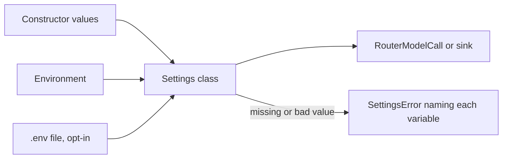

Each part of the library that needs a key or a URL reads it through one settings class. Load them once at startup, so a missing key fails the deploy and not the first call.

On this page:

- [Check them at startup](#check-them-at-startup) - `check_settings`
- [How a value is read](#how-a-value-is-read) - the order and the errors
- [Every variable](#every-variable) - SLNG, Langfuse, Logfire, Coval
- [Flag variables](#flag-variables) - `env_flag`
- [A variable whose name comes from config](#a-variable-whose-name-comes-from-config) - `env_value`
- [Your own settings](#your-own-settings) - subclass `EnvSettings`
- [Every argument these functions take](#every-argument-these-functions-take) - signatures

## Check them at startup

```python agent.py
from pydantic import Field, SecretStr
from pydantic_settings import SettingsConfigDict
from unmute_core.model import OpenAIModelCall
from unmute_core.settings import EnvSettings, check_settings
from unmute_core.telemetry import Langfuse, LangfuseSettings


class ShopSettings(EnvSettings):
    """The settings of your own agent. Each variable starts with SHOP_."""

    model_config = SettingsConfigDict(env_prefix="SHOP_")

    openai_api_key: SecretStr = Field(description="Your OpenAI key.")
    model: str = "gpt-5.6-terra"


shop, langfuse = check_settings(ShopSettings, LangfuseSettings)

model = OpenAIModelCall(shop.model, api_key=shop.openai_api_key.get_secret_value())
sink = Langfuse.from_settings(langfuse)
```

If `SHOP_OPENAI_API_KEY` and `LANGFUSE_SECRET_KEY` are unset, `check_settings` raises one `SettingsError` that names both. The error lists every missing variable, so one deploy fixes them all.

The library's own classes work the same way. `LangfuseSettings` above is one. `SlngSettings` holds the variables of the SLNG Context Router. This is a router call with your own OpenAI key:

```python router.py
from pydantic import Field, SecretStr
from unmute_core.settings import check_settings
from unmute_core.slng import (
    OpenAIEndpoint,
    RouterConfig,
    RouterModelCall,
    SlngSettings,
)


class RouterSettings(SlngSettings):
    """The router settings, with your own OpenAI key."""

    model: str = "gpt-5.6-luna"
    openai_api_key: SecretStr = Field(min_length=1, validation_alias="OPENAI_API_KEY")

    def config(self) -> RouterConfig:
        """Return one model, on your OpenAI key."""
        endpoint = OpenAIEndpoint(
            url="https://api.openai.com/v1",
            api_key=self.openai_api_key.get_secret_value(),
        )
        return RouterConfig.single(self.model, endpoint)


(slng,) = check_settings(RouterSettings)

model = RouterModelCall(
    state.call,
    model=slng.model,
    config=slng.config(),
)
```

`RouterSettings` adds your OpenAI key to the SLNG settings. Each request carries your own router config with that key. See [Your router config](/core/reference/slng#your-router-config).

## How a value is read



1. A value passed to the constructor wins. `SlngSettings(model="m")` ignores `SLNG_MODEL`.
2. Otherwise the class reads the environment. An empty variable counts as unset.
3. A `.env` file is read only when you ask: `SlngSettings(_env_file=".env")`.
4. The settings feed a `RouterModelCall` or a sink. Secrets are `SecretStr`, so they never show in a log line or `repr`.
5. A missing or bad value raises an error that names every variable to fix. Each class raises its own subclass of `SettingsError`: `SlngConfigError` or `TelemetryConfigError`.

Nothing reads the environment when you import the library.

## Every variable

Copy this into your `.env.example`. A line that starts with `#` has a default.

```bash
# The SLNG API key.
SLNG_API_KEY=
# The world part whose router to use, like eu-north. Or set SLNG_ROUTER_URL.
# SLNG_WORLD_PART=
# The Context Router URL, like https://eu.context-router.slng.ai/v1. It wins over SLNG_WORLD_PART.
# SLNG_ROUTER_URL=
# The model name. slng/auto lets the router config pick and fail over.
# SLNG_MODEL=slng/auto
# The stored router config to use, when the key does not fix one.
# SLNG_LLM_CONFIG_ID=
# The Langfuse public key, pk-lf-...
LANGFUSE_PUBLIC_KEY=
# The Langfuse secret key, sk-lf-...
LANGFUSE_SECRET_KEY=
# The Langfuse host, like https://cloud.langfuse.com.
LANGFUSE_BASE_URL=
# The Logfire write token, like pylf_v1_eu_...
LOGFIRE_TOKEN=
# The Coval API key. Unset sends no spans to Coval.
# COVAL_API_KEY=
# The Coval simulation this call belongs to. Unset reads it from the call.
# COVAL_SIMULATION_ID=
```

`env_example(SlngSettings, LangfuseSettings, ...)` prints the same text for the classes your app uses. A test keeps this block in step with the classes.

| Class | Module | Variables |
|---|---|---|
| `SlngSettings` | `unmute_core.slng` | `SLNG_API_KEY`, `SLNG_WORLD_PART` or `SLNG_ROUTER_URL` (one is needed), `SLNG_MODEL` (default `slng/auto`), `SLNG_LLM_CONFIG_ID` |
| `LangfuseSettings` | `unmute_core.telemetry` | `LANGFUSE_PUBLIC_KEY`, `LANGFUSE_SECRET_KEY`, `LANGFUSE_BASE_URL` (or `LANGFUSE_HOST`) |
| `LogfireSettings` | `unmute_core.telemetry` | `LOGFIRE_TOKEN` |
| `CovalSettings` | `unmute_core.telemetry` | `COVAL_API_KEY`, `COVAL_SIMULATION_ID` (both may be unset) |
| `AgentSettings` | `unmute_core.state` | `UNMUTE_AGENT_ID`, the agent id a call takes when your code passes none. Without either, building the call state raises `SettingsError`. |
| `CallStartSettings` | `unmute_core.call` | `UNMUTE_CALL_START` (a JSON object, may be unset) |
| `DevSettings` | `unmute_core.dev` | `UNMUTE_DEV_METRICS` (an on/off word, off when unset). `unmute dev` sets it. `metrics_enabled()` reads it. |

The SLNG variables feed the optional [Context Router model call](/core/models/slng). The Langfuse, Logfire and Coval variables feed the [telemetry sinks](/core/observe/telemetry).

Some names are yours to pick, and the library reads them when it needs them, not through a settings class:

- `WebhookAuth(token_env=...)` reads its token on each webhook call, so a rotated token works without a restart. It uses `env_value` below. Like `credential_env`, it reads the exact name, in the case you wrote it.
- `save_call_start` reads `UNMUTE_CALL_START`, a JSON object like `{"customer_id": "c_42"}`, for a local run. The dispatch's values win over it, and `env=False` skips it. See [start values](/core/build/call-lifecycle). A value that is not a JSON object raises `SettingsError`.
- `KnowledgeBase(credential_env=...)` reads its embedding key when it starts.

The OpenTelemetry SDK reads `OTEL_EXPORTER_OTLP_*` for the `Otlp` sink itself.

## Flag variables

`env_flag` reads a variable that turns something on or off:

```python
from unmute_core.settings import env_flag

if env_flag("UNMUTE_LOCAL_RUN"):
    ...
```

1. `1`, `true`, `yes`, `y`, `on` and `t` mean on. `0`, `false`, `no`, `n`, `off` and `f` mean off. Case and spaces around the value do not matter.
2. An unset or empty variable gives `default`, which is `False` unless you pass one.
3. Any other word raises `SettingsError` and names the variable. The library does not guess.

`UNMUTE_DEV_METRICS`, which turns on dev records, reads the same words. A word it does not know logs a warning and counts as off, so a typo never breaks a call.

## A variable whose name comes from config

```python
from unmute_core.settings import env_value

token = env_value("ORDERS_TOKEN", str)  # the text, or None when unset or empty
retries = env_value("ORDERS_RETRIES", int)  # read as an int
```

1. `env_value(name, kind)` reads one variable and returns it as a `kind`.
2. An unset or empty variable gives `None`.
3. A value that is not a `kind` raises `SettingsError`.
4. Use it when the name is your own config, like a webhook's `token_env`. Use a settings class when the name is fixed.
5. The name is read exactly, and case matters. `orders_token` does not answer `ORDERS_TOKEN`. The same holds for `token_env` and `credential_env`.

## Your own settings

Subclass `EnvSettings` to get the same behaviour for your app's own names:

```python
from pydantic import Field, SecretStr
from pydantic_settings import SettingsConfigDict
from unmute_core.settings import EnvSettings


class SalonSettings(EnvSettings):
    model_config = SettingsConfigDict(env_prefix="SALON_")

    booking_api_key: SecretStr = Field(description="The booking system's API key.")
```

`check_settings(SlngSettings, SalonSettings)` then names `SALON_BOOKING_API_KEY` with the rest.

## Every argument these functions take

### check_settings

<ParamField path="*classes" type="type[EnvSettings]" required>
  The settings classes the app needs, like `SlngSettings`. Returns one loaded object per class, in order. Raises `SettingsError` if any class is missing a value or holds a bad one.
</ParamField>

### env_flag

<ParamField path="name" type="str" required>
  The variable to read, like `UNMUTE_LOCAL_RUN`.
</ParamField>
<ParamField path="default" type="bool" default="False">
  The value when the variable is unset or empty. Keyword only.
</ParamField>

### env_value

<ParamField path="name" type="str" required>
  The variable to read, like `ORDERS_TOKEN`.
</ParamField>
<ParamField path="kind" type="type" required>
  The type to read it as, like `str` or `int`. Returns a `kind`, or `None` when the variable is unset or empty. Raises `SettingsError` when the value is not a `kind`.
</ParamField>

### env_example

<ParamField path="*classes" type="type[EnvSettings]" required>
  The settings classes to print. Each variable gets its field description as a comment. A required variable is left empty, and one with a default shows it commented out.
</ParamField>

## Where to go next

<CardGroup cols={2}>
  <Card title="SLNG" icon="brain" href="/core/models/slng">
    What the SLNG variables do in the Context Router call.
  </Card>
  <Card title="Telemetry" icon="activity" href="/core/observe/telemetry">
    The sinks that read the Langfuse, Logfire and Coval variables.
  </Card>
</CardGroup>
