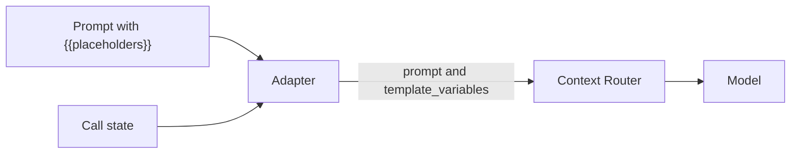
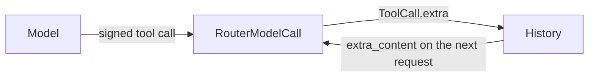

This page is the full detail behind [SLNG speech and the Context Router](/core/models/slng). Start there to add SLNG speech or the router to your agent.

## Speech and router in one session

```python agent.py
import os

from livekit.agents import AgentSession
from livekit.plugins import silero, slng

from unmute_core.livekit import ModelCallLLM
from unmute_core.slng import (
    OpenAIEndpoint,
    RouterConfig,
    RouterModelCall,
    tracking_ids,
)

# Your SLNG project's region, like eu-north.
world_part = os.environ["SLNG_WORLD_PART"]
config = RouterConfig.single(
    "gpt-5.6-luna",
    OpenAIEndpoint(
        url="https://api.openai.com/v1",
        api_key=os.environ["OPENAI_API_KEY"],
    ),
)
router = RouterModelCall(
    state.call,
    model="gpt-5.6-luna",
    config=config,
)

session = AgentSession(
    stt=slng.STT(
        api_key=os.environ["SLNG_API_KEY"],
        slng_base_url=f"{world_part}.api.slng.ai",
        model="soniox/speech-ai:rt-v5",
        language="en",
        **tracking_ids(state.call),
    ),
    llm=ModelCallLLM(router, state=state),
    tts=slng.TTS(
        api_key=os.environ["SLNG_API_KEY"],
        slng_base_url=f"{world_part}.api.slng.ai",
        voice="8d8aec63a56c460cb7def795bdf754fa",
        model="slng/fish/tts:s2.1-pro",
        language="en",
        **tracking_ids(state.call),
    ),
    vad=silero.VAD.load(),
)
```

Each request carries your own router config. It sends the model to OpenAI on your own `OPENAI_API_KEY`. The `SLNG_API_KEY` must come from a project on the Execution Layer. See [Your router config](#your-router-config).

Speech and the router send the same two ids: the agent's id and the call's session id, from `state.call`. SLNG groups usage by them. See [Agent and session ids](#agent-and-session-ids).

`SLNG_WORLD_PART` must be your SLNG project's region. Speech and the router both use it. `RouterModelCall` reads it from the settings. A key used in another region gets 401 from the router.

The three parts are independent. Use the SLNG speech plugins with your own LLM, or the router with your own speech plugins. The complete files are `examples/parcel-desk/livekit/agent.py` and `examples/parcel-desk/pipecat/bot.py`.

## Speech plugins

The speech plugins are separate packages: `livekit-plugins-slng` for LiveKit and `pipecat-slng` for Pipecat. The `slng` extra holds only what the router client needs.

`tracking_ids(state.call)` gives both plugins `external_agent_id` and `external_session_id`. Build the call state before the session or the pipeline, so the ids exist.

On LiveKit, call `stt.attach_to_session(session)` after you build the session. Put both services in the session or the pipeline.

STT and TTS spans carry `unmute.upstream.provider` when the provider is a gateway and the model id reads `[slng/]<upstream>/<model>`. For `soniox/speech-ai:rt-v5` the value is `soniox`, and for `slng/fish/tts:s2.1-pro` it is `fish`. A gateway is a provider that passes a request on to another one. `Telemetry(gateways=)` names them, and `openrouter` and `slng` are the default. A model id with no upstream part gives no attribute. The LiveKit SLNG STT plugin reports `slng` as its model, so its STT span has no upstream.

## The router adapters

The router is a [`ModelCall`](/core/models/model-call). Each framework runs it through a small adapter: `ModelCallLLM` on LiveKit, `ModelCallLLMService` on Pipecat.



1. The adapter sends the prompt with its `{{placeholders}}` still in it.
2. It sends the values of `state` beside the prompt, as `template_variables`.
3. The router fills the prompt. The model sees the same text it would see on a native LLM.
4. The router retries and fails over by its own rules.

Pass `state=None` when the prompt has no placeholders.

With `UnmuteAgent`, give the router to the agent's spec instead: `AgentSpec(PROMPT, model=router)`. On Pipecat, `UnmuteFlows` sends the requests through the `ModelCallLLMService`. Build the router and the spec per call, after the state, because the router reads `state.call`. See [AgentSpec](/core/reference/agent-spec).

`ModelCallLLM` is a real LiveKit `llm.LLM`, so `AgentSession` accepts it. Its `site` attribute is the prompt site of the next request. A prompt site is the place where the prompt is used: the main prompt, or a task step. It starts as an empty string, the main prompt. Its `model` and `provider` come from the router, so spans show `slng/auto` and `slng`. On Pipecat, give `ModelCallLLMService` the usual `settings`. It builds no OpenAI client of its own.

## RouterModelCall

Sends each request to the SLNG Context Router. It needs the `slng` extra and raises `ImportError` with the install command when the extra is missing.

```python
from unmute_core.slng import RouterModelCall

router = RouterModelCall(
    state.call,
    model="gpt-5.6-luna",
    config=config,
    body={"reasoning_effort": "none"},
)
```

OpenAI refuses function tools with reasoning on `/v1/chat/completions`, and answers 400. The router sends the request there. So an agent with tools sends `reasoning_effort` `"none"`. An agent with no tools may leave it out.

- It sends `config` as `slng_config` with every request. See [Your router config](#your-router-config).
- It sends the prompt unfilled, with `{{a.b}}` written `{{a__b}}`.
- It sends the values as `template_variables`. The router fills the prompt.
- The `provider` attribute is `slng`. The `model` attribute defaults to `slng/auto`.
- `aclose()` closes the client only when the call built it. A client you pass in stays open.
- `last_response` holds the `x-slng-*` headers of the latest answer.
- A placeholder name whose router key is over 64 characters is refused when the agent is built. `RouterModelCall.variable_key_max` is 64. See [Placeholder names](/core/build/tasks/what-the-model-reads#placeholder-names).
- Each answer ends with its `Usage`.

Arguments left out are read from the `SLNG_*` settings. See [Settings](/core/reference/settings).

### RouterModelCall arguments

<ParamField path="call" type="CallInfo" required>
  What the call carries: pass `state.call`. Every request sends its `agent_id` and `session_id`. Anything else raises `TypeError`.
</ParamField>
<ParamField path="llm_config_id" type="str | None" default="None">
  The stored router config to use, when the key does not fix one. Falls back to `SLNG_LLM_CONFIG_ID`.
</ParamField>
<ParamField path="model" type="str | None" default="None">
  The model name. Falls back to the settings, then to `slng/auto`. A name that is not in the `config` raises `ValueError` when the config sets tiers.
</ParamField>
<ParamField path="base_url" type="str | None" default="None">
  The router's OpenAI-compatible URL, ending in `/v1`.
</ParamField>
<ParamField path="world_part" type="str | None" default="None">
  The world part whose router to use, like `eu-north`, when there is no `base_url`. It is checked by shape, as one DNS label, and read in lower case.
</ParamField>
<ParamField path="api_key" type="str | None" default="None">
  The SLNG key. Falls back to the settings.
</ParamField>
<ParamField path="config" type="RouterConfig | None" default="None">
  A router config sent with every request as `slng_config`. Always pass one. See [Your router config](#your-router-config).
</ParamField>
<ParamField path="pure_proxy" type="bool" default="False">
  Sends `slng_pure_proxy`: no cache, no prompt edits, the default tier only.
</ParamField>
<ParamField path="body" type="Mapping[str, Any] | None" default="None">
  Extra body fields for every request, like `reasoning_effort`. A request's `params` win over it. Its `template_variables` join each request's own, and the request's value wins on a shared name. Setting `slng_config`, `slng_pure_proxy` or `stream_options` here raises `ValueError`.
</ParamField>
<ParamField path="extra_headers" type="Mapping[str, str] | None" default="None">
  Headers for every request. They never replace the identity headers.
</ParamField>
<ParamField path="timeout" type="openai.Timeout | float" default="TIMEOUT">
  The client timeout. See [Token counts, timeouts and errors](#token-counts-timeouts-and-errors).
</ParamField>
<ParamField path="client" type="AsyncOpenAI | None" default="None">
  A ready client, for tests. The environment is then not read.
</ParamField>

A missing key, or neither a URL nor a world part, raises `SlngConfigError`.

### Agent and session ids

Every call has both ids in `state.call`. The router, SLNG speech-to-text and SLNG text-to-speech all send them.

- `agent_id` is required. Pass it to `CallInfo`, `call_info`, `sip_call_info` or `telephony_call_info`. Else the call takes `UNMUTE_AGENT_ID`. With neither, building the call state raises `SettingsError`.
- `session_id` is a fresh id per call, unless your dispatch passes one. It is the same on every turn and on both frameworks.
- Each id is 1 to 128 characters after stripping. It may not hold a comma, whitespace, `{`, `}` or `|`, and it must be printable ASCII. A bad id fails when the call state is built, not on the first request.

`RouterHeaders` builds the headers from these ids. `RouterModelCall` makes it for you.

## What each request carries

| Part | What it is |
|---|---|
| `X-Slng-Agent-Id`, `X-Slng-Session-Id` | From `state.call`. |
| `X-Slng-Llm-Config-Id` | From `llm_config_id` or the settings. A config in the request wins over it. |
| `X-Slng-Prompt-Site` | `task:<name>` while a task runs. None for the main prompt. |
| `X-Slng-Request-Id` | New for each request. The router logs it and sends it back. A failed request logs it too. |
| `extra_headers` | Your own headers. |
| `slng_config` | The `config`. |
| `slng_pure_proxy` | With `pure_proxy=True`. |
| `stream_options.include_usage` | Always on, so the answer ends with its token counts. |
| `template_variables` | The values the router fills the prompt with. At most 64 names. A name is 1 to 64 letters, digits or underscores. The router takes a value of at most 4000 characters, so `RouterModelCall` cuts a longer one to 4000 and logs a warning. A native model call cuts nothing. |

The site goes in a header so the router scopes its cache by prompt. The router judges which turns are repeatable, and some never cache. A site must be `task:` plus a lower snake case name of at most 64 characters, or `summary`, which goes out as `task:summary`.

Each answer logs one line at info level: `slng router: scope=<agent id> source=<source> layer=<layer> model=<model> request_id=<id>`. `layer` and `model` appear only when the router sends them.

## Your router config

A router config names the models the router may use, their weights, their fallbacks and the keys they run on. Send your own config with every request. Your provider keys go in it.

```python
import os

from unmute_core.slng import (
    OpenAIEndpoint,
    RouterConfig,
    RouterModelCall,
)

config = RouterConfig.single(
    "gpt-5.6-luna",
    OpenAIEndpoint(
        url="https://api.openai.com/v1",
        api_key=os.environ["OPENAI_API_KEY"],
    ),
)
router = RouterModelCall(
    state.call,
    config=config,
)
```

1. `RouterConfig.single` puts one model in tier 1 with weight 100. The endpoint holds your OpenAI key.
2. `RouterModelCall` sends the config as `slng_config` with every request.
3. A pinned `model` must be one of the config's models when the config sets tiers. `slng/auto` lets the router pick.

### Which key may send a config

The router accepts a `slng_config` only from an SLNG key in a project on the Execution Layer. Any other key gets 403 `project_mode_forbidden`.

### Why not the stored config

The router also keeps a config for your org or key. Do not rely on it. A request with no `slng_config` uses the stored config. When that config does not select the request's model, the router answers 400:

```text wrap
model "gpt-5.6-luna" is not selected by this org's default router config
```

Your config also lays over the stored one, one top-level field at a time. A field you leave out keeps its stored value. So always set `tiers`, as `RouterConfig.single` does.

### RouterConfig

<ParamField path="tiers" type="dict[Literal['1', '2', '3'], list[TierEntry]] | None" default="None">
  Tier to its models. `None` keeps the stored tiers.
</ParamField>
<ParamField path="default_tier" type="Literal[1, 2, 3] | None" default="None">
  The tier `slng/auto` uses when it does not pick one. `None` keeps the stored value.
</ParamField>
<ParamField path="cache_enabled" type="bool | None" default="None">
  Whether the router may answer from its cache. The router judges which turns are repeatable, and some never cache. `None` keeps the stored value.
</ParamField>
<ParamField path="slice_assistant_max_chars" type="int | None" default="None">
  The most characters of an earlier assistant reply the router keeps in the prompt, 1 to 10000. `None` keeps the stored value.
</ParamField>
<ParamField path="prewarm_cache_enabled" type="bool | None" default="None">
  Whether the router fills its cache ahead of requests. `None` keeps the stored value.
</ParamField>

Other fields are `None` by default, and `None` keeps the stored value:

```python
RouterConfig(
    disable_reasoning=True,
    pii_detection_enabled=True,
    pii_regex_packs=("global", "us"),
)
```

| Field | What it does |
|---|---|
| `cache_skip_numeric_enabled` | Skips the cache for requests that hold numbers. |
| `template_vars_strict` | Refuses a request that leaves a placeholder without a value. |
| `disable_reasoning` | Asks the model not to reason. |
| `pii_detection_enabled` | Looks for personal data. |
| `pii_regex_packs` | The pattern packs for personal data: `global`, `indian`, `european`, `us`. |
| `pii_ner_models` | The name-finding models: `gliner_multilingual`, `indic_ner`, `gliner_pii_en`, `gliner_multi_ar`. |
| `slng_flow` | A map of agent id to that agent's flow, the steps the router follows. Each key must be a valid agent id. |

`RouterConfig`, `TierEntry` and the endpoint classes are Pydantic models. `RouterConfig.model_validate(data)` reads a config from JSON or YAML data. A bad value raises a `ValidationError` that names the field. The config is checked when you build it:

1. A tier needs an entry with priority 0. A higher priority is a fallback.
2. The weights of one priority in one tier sum to 100.
3. A model appears once per tier.
4. An unknown field is refused. The JSON may be at most 256 KB.
5. Some request fields never reach the model: the Context Router drops them. They are fields like `api_base`, `api_key`, `metadata` or `extra_headers`, and any name that starts with `aws_`, `vertex_`, `azure_` or `watsonx_`. The library still sends them. It logs one warning per field name that says the router drops it. A tier entry's `kwargs`, `RouterModelCall(body=...)` and a request's `params` are all checked. `reasoning_effort`, `extra_body` and `extra_query` are not dropped.

### TierEntry

<ParamField path="model" type="str" required>
  The name a request may pin, like `gpt-5.6-luna`.
</ParamField>
<ParamField path="weight" type="int" required>
  Its share of the traffic of its priority, 1 to 100.
</ParamField>
<ParamField path="priority" type="int" default="0">
  0 is tried first. A higher priority is a fallback. The range is 0 to 100.
</ParamField>
<ParamField path="endpoint" type="Endpoint | None" default="None">
  Where the model runs. `None` uses SLNG's own deployment of the model.
</ParamField>
<ParamField path="kwargs" type="dict[str, Any] | None" default="None">
  Default request fields for this entry, like `{"temperature": 0}`. A request's own fields win.
</ParamField>

```python
from unmute_core.slng import RouterConfig, TierEntry

luna = TierEntry(model="gpt-5.6-luna", weight=70, endpoint=openai)
flash = TierEntry(model="gemini-flash", weight=30, endpoint=vertex)
haiku = TierEntry(
    model="claude-haiku", weight=100, priority=1, endpoint=bedrock
)
tier_1 = [luna, flash, haiku]
config = RouterConfig(tiers={"1": tier_1}, default_tier=1)
```

### Providers

| Class | `provider` | Fields |
|---|---|---|
| `OpenAIEndpoint` | `openai-compat` (default) or `openai-responses` | `url`, `api_key`, optional `model_id` and `auth_header` |
| `AzureEndpoint` | `azure` | `url` (the resource root), `api_key`, `azure_deployment`, `api_version`, optional `model_id` |
| `VertexEndpoint` | `vertex` | `vertex_credentials`, `vertex_location`, optional `vertex_project` and `model_id` |
| `BedrockEndpoint` | `bedrock` | `aws_access_key_id`, `aws_secret_access_key`, `aws_region`, `model_id`, optional `aws_session_token` and `aws_bedrock_runtime_endpoint` |

1. Field names are the router's own. A missing `provider` means `openai-compat`.
2. Unmute's validation has exercised the `openai` and `openai-compat` upstreams against the live router. `azure`, `vertex` and `bedrock` follow the router's published contract, and have not been run live there.
3. `auth_header` names the header the key goes in when it is not `Authorization: Bearer`. It can never be `Authorization`.
4. Every key is a secret. Neither `repr` nor a validation error shows it. Only the request body has it in clear. Never turn on the OpenAI client's debug logging (`OPENAI_LOG=debug`) with an inline config, because it prints request bodies.
5. On `AzureEndpoint`, the router ignores `model_id`. It is accepted so a stored config validates.
6. `vertex_credentials` takes a dict, or text. The text is the key's JSON, that JSON base64 encoded, or a path to the key file. `read_vertex_key(text)` does the same on its own.

```python
VertexEndpoint(
    vertex_credentials=os.environ["VERTEX_KEY"],
    vertex_location="europe-west4",
)
```

## Without the router

`OpenAIModelCall` is a native call for any OpenAI-compatible endpoint. It sends no SLNG header and no SLNG body field, and the library fills the prompt. See [OpenAIModelCall](/core/reference/model-call#openaimodelcall).

## Gemini thought signatures

Gemini 3 signs the first tool call of each reply. Through an OpenAI-compatible API, the signature comes as the call's `extra_content`:

```json
{
  "id": "c1",
  "type": "function",
  "function": {"name": "find", "arguments": "{}"},
  "extra_content": {"google": {"thought_signature": "..."}}
}
```

When the chat is sent again, each call must carry its signature back. Without it, Gemini 3 can refuse the request with a 400. The router passes `extra_content` through as it is, both ways.



1. `RouterModelCall` reads each call's `extra_content` into `ToolCall.extra`. A `ModelCall` of your own does the same.
2. The adapter keeps it with the call in the history. Each later request sends it back as the call's `extra_content`. Finish checks do too, and the finish a check chose keeps the check's own signature. So does an agent that takes the call with the full history, on a model of its own.
3. On LiveKit, it becomes `FunctionCall.extra`, which LiveKit sends back itself.
4. On Pipecat, the context keeps only a call's id, name and arguments. So `ModelCallLLMService.tool_extras` keeps the extras by call id and puts them back on each request, before the `before_model` hooks.
5. Both adapters send back only the `google`, `livekit` and `xai` keys, the ones LiveKit sends (`REPLAYED_PROVIDERS`). `replayed_extra(extra)` returns what goes back. A call with none of them goes back with no `extra_content`.
6. An `after_model` hook reads all the provider data the model sent, in `ToolCall.extra`. On Pipecat this needs a `ModelCallLLMService`. A native service keeps none.

For a Gemini model, `RouterModelCall` adds Google's placeholder, `skip_thought_signature_validator`, to an assistant message whose first call has no signature. A call the runtime makes itself, or one from another model, then passes. The model counts as Gemini when:

- the pinned `model` names Gemini,
- a model of the `config` names Gemini, or
- the history already holds a signature.

Under `slng/auto` with no config, the library cannot know the router picked Gemini until a signature comes back. A call the runtime adds before then, like a step's opening call, goes without the placeholder. An answer from the router's cache carries no signature. When the library knows the model is Gemini, the placeholder covers its calls on the next request.

`signed_tool_calls(messages, gemini=True)` applies the placeholder rule to any OpenAI-format chat, for a `ModelCall` of your own.

Gemini's OpenAI-compatible endpoint keeps only the last system message. The router folds the library's several system messages into one, so it avoids this limit. See [Gemini and several system messages](/core/reference/model-call#gemini-and-several-system-messages).

A native framework LLM keeps or drops signatures as its framework does. LiveKit's OpenAI-compatible plugins keep them. Pipecat's OpenAI services drop them, so reach Gemini 3 through `GoogleLLMService` or a `ModelCallLLMService`.

## Token counts, timeouts and errors

The router sends the token counts at the end of each answer. `RouterModelCall` yields them as a `Usage` event. The `llm` span shows them as `gen_ai.usage.input_tokens` and `gen_ai.usage.output_tokens`. On Pipecat, turn on usage metrics:

```python
params = PipelineParams(
    enable_metrics=True, enable_usage_metrics=True
)
PipelineWorker(pipeline, params=params)
```

The client never retries. The router fails over by itself. `RouterModelCall.aclose()` closes the client only when the call built it. The default timeout is 15 seconds to connect, then 5 seconds for each read, the first token included. Pass `timeout=openai.Timeout(...)` or a number of seconds above zero to change it. `timeout=0` is refused.

| Answer | What happens |
|---|---|
| 400, 401, 402, 413, 422 | The call stops. No other model fixes it. |
| 400 from OpenAI on a request with tools | The call stops. Reasoning is on. Send `body={"reasoning_effort": "none"}`. |
| 400 `model ... is not selected by this org's default router config` | The call stops. The request carried no config of its own. Pass `config=`. |
| 401 with a valid key | The call stops. `SLNG_WORLD_PART` is not your SLNG project's region. |
| 403 `project_mode_forbidden` | The call stops. The key's project is not on the Execution Layer, so it may not send a config. `RouterModelCall.stop_codes` holds this code, and `FallbackModelCall` reads it. |
| 429 | `FallbackModelCall` waits out a short `Retry-After`, then fails over. With `same_model_retries`, a 429 with no usable `Retry-After` retries the same call first. |
| 5xx, a timeout, a lost connection | `FallbackModelCall` tries the next call. |

## Where to go next

<CardGroup cols={2}>
  <Card title="SLNG speech and the Context Router" icon="router" href="/core/models/slng">
    Add SLNG speech or the router to your agent.
  </Card>
  <Card title="Model call reference" icon="book" href="/core/reference/model-call">
    ModelCall, ModelRequest, events and FallbackModelCall.
  </Card>
  <Card title="Settings" icon="settings" href="/core/reference/settings">
    The `SLNG_*` variables and how to check them at startup.
  </Card>
  <Card title="Telemetry" icon="activity" href="/core/observe/telemetry">
    Where the `llm` span and the router's headers show up.
  </Card>
</CardGroup>
