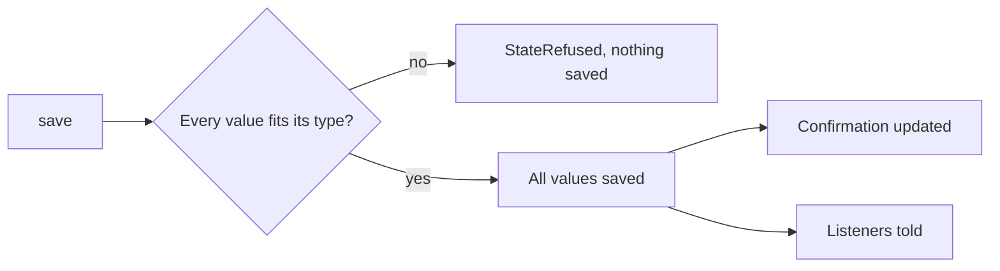
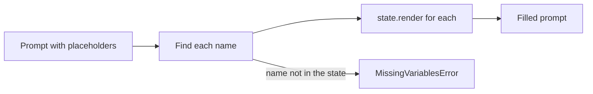

This page is the full detail behind [State](/core/build/state). Start there to define, save and read a call's values. Come here for every rule, argument and error.

## What it gives you

| On a call without it | What the library does |
|---|---|
| The model saves half of a batch, and the values no longer fit together. | The whole batch is checked first. One bad value refuses all of it. [How a save works](#how-a-save-works) |
| A bad value comes back as a bare validation error. The model cannot tell what to ask. | The refusal says what is wrong, like `caller_phone: expected a phone number with its country code`. The model asks the caller again. |
| "612 345 678" is saved, or a number that does not exist. | `Phone` cleans and checks the number and saves it in E.164. [Value types](#value-types) |
| A misheard value is treated as fact, and the model reads it back as true. | Only the confirming step can confirm a value. Until then, other prompts show `none recorded yet`. [Confirmation](#confirmation) |
| The caller fixes their number. The record looked up from the old one stays. | A value saved from inputs goes back to empty when an input changes. |
| `3.0` is read aloud as "three point zero". | Whole numbers read as `3`. [How a value reads in a prompt](#how-a-value-reads-in-a-prompt) |
| Your product lets users define agents, and needs its own type system. | `StateSchema` builds the State from type text like `Phone \| None`. [Building a State from type text](#building-a-state-from-type-text) |

## CallState

`unmute_core.state` holds what one call knows. It keeps typed values, whether the caller confirmed each one, and how each value reads in a prompt. It works on any Pydantic model.

```python state.py
from pydantic import BaseModel

from unmute_core.state import CallState, Phone


class State(BaseModel):
    caller_phone: Phone | None = None
    note: str | None = None


state = CallState(State, confirm={"caller_phone": "verify_phone"})

state.save({"caller_phone": "+34 612 345 678"}, step="verify_phone")
state.plain("caller_phone")  # "+34612345678"
state.is_confirmed("caller_phone")  # True, the confirming step saved it

state.save({"caller_phone": "+34 612 345 679"})
state.is_confirmed("caller_phone")  # False, another save must wait for the caller
state.render("caller_phone")  # "none recorded yet."
```

Every field needs a default, because every value starts the call empty. A field with no default raises `TypeError` when you build the `CallState`.

`state.names` lists the value names in the model's order. `state.name_set` gives the same names as a `frozenset`, for a quick membership test:

```python
"note" in state.name_set  # True
```

### Every argument CallState takes

<ParamField path="model" type="type[BaseModel]" default="NoValues">
  The Pydantic model class of the state. Every field needs a default. Anything else raises `TypeError`. The default, `NoValues`, is for an agent with no values.
</ParamField>
<ParamField path="confirm" type="Mapping[str, str] | None" default="None">
  Value name to the task step that must hear the caller agree to it.
</ParamField>
<ParamField path="dependencies" type="Mapping[str, Sequence[str]] | None" default="None">
  A looked-up value name to the value names it was looked up from.
</ParamField>
<ParamField path="call_start" type="Mapping[str, str] | None" default="None">
  Value name to `required` or `optional`, for the values a dispatch sets.
</ParamField>
<ParamField path="call" type="CallInfo | None" default="None">
  What the call carries, as `state.call`. None gives a web call with a new `session_id`. Build one with `call_info`, `sip_call_info` or `telephony_call_info`.
</ParamField>

Every call needs an agent id. Pass `agent_id` to `CallInfo`, `call_info`, `sip_call_info` or `telephony_call_info`, or set `UNMUTE_AGENT_ID`. With neither, building the call state raises `SettingsError`. See [Settings](/core/reference/settings).

## How a save works



1. `state.save(values)` checks the whole batch against the model first.
2. If one value is unknown, does not fit its type, or is longer than 64,000 characters, `save` raises `StateRefused`. Nothing from the batch is saved.
3. `StateRefused.message` is worded for the model, like `caller_phone: expected a phone number with its country code`. A task step shows it to the model, so the model can ask the caller again.
4. Otherwise every value is saved. Phone numbers, dates and the like are saved in their clean form.
5. Read `state.values` if you like, but never write to it. `save` is the one way in.

A value is saved by a task step, by [prefetch](/core/build/prefetch), by the model through the [`save_values` tool](#saving-values-no-task-saves), or by your own code calling `state.save`.

A task step may try to save before the caller said anything in it. The state keeps that save aside. It is a held save. When the call ends, the library decides whether to keep it. That decision is to settle it. [Held saves](/core/build/tasks/held-saves) explains how.

## Confirmation

`confirm` maps a value name to the task step that must hear the caller agree to it.

1. A value in `confirm` starts unconfirmed.
2. It becomes confirmed when its own step saves it with something in it.
3. Any other save of it makes it unconfirmed again. The caller must agree again.
4. `state.withdraw("verify_phone")` takes back every confirmation that step gave. The step runs again.
5. `state.is_confirmed(name)` is true when the value is filled and its confirmation stands.

`dependencies` covers a value that was looked up from other values: `CallState(State, dependencies={"customer": ["caller_phone"]})`. It is confirmed only while all of those values are filled and confirmed.

A dependent value that no step confirms reads empty in every prompt until its sources are confirmed. One that a step confirms reads in that step's prompt too.

A value saved by a prefetch `Lookup` also remembers what it was read from. When one of those inputs changes, the value goes back to its default. See [Prefetch](/core/build/prefetch).

## How a value reads in a prompt

`state.render(path, site="")` gives the text a prompt shows.

| Value | What `render` returns |
|---|---|
| Text | The text as it is |
| Anything else | Compact JSON, like `{"name":"Jo"}` |
| Empty, or waiting for the caller | `none recorded yet.` |
| An empty call-start value | Empty text |
| A long value | The whole value. Only a model call with its own limit, like the router, cuts it |

A value that waits for confirmation reads as empty. The one exception is the step that confirms it. Pass `site="task:verify_phone"` and that step sees the value, so it can read it back to the caller.

`state.plain(path)` gives JSON data instead of text. A date reads `"2026-10-02"`. A dotted path reads into a shape: `state.plain("customer.status")`. A path through an absent value gives `None`. A name the state does not hold raises `KeyError`.

`state.snapshot(site="")` gives every value as `render` does. The model call uses it to fill the prompt.

## Filling a prompt

```python
from unmute_core.model import render_prompt

prompt = render_prompt("Help the caller on {{caller_phone}}.", state)
```

The prompt names a value as `{{caller_phone}}`. A path into a shape is `{{customer.status}}`. The same path also reads `{{customer__status}}`, the form the SLNG Context Router reads.



1. Each `{{name}}` is found. Spaces inside the braces are fine: `{{ name }}`.
2. Each name is rendered with `state.render`. So a value that waits for confirmation reads `none recorded yet.`
3. A task step passes its own site, like `task:verify_phone`. A site is the place in the agent where a prompt is used: `task:<name>` for a task step, none for the main prompt. At its own site, the step sees the unconfirmed value.
4. The fill runs in one pass. A value that holds `{{x}}` is not filled again.
5. A saved value reaches the model whole. A native model call never cuts it.
6. A name the state does not hold raises `MissingVariablesError`. Its `names` list every missing name.

### render_prompt

<ParamField path="text" type="str" required>
  The prompt, with `{{name}}` placeholders.
</ParamField>
<ParamField path="state" type="CallState | None" required>
  The call state. None works for a prompt with no placeholders.
</ParamField>
<ParamField path="site" type="str" default='""'>
  The prompt reading the values, like `task:verify_phone`.
</ParamField>

Call `render_prompt` again after a save, so the prompt shows the new values. Two lower-level helpers, `template_variables(messages, state, site)` and `fill_messages(messages, variables)`, work on chat messages. They fill only system and developer messages.

### Which one to use

<CodeGroup>

```python LiveKit
from unmute_core.livekit import ModelCallLLM, UnmuteAgent

agent = UnmuteAgent(AgentSpec(PROMPT, tasks=plan), state=state)  # the session's LLM answers
llm = ModelCallLLM(model, state=state)  # a ModelCall answers
```

```python Pipecat
from unmute_core.pipecat import ModelCallLLMService, UnmuteFlows

llm = ModelCallLLMService(model_call, state=state)  # a ModelCall answers
flows = UnmuteFlows(AgentSpec(PROMPT, tasks=plan), llm=llm, state=state, ...)
```

```python Plain agent
instructions = render_prompt(PROMPT, state)  # a native LLM of your own
```

</CodeGroup>

With a `ModelCall`, the prompt stays unfilled in the request. The model call fills it, natively or through the router. The model reads the same final prompt either way. See [Model call](/core/models/model-call).

## Values the call starts with

```python
from unmute_core.call import save_call_start

state = CallState(State, call_start={"customer_id": "required", "brand": "optional"})
save_call_start(state, dispatched)
render_prompt("Welcome to {{brand}}.", state)  # "Welcome to Salon Sol." or "Welcome to ."
```

Every value a call starts with is a State value. `call_start=` names them, like `confirm=` does.

1. `required` means the call cannot start without it. `optional` means it may be missing.
2. `save_call_start(state, dispatched, *, env=True)` reads `state.call_start`.
3. `dispatched` is the `call_start` object a call is dispatched with. `UNMUTE_CALL_START` gives the same for a local run, and the dispatch wins. Pass `env=False` to read only the dispatch.
4. With a mapping, only those names are taken. A missing required name raises `CallStartError`.
5. Without a mapping, any State value may be set and none is required.
6. Other names are dropped, and the log names them. A value that does not fit raises `CallStartError`, and nothing is saved.
7. The origin kind of these saves is `call_start`.
8. A name in `call_start` that the model does not have raises `ValueError`. So does a rule other than `required` or `optional`, and a name that is also in `confirm`. The caller is never asked for a value the call starts with.

[The call's life](/core/build/call-lifecycle#start-values) shows where `save_call_start` runs.

### How they read

1. An empty call-start value reads `""` in a prompt. Other empty values read `none recorded yet.`.
2. An optional call-start value never refuses a tool. A `{{brand}}` in an argument, a locked argument or an announce line reads as empty text.
3. The save tool (`values_tool`) leaves call-start values out. A call that names one is refused with `brand is set when the call starts. It cannot change`.
4. `values_block` shows each one as "set when the call starts".

### In a schema

```python
{"name": "brand", "type": "str", "call_start": "optional"}
```

A `StateSchema` row has a `call_start` field: `"required"`, `"optional"` or none. `schema.call_start` gives the mapping, like `schema.confirm` does. Pass it on to `CallState`.

## Values the call carries: `state.call`

```python
state = CallState(State)
state.call.session_id  # one id for the whole call
state.call.calling_number  # "+34612345678", or None
render_prompt("The caller is {{call.calling_number}}.", state)
```

Every `CallState` holds one more value. Its name is `call`. It holds what the call itself carries: who is on it and how it came in. The library fills it. Your State class does not declare it. [State](/core/build/state#values-the-call-carries-state-call) lists its fields.

`CallState()` with no model works too. It uses `NoValues`, for an agent that has no values of its own.

More on the fields:

1. `session_id` is new for each call and never changes. It is the same on every turn, task and handoff, on LiveKit and on Pipecat.
2. `carrier_call_id` is not `session_id`.
3. The library saves `first_user_message` from what the caller said first, and `end_reason` as the call ends.
4. A withheld or malformed number reads as `None`. It is never an error.

### The three cases

1. **Inbound phone call.** The caller is `calling_number`. The agent's own number is `called_number`. `remote_number` is the caller.
2. **Outbound phone call.** The agent's own number is `calling_number`. The customer is `called_number`. `remote_number` is the customer.
3. **Web call.** `channel` is `web`. There are no numbers and no `direction`. The `session_id` is still set.

To try a phone call in a web session, give a `call` object in the call-start dispatch. `save_call_start(state, dispatched)` reads it, so your agent must call it:

```bash
UNMUTE_CALL_START='{"call": {"direction": "inbound", "calling_number": "+34612345678"}}' uv run python agent.py
```

1. On a web call, every field you give applies.
2. On a phone call, the line wins. Its own `channel`, `direction`, `calling_number`, `called_number` and `carrier_call_id` stay. The dispatch fills only the empty ones.
3. `agent_id` and `session_id` always apply.

### Where it reads

1. Python reads `state.call.calling_number`.
2. A prompt, a task text, a greeting, an announce line and a locked tool argument read `{{call.calling_number}}` and `{{call.session_id}}`.
3. An empty call value reads `""` in a prompt.
4. A tool that locks an empty call value is refused: `this tool reads call.carrier_call_id, which this call does not carry`.
5. `state.names`, `values_block`, `snapshot`, `save_values` and `state.dump()` leave `call` out.

### Read-only

Only the library writes `call`. `state.save({"call": ...})` is refused unless the save comes from the library.

A State value named `call` raises `ReservedNameError`. It is a `ValueError`. The same holds for a `StateSchema` variable, an alias, a `confirm`, `dependencies` or `call_start` rule, a task `assign` and a prefetch `assign`. The message says:

```text
... names 'call', which unmute-core reserves for what the call carries ...
```

**Fix:** rename your value, like `caller_phone`.

### Confirming the caller's number

`state.call` is read-only, so the caller cannot confirm it there. Copy it into your own value with a `CallValue` prefetch entry. Then confirm that value in `confirm=`.

```python
from unmute_core.prefetch import CallValue, Prefetch

class State(BaseModel):
    customer_phone: Phone | None = None

prefetch = Prefetch([CallValue("caller", "calling_number", ["customer_phone"])], state=State)
state = CallState(State, confirm={"customer_phone": "verify_phone"})
```

A step named `verify_phone` then asks the caller to agree. See [Prefetch](/core/reference/prefetch#callvalue).

## Saving values no task saves

Some values belong to no task. The model learns them in free talk. `values_tool` gives the model a `save_values` tool for those values. `values_block` writes the values block: a short system message that lists each value and what it holds now.

```python
from unmute_core.tools import values_block, values_tool

tool = values_tool(state, owners=plan_spec.owners())
values_block(state, owners=plan_spec.owners())
```

`values_block` gives text like this:

```text
Values of this call. Save new ones with save_values.
- name (The caller's name): Ana
- party: 2
- booking, saved by the task book_table: none recorded yet.
- brand, set when the call starts: Salon Sol
```

1. `values_tool` builds the `save_values` tool. Each free value is an optional argument that may be null.
2. `null` puts a value back to its default.
3. `owners` maps a value to the task that saves it. Use `TasksSpec.owners()`.
4. A value a task saves is refused with `<name> is saved by the task <task>. Start that task to change it`.
5. A call-start value is left out and refused too, with `<name> is set when the call starts. It cannot change`.
6. The tool returns `{"ok": true, "saved": {...}}`.
7. The tool saves the batch as a whole, like `state.save`. A value that does not fit refuses all of them.
8. If every value belongs to a task or to the call's start, there is nothing to save. `values_tool` raises `ValueError`. `free_values(state, owners)` lists the values left to save, so you can check first.
9. `AgentSpec(save_values=True)`, on either adapter, shows the block whenever State has values. It offers the `save_values` tool only when a value is free. With none free, the block's first line names no tool.

### values_tool

<ParamField path="state" type="CallState" required>
  The call state.
</ParamField>
<ParamField path="owners" type="Mapping[str, str] | None" default="None">
  Value name to the task that saves it.
</ParamField>
<ParamField path="name" type="str" default="save_values">
  The tool name.
</ParamField>

### values_block

<ParamField path="state" type="CallState" required>
  The call state.
</ParamField>
<ParamField path="owners" type="Mapping[str, str] | None" default="None">
  Value name to the task that saves it.
</ParamField>
<ParamField path="tool" type="str" default="save_values">
  The save tool's name, as the block names it.
</ParamField>

### Turn it on

[State](/core/build/state#saving-values-no-task-saves) shows `save_values=True` on `UnmuteAgent` and `UnmuteFlows`. On a plain LiveKit agent:

```python Plain LiveKit agent
from livekit.agents import Agent

from unmute_core.livekit import filled_llm, function_tools
from unmute_core.tools import ToolRegistry, values_tool

registry = ToolRegistry([values_tool(state)])


class Desk(Agent):
    def __init__(self) -> None:
        super().__init__(instructions=PROMPT, tools=function_tools(registry, state))

    async def llm_node(self, chat_ctx, tools, model_settings):
        async for chunk in filled_llm(
            self, chat_ctx, tools, model_settings, state=state, save_values=True
        ):
            yield chunk
```

1. `save_values=True` on the spec gives that agent the tool. An agent the call is handed to has its own `save_values`. Each main-agent model request ends with the block as its last system message. A step's request gets none.
2. `save_values=True` needs a state. Without one, `UnmuteAgent` and `UnmuteFlows` raise `ValueError`.
3. On a plain LiveKit agent, `filled_llm` runs the agent's own LLM plugin. It fills the prompt from the state on each request. With `save_values=True` it ends the request with the block.
4. On a plain Pipecat pipeline, give `tools_schema(registry, state)` to the context. Then `await fill_prompt(llm, worker, PROMPT, state, save_values=True)` before the pipeline runs. It sends the filled prompt as the service's system instruction, and sends it again after each save. See [Pipecat](/core/frameworks/pipecat).
5. `is_values(role, text)` from `unmute_core.tools` tells whether a message is that block. It is a `system` message that starts with the block's header. Use it to drop the old block from a chat before you add a new one.

## Building a State from type text

```python
from unmute_core.state import CallState, StateSchema

schema = StateSchema(
    [
        {"name": "caller_phone", "type": "Phone | None", "confirm": "verify_phone"},
        {"name": "contacts", "type": "list[Contact]", "description": "People to call back."},
        {"name": "note"},
    ],
    [
        {
            "name": "Contact",
            "fields": [
                {"name": "name", "type": "str"},
                {"name": "email", "type": "EmailStr"},
            ],
        }
    ],
)
state = CallState(schema.model, confirm=schema.confirm, call_start=schema.call_start)
```

`StateSchema(variables, shapes)` checks the rows and builds the Pydantic class. `schema.model` is that class. `schema.confirm` and `schema.call_start` are the maps for `CallState`. The class and a hand-written one run through the same `CallState`.

1. Every value starts empty. A list starts as `[]`. Anything else starts as `None`.
2. Empty text counts as no value.
3. A `Variable` holds `name`, `description`, `type` (text by default), `confirm` and `call_start`.
4. A `Shape` is a named group of fields, like `Contact`. Name a shape in the type text.
5. A field of a shape is required unless its type ends in `| None`.
6. A bad row raises `StateSchemaError` or a Pydantic error. It names the row and the fix.

### The type grammar

A type is plain Python type text. `parse_type("Phone | None").canonical` gives the one canonical spelling.

| Type text | Meaning |
|---|---|
| `str`, `int`, `float`, `bool` | The usual scalars. `string`, `integer`, `number` and `boolean` also work. A `float` refuses NaN and infinity. A text value is trimmed of spaces at both ends. |
| `Phone`, `Date`, `Time`, `Id`, `EmailStr` | The value types below |
| `Literal["new", "known"]` | One of the listed texts |
| `list[T]` | A list of `T` |
| `Contact`, `NameEmail` | A shape. `NameEmail` is built in. |
| `T \| None` | `T`, or nothing yet |

A type the grammar does not take raises `TypeTextError`. Its message says what to write instead. For example, `datetime` is refused. Write `Date` and `Time` as two fields.

## Value types

A model may also use these classes from `unmute_core.state` directly, as `State` does in the [CallState](#callstate) example.

| Type | Saved as | JSON Schema `format` |
|---|---|---|
| `Phone` | E.164 text, like `+34612345678` | `phone` |
| `Date` | `YYYY-MM-DD` text | `date` |
| `BirthDate` | `YYYY-MM-DD` text | `birth-date` |
| `Time` | `HH:MM` text on the 24-hour clock | `time` |
| `Id` | Text of letters, digits, and `. _ : -` | `id` |
| `Spelled` | The code as given, trimmed | `spelled` |
| `NameEmail` | A shape with `name` and `email` | none |

1. `Phone` drops spaces, dashes, dots and brackets. A leading `00` becomes `+`.
2. A phone number with no plus is saved only when one valid reading exists. The call's country can help. Enter `use_phone_region(...)` with the country the call is in. [Prefetch](/core/build/prefetch#what-a-call-carries) shows how.
3. A bad number is refused with a reason the model can act on. It may be too short, too long, or missing its country code.
4. `NameEmail` reads `Jo Bloggs <jo@example.com>` or a bare address. Paths read its parts: `{{contact.email}}`.
5. The `format` lets a tool schema or another reader name the type.
6. A bad `Id` is refused with the words: "expected an identifier: letters, digits, and then any of dot, dash, underscore or colon". An `Id` has at most 64 characters. The refusal shows no pattern.
7. A number sent to a text value is saved as its text. NaN and infinity are refused there too.
8. A whole float reads as an integer in a prompt, a tool result, a webhook URL placeholder and `CallState.snapshot()`: `3.0` renders as `3`. A locked argument that is a whole `"{{price}}"` still sends the float.
9. A choice (`Literal[...]`) is matched with the spaces around the answer and the choices ignored, so a padded answer still fits. The value saved is the choice as declared, `" small"` included.
10. Code says a `BirthDate` with its year and no weekday, like "June 5, 1979", and a `Spelled` code a character at a time, in groups, like "K P, 4 8 2, 9 1 3". A voice then reads each character on its own. Check a code's pattern with your own validator.
11. A variable name may start with an underscore or be a `model_*` name. It works as any other name, in the prompt, in a tool's arguments and in a task's saves.

## Listening to changes

```python
def show(event) -> None:
    for change in event.changes:
        print(change.field, change.value, change.confirmed, change.by.kind)


stop = state.listen(show)
state.save({"note": "call back"}, step="take_note")
stop()
```

1. A listener gets one `StateEvent` per save that changed something. A save that changed nothing sends nothing.
2. `event.changes` lists each value that changed. A change holds `field`, `value` as JSON, `confirmed`, and `by`.
3. `confirmed` is `None` for a value that never waits for the caller.
4. `by` is a `StateOrigin`. Its `kind` is one of nine: `step`, `prefetch`, `call`, `call_start`, `tool`, `event`, `withdraw`, `start` or `reset`. Any other kind raises a `ValidationError` when you build the origin.
5. `listen(listener, replay=True)` first sends the values already set, as one event of kind `start`.
6. A listener that raises is logged and removed. It never fails the save.

## Who supplies a value

When a tool needs a value that is not set, the refusal tells the model which task saves it. See [Tools](/core/reference/tools#a-call-that-is-refused). The state keeps that map in `state.suppliers`.

```python
state.set_suppliers({"caller_phone": "verify_phone"})  # value name to task or group
state.clear_suppliers()  # an agent with no tasks has no suppliers
```

1. `set_suppliers` replaces the earlier map. It does not merge.
2. The adapters call it when a task plan runs. You call it only when you build your own task host.
3. Write to the map only through these two methods.

## Troubleshooting

### TypeError when you build the CallState

The first argument is not a Pydantic model class, like `CallState(int)`. Or a field has no default. Every value starts the call empty.

**Fix:** pass your State class, or `schema.model`. Give each field a default.

```python
class State(BaseModel):
    note: str | None = None
```

### StateRefused from a save

A value is unknown, does not fit its type, or is too long. Nothing from the batch was saved. `StateRefused.message` says which value and why.

**Fix:** correct the value and save the batch again. In a task step, the model reads the message and asks the caller again.

### MissingVariablesError when a prompt fills

The prompt names a `{{name}}` the state does not hold. Its `names` list every missing name.

**Fix:** add the value to the model, or correct the name in the prompt.

### ValueError from values_tool

Every State value belongs to a task or to the call's start, so there is nothing to save. Only a direct `values_tool` call raises it. `AgentSpec(save_values=True)` shows the block and offers no tool instead.

**Fix:** build the tool only when a value is free, or use `save_values=True`.

## Where to go next

<CardGroup cols={2}>
  <Card title="State" icon="database" href="/core/build/state">
    Define, save, confirm and read a call's values.
  </Card>
  <Card title="Prefetch" icon="zap" href="/core/build/prefetch">
    Fill values before the greeting.
  </Card>
</CardGroup>
