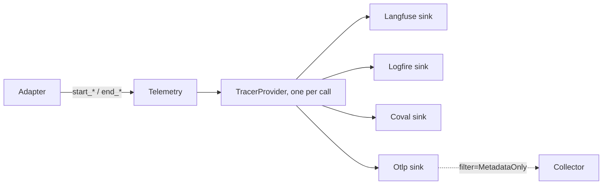
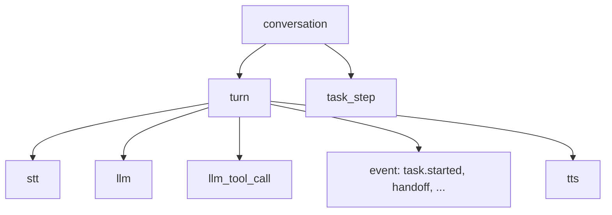

This page is the full detail behind [Telemetry](/core/observe/telemetry). Start there to send a call's spans somewhere. Come here to call the helpers by hand, write a sink, or read a span's attributes.

## How it works



1. The LiveKit or Pipecat adapter calls the `start_*` and `end_*` helpers on session events.
2. `Telemetry` owns one TracerProvider for the call. It stamps the call's identity on every span.
3. Each sink adds a batch processor and an OTLP/HTTP exporter to that provider.
4. A sink with `filter=MetadataOnly()` sends no text. It keeps only an allow-list of attributes.
5. `close()` ends the call span and flushes every sink.

## Telemetry

### Telemetry arguments

<ParamField path="*sinks" type="Sink" required>
  Where the spans go. Pass at least one.
</ParamField>
<ParamField path="agent" type="str" required>
  The agent's name. It is the trace name and the service name.
</ParamField>
<ParamField path="call_id" type="str" required>
  The call's ID, like the room or session ID. It is stamped on every span as `session.id`. An empty `agent` or `call_id` raises `ValueError`.
</ParamField>
<ParamField path="resource" type="Mapping[str, AttributeValue] | None" default="None">
  Extra resource attributes, like `deployment.environment.name`.
</ParamField>
<ParamField path="processors" type="Sequence[SpanProcessor]" default="()">
  Extra span processors that run before the sinks, for example one that adds your own attributes.
</ParamField>
<ParamField path="gateways" type="Set[str]" default='{"openrouter", "slng"}'>
  Providers that pass a request on to another provider named in the model id, like OpenRouter. A speech span for one of them records the provider behind it as `unmute.upstream.provider`. For `slng/fish/tts:s2.1-pro` the value is `fish`. Add your own gateway here. The default is `GATEWAYS`.
</ParamField>

### Call the helpers by hand

The adapters call these helpers for you. Call them yourself only on a framework the library has no adapter for.

```python agent.py
telemetry = Telemetry(Langfuse.from_env(), agent="salon", call_id=state.call.session_id)
telemetry.start_call()
telemetry.describe_call(origin="phone", framework="livekit")  # how the call arrived

turn = telemetry.start_turn(1)
telemetry.stt(text="Book me in", model="soniox/speech-ai:rt-v5", provider="slng", start_time=spoke_at)
llm = telemetry.start_model_request(
    model="gpt-5.6-terra", provider="openai", messages=messages, tools=tools, parent=turn
)
request_headers = telemetry.headers(llm)  # traceparent for the model request
telemetry.end_model_request(llm, tool_calls=calls, input_tokens=812, output_tokens=40, ttfb=0.31)
telemetry.event("task.started", {"task": "booking"})  # also: tasks.listen(telemetry.event)
tts = telemetry.start_tts(model="slng/fish/tts:s2.1-pro", provider="slng", voice=VOICE)
telemetry.end_tts(tts, text="Which day?", ttfb=0.12)
telemetry.end_turn(turn, user_text="...", agent_lines=["Which day?"], e2e=1.1)

await telemetry.close(state=call_state, reason="ended")  # ends the call, flushes
```

### Helpers

| Helper | Span it makes |
|---|---|
| `start_call()`, `describe_call(origin=, framework=)`, `close(timeout=, state=, reason=)` | `conversation` |
| `start_turn(number, parent=)`, `end_turn(span, ...)` | `turn` |
| `stt(text=, model=, provider=, start_time=, language=, ttfb=, parent=)` | `stt` |
| `start_model_request(model=, provider=, site=, messages=, tools=, parent=, started_at=)`, `end_model_request(span, ...)` | `llm` |
| `start_tool_call(name=, call_id=, arguments=, parent=)`, `end_tool_call(span, result=, error=)` | `llm_tool_call` |
| `start_tts(model=, provider=, voice=, parent=)`, `end_tts(span, text=, ttfb=, interrupted=, error=)` | `tts` |
| `start_task_step(task=, step=, parent=)`, `end_task_step(span, outcome=, saved=, error=)` | `task_step` |
| `event(name, data, parent=)` | one event span |
| `headers(span)` | none. Returns a `traceparent` for a model request. |

`close` waits up to 10 seconds by default (`CLOSE_TIMEOUT_SECONDS`) so a call that no simulation placed has time to be filed with Coval. It returns whether the flush finished.

Rules for the end helpers:

1. Latencies are in seconds. A missing, negative or infinite latency is left out, never sent as 0.
2. `error="<type>"` sets `error.type` and the span status to ERROR. On Pipecat, the `llm` span gets the error type of an `ErrorFrame` from the LLM service.
3. An attribute with no value is not set.
4. `gen_ai.provider.name` is lowercase, so one provider has one name on both frameworks.
5. A text attribute keeps up to 256 KiB, so a long prompt stays valid JSON.

`describe_call(origin=..., framework=...)` sets `unmute.call.origin` (`phone`, `browser` or `websocket`) and `unmute.call.framework` (`livekit` or `pipecat`) on the call span. Values given before `start_call` wait and are set when it starts. After the call span ended, it does nothing. The adapters stamp the framework themselves. `correlate_coval` sets the origin.

## On a plain agent

On LiveKit, `UnmuteAgent` traces the session for you. `trace_session` is for a plain `Agent`:

```python
from unmute_core.livekit import trace_session

trace = trace_session(session, telemetry, state)
```

A native LLM plugin on a plain `Agent` gets an `llm` span through `traced_llm`, which also fills `{{placeholders}}` from the trace's state. `tts` spans need a `tts_node` on your agent:

```python
class OrdersAgent(Agent):
    async def llm_node(self, chat_ctx, tools, model_settings):
        async for chunk in traced_llm(self, trace, chat_ctx, tools, model_settings):
            yield chunk

    async def tts_node(self, text, model_settings):
        async for frame in traced_tts(self, trace, text, model_settings):
            yield frame
```

`ModelCallLLM(model, trace=trace)` also gives an `llm` span when a `ModelCall` answers.

On Pipecat, leave Pipecat's own `enable_tracing` off, or the call is traced twice. Set `PipelineParams(enable_metrics=True, enable_usage_metrics=True)`, or the spans have no time to first byte and no tokens. `TelemetryObserver` logs one warning when these are not on.

### TelemetryObserver

<ParamField path="telemetry" type="Telemetry" required>
  The call's telemetry, with its call span started.
</ParamField>
<ParamField path="model" type="str" required>
  The model name the `llm` spans carry. After a handoff gives the next agent its own model call, its spans name that one.
</ParamField>
<ParamField path="provider" type="str" required>
  Who serves the model, like `openai`.
</ParamField>
<ParamField path="flows" type="UnmuteFlows | None" default="None">
  The call's tasks, which tell each request's prompt site.
</ParamField>

With a `ModelCallLLMService` in `flows`, the observer also sets the service's `trace_headers`. Each model request then carries a `traceparent`, so the router's spans join the call's trace. On Pipecat they are children of the turn span, not of the request's `llm` span. The observer gets frames through a queue, so the `llm` span may open after the request is sent.

## Sinks

| Sink | Sends to |
|---|---|
| `Langfuse` | `{base_url}/api/public/otel/v1/traces` |
| `Logfire` | `https://logfire-{us,eu}.pydantic.dev/v1/traces`. The token names the region. |
| `Coval` | `https://api.coval.dev/v1/traces`, after `activate()` or when the call is filed |
| `Otlp` | Any OTLP/HTTP endpoint, like an OpenTelemetry Collector |

Each of the first three has `from_env()` and `from_settings(settings)`. `from_env` raises `TelemetryConfigError` and names every missing variable. A missing Coval key only logs a warning. `LangfuseSettings`, `LogfireSettings` and `CovalSettings` read the same variables. Pass one to `from_settings` to load them at startup with `check_settings`, or to set values in code. Both methods take sink options too, like `Langfuse.from_env(filter=MetadataOnly())`. [Settings](/core/reference/settings) lists every variable.

### Sink arguments

<ParamField path="public_key" type="str" required>
  `Langfuse`. The project's public key.
</ParamField>
<ParamField path="secret_key" type="str" required>
  `Langfuse`. The project's secret key.
</ParamField>
<ParamField path="base_url" type="str" required>
  `Langfuse`. Like `https://cloud.langfuse.com`.
</ParamField>
<ParamField path="token" type="str" required>
  `Logfire`. A write token.
</ParamField>
<ParamField path="api_key" type="str | None" required>
  `Coval`. The Coval API key. `None` exports nothing.
</ParamField>
<ParamField path="simulation_id" type="str | None" default="None">
  `Coval`. The simulation ID for a local run. An adapter's `correlate_coval` reads it.
</ParamField>
<ParamField path="file_calls" type="bool" default="True">
  `Coval`. File a call no simulation placed as a Coval conversation at the end. `False` files nothing.
</ParamField>
<ParamField path="endpoint" type="str | None" default="None">
  `Otlp`. The full traces URL, like `http://collector:4318/v1/traces`. With none, the OpenTelemetry SDK reads its own `OTEL_EXPORTER_OTLP_*` variables.
</ParamField>
<ParamField path="headers" type="dict[str, str]" default="{}">
  `Otlp`. Extra HTTP headers, like an API key.
</ParamField>
<ParamField path="filter" type="MetadataOnly | None" default="None">
  Every sink. Lets only metadata through.
</ParamField>

### Datadog

Send the spans with an `Otlp` sink to an OpenTelemetry Collector. The Collector exports them to Datadog. The library needs no Datadog package.

```python
from unmute_core.telemetry import Otlp, Telemetry

telemetry = Telemetry(
    Otlp(endpoint="http://collector:4318/v1/traces"), agent="salon", call_id=state.call.session_id
)
```

A Collector config that receives OTLP over HTTP and exports to Datadog:

```yaml collector.yaml
receivers:
  otlp:
    protocols:
      http:
        endpoint: 0.0.0.0:4318
processors:
  batch:
exporters:
  datadog:
    api:
      key: ${env:DD_API_KEY}
      site: datadoghq.com
service:
  pipelines:
    traces:
      receivers: [otlp]
      processors: [batch]
      exporters: [datadog]
```

Set `site` to your Datadog site, like `datadoghq.eu`. Keep the API key in the Collector's environment, not in the agent. Add `filter=MetadataOnly()` to the `Otlp` sink to send no text.

### Coval

Coval needs to know which Coval run the call belongs to. Spans wait in memory, up to 1024, until `coval.activate(simulation_id=...)` or `coval.activate(conversation_id=...)`. Pass `method="dispatch_metadata"` or similar to record how the ID was found. It becomes `coval.correlation.method` on the call span. `activate` raises `ValueError` unless you pass exactly one of the two IDs. It raises `RuntimeError` when no `Telemetry` was built with the sink, or the call already has a Coval ID. It sends the held spans on the calling thread, so call it with `asyncio.to_thread` from async code.

An adapter finds the ID for you. Call `correlate_coval` once, with the sink the call's `Telemetry` was built with:

```python
from unmute_core.livekit import correlate_coval  # or unmute_core.pipecat

correlate_coval(ctx, coval, telemetry)  # LiveKit: the JobContext
correlate_coval(runner_args, coval, telemetry)  # Pipecat: the runner's arguments
```

On Pipecat, `runner_args` is Pipecat's `RunnerArguments`. It also tells `telemetry` how the caller arrived, with `describe_call(origin=...)`.

| | LiveKit | Pipecat |
|---|---|---|
| Where it looks, in order | The job's dispatch metadata (JSON, bad JSON is ignored), the simulation ID setting, then each remote participant's attributes | The WebSocket headers, the SIP headers of a dial-in body, the body, `call_data.body`, then the simulation ID setting |
| When it looks | Now, on `participant_connected` and on `participant_attributes_changed`, because a SIP participant joins late | Once, at the start |
| `origin` | `phone` when a SIP participant is in the room, `browser` for any other, nothing for an empty room | `phone` for a dial-in body or a carrier's WebSocket, `websocket` for a plain one, `browser` for WebRTC or a Daily room |

The ID is the `coval.simulation_id` key, or any key that ends in `x-coval-simulation-id`, in any case. `coval_simulation_id(mapping)` does the lookup. On LiveKit the first ID wins, and the sink activates once on a worker thread. On Pipecat it activates at once, on the calling thread.

A call that no simulation placed is filed when it ends. A real call or a local run then shows up in Coval's trace search.

1. `Telemetry.close()` flushes, then the provider shuts the Coval exporter down.
2. The exporter reads the transcript, the session ID, the agent name and the origin from the held call span. It merges consecutive lines of one speaker.
3. It posts them to `https://api.coval.dev/v1/conversations:submit` and waits at most 5 seconds.
4. With the conversation ID it sends every held span with the `X-Conversation-Id` header. The call span gets `coval.conversation_id` and `coval.correlation.method=conversation_submit`.

An adapter logs the two events with helpers you can reuse in your own adapter. `log_no_simulation(log, call="call")` says no simulation placed the call, so its trace is filed at the end. `log_activated(log, simulation_id, method, call=None)` says the sink is now bound to a simulation.

A failed submit logs a warning and never raises. The held spans are then dropped. A call is not filed, and the log says why, when:

- it already has a simulation or conversation ID,
- there is no Coval API key,
- the sink is `Coval(file_calls=False)`,
- the sink has a `filter`, because metadata only never sends the transcript,
- the call span has no transcript.

## Metadata only

```python
Otlp(endpoint="http://collector:4318/v1/traces", filter=MetadataOnly())
```

The filter does the following:

1. It keeps an attribute only if the key is on the list and the value is a number, a bool or a short safe string.
2. It renames any span not on the list to `operation`.
3. It drops events, link attributes and the status description.
4. It keeps only allowed resource keys.

### MetadataOnly arguments

<ParamField path="attributes" type="frozenset[str]" default="DEFAULT_ATTRIBUTES">
  Span attribute keys to keep. Pass `DEFAULT_ATTRIBUTES | {"my.key"}` to allow more.
</ParamField>
<ParamField path="span_names" type="frozenset[str]" default="DEFAULT_SPAN_NAMES">
  Span names to keep.
</ParamField>
<ParamField path="resource" type="frozenset[str]" default="DEFAULT_RESOURCE">
  Resource attribute keys to keep.
</ParamField>

`MetadataOnly` is a frozen Pydantic dataclass. A value of the wrong type raises a `ValidationError`.

`filter.apply(span)` filters one span. `filter.apply_all(spans)` filters a batch. The sink uses `apply_all` on each export. It builds the filtered resource once for each resource the spans share, so a batch of a call's spans costs less than one `apply` per span.

## Write a sink

`Sink` is the plug point for a new provider. Subclass it and return an exporter:

```python
from dataclasses import dataclass

from opentelemetry.exporter.otlp.proto.http.trace_exporter import OTLPSpanExporter
from opentelemetry.sdk.trace.export import SpanExporter

from unmute_core.telemetry import Sink


@dataclass(kw_only=True)
class MyVendor(Sink):
    api_key: str

    def exporter(self) -> SpanExporter:
        return OTLPSpanExporter(
            endpoint="https://otlp.example.com/v1/traces", headers={"x-api-key": self.api_key}
        )
```

The base class wraps the exporter in a batch processor, and in `filter` when one is set. Build sinks once per call, with the call's `Telemetry`.

`Sink` is a Pydantic dataclass. A stdlib `@dataclass(kw_only=True)` subclass, as above, works. So does a `pydantic.dataclasses.dataclass(kw_only=True)` subclass. With the Pydantic one, a field of the wrong type, like `api_key=3`, raises a `ValidationError` when you build the sink. The built-in sinks check their fields the same way.

## Span contract

Both adapters emit these spans through the helpers. Do not create them by hand.



1. `conversation` is the call. It starts a new trace. When it closes, its input is the transcript, one entry per line. Its output is how the call ended: `{"end_reason", "state", "confirmed"}`.
2. `turn` is one caller message and everything the agent does until the next one. Its output is every line the agent said, joined by a space. Only a turn where the agent speaks first has no caller input.
3. `stt` is one transcript. `tts` is one piece of speech.
4. `llm` is one model request: the prompt as filled, the tools offered, and the text and tool calls the model chose. `llm_tool_call` is one tool run.
5. An event span is one decision, like a task starting, a step skipped or a handoff. It has no length. Langfuse does not show OpenTelemetry span events, so each one is a span.
6. `task_step` sits under the call, not around turns. One turn can finish a task and start the next.

Every span also gets `session.id`, `gen_ai.conversation.id` (both the call ID) and `agent.name`. The resource has `service.name` set to the agent name.

<Accordion title="Attributes of each span">

| Span | Helper | Start attributes | End attributes |
|---|---|---|---|
| `conversation` | `start_call`, `describe_call`, `close` | `gen_ai.operation.name=invoke_workflow`, `langfuse.trace.name`, `unmute.call.origin` and `unmute.call.framework` (when `describe_call` set them) | `input.value` (transcript as JSON, one entry per line), `output.value` (end reason, final values and the confirmed ones, JSON), `unmute.call.end_reason`. Both adapters write the shared end reasons: `caller_hung_up`, `agent_ended`, `transferred`, `max_duration`, `idle`, `error` or `ended`. See [Why the call ended](/core/build/call-lifecycle#why-the-call-ended) |
| `turn` | `start_turn`, `end_turn` | `turn.number`, `gen_ai.operation.name=invoke_agent`, `gen_ai.agent.name` | `input.value` (caller), `output.value` (every agent line, joined), `turn.interrupted`, `turn.e2e_seconds` (the caller's end of speech to the agent's first audio, whether the model or code wrote the line), `turn.stt_final_seconds`, `turn.eou_seconds` (LiveKit only), `turn.llm_ttft_seconds`, `turn.tts_ttfb_seconds`, `turn.llm_requests` (the turn's model requests, 0 when code spoke the reply), `turn.llm_requests_cut` (the ones cut off, like a LiveKit preemptive request the caller spoke over) |
| `stt` | `stt` | `langfuse.observation.type=generation`, `gen_ai.operation.name=stt`, `gen_ai.provider.name`, `gen_ai.request.model`, `stt.language` | `output.value` (transcript), `metrics.ttfb` |
| `llm` | `start_model_request`, `end_model_request` | `gen_ai.operation.name=chat`, `gen_ai.provider.name`, `gen_ai.request.model`, `unmute.prompt.site`, `input.value` (messages as JSON, prompt filled), `gen_ai.tool.definitions` (tools offered, JSON) | `output.value` (text, or the assistant message with `tool_calls` as JSON), `gen_ai.usage.input_tokens`, `gen_ai.usage.output_tokens`, `gen_ai.response.finish_reasons`, `metrics.ttfb`, `langfuse.observation.completion_start_time`, `gen_ai.response.model` (the model call that answered, read at the end of the request, so a `FallbackModelCall` shows the call it moved to), `error.type` (when the request failed, also on Pipecat). A reply cut off before it finished adds `llm.interrupted`, `langfuse.observation.level=WARNING` and `langfuse.observation.status_message` |
| `tts` | `start_tts`, `end_tts` | `langfuse.observation.type=generation`, `gen_ai.operation.name=tts`, `gen_ai.provider.name`, `gen_ai.request.model`, `tts.voice` | `input.value` (text), `metrics.character_count`, `langfuse.observation.usage_details` (`{"characters": n}`), `metrics.ttfb`, `langfuse.observation.completion_start_time`, `tts.interrupted` |
| event | `event` | `langfuse.observation.type=event`, `unmute.event.name`, `input.value` (its data, JSON) | none |
| `llm_tool_call` | `start_tool_call`, `end_tool_call` | `gen_ai.operation.name=execute_tool`, `gen_ai.tool.name`, `gen_ai.tool.call.id`, `gen_ai.tool.call.arguments`, `function.name`, `tool_call_id`, `function.arguments` | `gen_ai.tool.call.result`, `tool.error` (0 or 1) |
| `task_step` | `start_task_step`, `end_task_step` | `unmute.task.name`, `unmute.task.step`, `input.value` | `unmute.task.outcome`, `output.value` (outcome and saved values, JSON) |

</Accordion>

<Accordion title="Where each adapter reads each span">

| Span | LiveKit | Pipecat |
|---|---|---|
| `conversation` | The agent's first `on_enter`. It ends when the session closes, which also flushes every sink. | `Telemetry.start_call()` and `close()` |
| `stt` | The caller's message, with its speech timings and STT model | Each `TranscriptionFrame` from the STT service |
| `llm` | `llm_node`, after the prompt is filled | `LLMContextFrame`, the service's system instruction, `FunctionCallsStartedFrame`. `gen_ai.request.model` is the model the request went to, read from the service's model call, not `TelemetryObserver(model=)` |
| `tts` | `tts_node` of the agent and of each step | `TTSStartedFrame` to `TTSStoppedFrame`, per context |
| `turn` | Starts at a caller message the trace has not seen. A model request carries it before LiveKit adds it to the chat. | Starts at `UserStartedSpeakingFrame`, a `TranscriptionFrame`, or an `LLMMessagesAppendFrame` with a user message (RTVI typed text) |
| event | `CallTasks.listen(telemetry.event)` and `hand_off` | the same, through `UnmuteFlows`. `flows.listen(sink)` adds another sink |
| `llm_tool_call` | `tool_execution_updated`: started and ended | `FunctionCallInProgressFrame` to `FunctionCallResultFrame` |
| `task_step` | The step loop, under the call | The step loop, under the call |

On LiveKit, STT is read from the caller's message, not from `stt_node`. Overriding `stt_node` would stop LiveKit reusing the STT stream each time a step starts. A subclass that overrides `tts_node` loses the `tts` spans unless it calls `super().tts_node(...)`. LiveKit's own spans stay off, and the adapter does not call `set_tracer_provider`.

</Accordion>

### What a tool span shows

A tool that takes no parameters shows `{}` as its input. A tool span's output is what the tool gave back, in three cases that need care:

1. A task call's span lasts the whole task. Its output is the task result the main agent reads, not Pipecat's first "running" result.
2. A step's closing tool shows what it really returned, like the customer record. The model reads only how the step ended, and the `task_step` span shows that.
3. A handoff shows `{"status": "handed off"}` on both frameworks. A step that hands off ends its `task_step` span with the outcome `handed_off`.

### Model requests that make no reply

Three kinds of model request make no reply. All are still `llm` spans in the turn they belong to.

1. A step's finish check. Its tools are only `finish` and `not_yet`, and a call is required. A `not_yet` is an answer, never run, so it has no tool span. A `finish` it chose runs as a tool, under the call id the check gave it.
2. The decision on a held save, made when the call ends. It sits in the last turn. LiveKit settles before it ends the turn, and a Pipecat host calls `flows.settle()` before the `EndFrame`. Its calls are answers too, never run.
3. A summary, for a handoff or a step with `history: summary`. Its site is `summary`, it offers no tools, and its output is the summary text.

See [Tasks](/core/build/tasks) and [Handoffs](/core/build/handoffs) for when each runs.

### When a turn starts and ends

A turn belongs to the caller until the agent says a line, starts speech or calls a tool. A model request alone does not count. A request cut off because the caller went on speaking leaves the rest of their words in the same turn. More caller input before that joins the open turn, like a caller who pauses mid-sentence. Caller input after that starts the next turn.

### Following the turns in your own adapter

```python
from unmute_core.telemetry import TurnEnd, TurnTracker

turns = TurnTracker(telemetry)
turns.start()  # the caller's words open a turn
turns.open()  # the agent does something: the turn is now answered
turns.caller_open  # True while a turn is open and the agent has not answered
end: TurnEnd = {"user_text": "Book me in", "agent_lines": ["Which day?"], "e2e": 1.1}
turns.end(**end)
```

Both adapters use `TurnTracker`. It numbers the turns and keeps the open `turn` span. You decide when a turn starts and what its text and latencies are.

<ParamField path="start" type="method">
  `start()`.
  Opens the next turn under the call and returns its span. End the earlier turn first.
</ParamField>
<ParamField path="open" type="method">
  `open(answering=True)`.
  Returns the open turn, or opens one when none is. It marks the turn answered unless you pass `answering=False`.
</ParamField>
<ParamField path="caller_open" type="bool">
  True while a turn is open and nothing the agent did has answered in it.
</ParamField>
<ParamField path="end" type="method">
  `end(**fields)`.
  Ends the open turn through `Telemetry.end_turn`. It does nothing when no turn is open.
</ParamField>
<ParamField path="TurnEnd" type="TypedDict">
  Names the fields of `end`: `user_text`, `agent_lines`, `interrupted`, `e2e`, `stt_final`, `eou`, `llm_ttft`, `tts_ttfb` and `error`. They are the same as the arguments of `end_turn`.
</ParamField>

### Events

The events are the task stages (`task.started`, `task.completed`, `task.refused_busy`, `group.step_skipped`, `task.handed_off` and the rest of `TaskStage`), `handoff` with `{"from", "to"}`, and the idle nudges (`idle_nudges.armed`, `idle_nudges.first.fired` and the rest). A nudge the model worded carries `{"generated": true}` in place of its text. The names are each agent's `AgentSpec.name`, else the call's `agent_id`, on both frameworks.

Coval shows `conversation`, `turn`, `llm` and `llm_tool_call` with their own colours and runs its built-in metrics on them. Langfuse and Logfire type spans from `gen_ai.operation.name`, not from the span name.

## Vendor names

The span contract above is neutral. A vendor's own names are added inside that vendor's sink, on a copy of each span just before export. No sink changes what another sink gets.

### Coval

Text keys move to the Coval name, so a large prompt is not sent twice. Other keys stay. A `metrics.ttfb` of zero or less is dropped, because Coval would average it as an instant answer.

<Accordion title="Coval names by span">

| Span | Coval name | From |
|---|---|---|
| `conversation` | `coval.call.origin` | `unmute.call.origin` |
| | `agent.provider` | `unmute.call.framework` |
| | `coval.agent_type=sip_inbound_voice` | only when the framework is `livekit` |
| | `coval.simulation_id` or `coval.conversation_id`, and `coval.correlation.method` | the sink's binding |
| `turn` | `turn.index` | `turn.number` |
| | `turn.user_transcript`, `turn.agent_transcript` | `input.value`, `output.value` |
| | `turn.interrupted` (1 or 0) | `turn.interrupted` |
| | `metrics.e2e_latency` | `turn.e2e_seconds` |
| | `vad.end_of_turn_delay` | `turn.eou_seconds` |
| `stt` | `transcript` | `output.value` |
| | `stt.providerName` | `gen_ai.provider.name` |
| | `stt.transcription_delay` | `metrics.ttfb` |
| `llm` | `input`, `prompt.message_count`, `prompt.messages_traced` | `input.value` |
| | `gen_ai.system_instructions` | the system messages in `input.value`, joined |
| | `tools` (names), `tool_count` | `gen_ai.tool.definitions` |
| | `output`, `response.length` | `output.value`, only when it is plain text |
| | `llm.finish_reason` | `gen_ai.response.finish_reasons`, else `tool_calls` or `stop` |
| | `llm.cancelled` (1 or 0) | `llm.interrupted` |
| `llm_tool_call` | `tool.result`, `tool.result.length` | `gen_ai.tool.call.result` |
| | `tool.latency_ms` | the span's start and end |
| `tts` | `transcript` | `input.value` |
| | `tts.characters_count` | `metrics.character_count` |

</Accordion>

Coval rejects an oversized batch with a 413, so text is cut. Most text keeps 1,024 characters. A prompt keeps 8,192. The system messages stay and the newest other messages fill the rest. `prompt.message_count` is how many there were, and `prompt.messages_traced` is how many were kept.

There is no `vad` span and no `transport` span. The turn carries `vad.end_of_turn_delay`, and the call span carries the origin and the correlation method, so they hold what those spans would say. The call span is still held until the ID is known.

### Logfire

`Logfire` adds `logfire.msg`, the row label: `turn: <first 80 characters of what the caller said>`, `chat <model>`, `tool <name>`, `stt <model>`, `tts <model>` and `call <session id>`. On a model request it also writes the messages under the GenAI names Logfire's LLM panel reads: `gen_ai.system_instructions`, `gen_ai.input.messages` (tool calls and tool replies as parts) and `gen_ai.output.messages`. `input.value` and `output.value` stay. With `filter=MetadataOnly()` the filter runs first, so only the labels go out.

## Where to go next

<CardGroup cols={2}>
  <Card title="Telemetry" icon="activity" href="/core/observe/telemetry">
    Send a call's spans to Langfuse, Logfire, Coval or Datadog.
  </Card>
  <Card title="Dev records" icon="monitor" href="/core/reference/dev-records">
    What one call did, for the local dev page.
  </Card>
</CardGroup>
