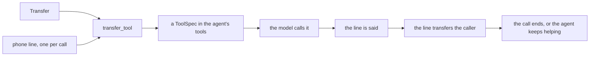

This page is the full detail behind [Phone calls](/core/telephony). Start there to take a call, place one or transfer a caller.

## How a transfer works



1. A `Transfer` says where the caller goes and what happens when nobody answers.
2. A phone line is the call's own leg. Build it per call, like `CallHooks`.
3. `transfer_tool` returns an ordinary tool. Hooks, spans, task tool lists and the end of the call treat it like any other tool. See [Tools](/core/build/tools).
4. The model calls it with no arguments. It never sees the destination.
5. The tool says its line first, like "Putting you through now, one moment." Once the transfer starts, the caller's speech cannot cancel it, on either framework. On LiveKit the line itself cannot be cut off either, and neither can the lines a `SipLine` says. On Pipecat the caller can still cut the line off. Build the user aggregator with `user_mute_strategies(protect=["tool_calls"])` to protect it.
6. The line transfers the caller. On success the call ends, with no model reply after it, and its end reason is `transferred`.
7. When nobody takes the transfer, `on_unavailable` decides:
   - `return_to_caller` is the default. The model reads why, like "The transfer failed (busy). Tell the caller and keep helping them."
   - `hangup` makes the line say `unavailable_line`, then the call ends. Write that line in the call's language.
8. A call with no phone leg, like a web call, tells the model so, and the agent keeps helping.
9. One transfer runs at a time per call. A second call of a transfer tool, the same one or another, tells the model one is already under way. After a transfer nobody took, the model may try again.

## Transfer

A frozen Pydantic dataclass.

<ParamField path="name" type="str" required>
  The tool's name, like `send_to_billing`.
</ParamField>
<ParamField path="destination" type="str" required>
  An E.164 number, or a `tel:`, `sip:` or `sips:` URI.
</ParamField>
<ParamField path="description" type="str" default="Transfer the caller to a human agent.">
  When the model should call it.
</ParamField>
<ParamField path="mode" type="cold | warm" default="cold">
  `cold` hands the caller's leg over. `warm` calls the person first and briefs them.
</ParamField>
<ParamField path="briefing" type="str" default='""'>
  Extra words for the person a warm transfer calls, after the chat. Only a warm transfer may set it.
</ParamField>
<ParamField path="ring_timeout_s" type="float | None" default="None">
  How long the destination may ring. `None` uses the carrier's default. It must be positive.
</ParamField>
<ParamField path="on_unavailable" type="return_to_caller | hangup" default="return_to_caller">
  What happens when nobody takes it.
</ParamField>
<ParamField path="announce" type="str | None" default="None">
  Said before the transfer starts. `None` uses the mode's line.
</ParamField>
<ParamField path="connected_line" type="str" default="CONNECTED_LINE">
  Said once a warm transfer has merged the calls.
</ParamField>
<ParamField path="unavailable_line" type="str" default="UNAVAILABLE_LINE">
  Said before hanging up, with `on_unavailable="hangup"`.
</ParamField>

A bad destination raises `ValueError`. A briefing on a cold transfer, or a warm transfer with a destination that names no one, raises `ValueError` that names the transfer. An unknown `mode` or `on_unavailable`, or a `ring_timeout_s` that is not positive, raises a `ValidationError` that names the field. An unknown argument raises `TypeError`.

### transfer_tool

Returns a tool that transfers the caller on this call's line. Build it per call.

<ParamField path="transfer" type="Transfer" required>
  Where to go, and what happens when nobody takes it.
</ParamField>
<ParamField path="line" type="PhoneLine" required>
  This call's phone line.
</ParamField>

A warm transfer on a line that cannot make one raises `ValueError`. The message says to run it on LiveKit SIP or make it cold.

`PhoneLine` is a protocol. The adapters ship `SipLine`, `TwilioLine`, `TelnyxLine` and `DailySipLine`. A line of your own must be hashable and weak-referenceable, as a plain class is. The library uses this to tell which lines have a transfer under way without keeping them alive. `transfer_tool` raises `TypeError` for a line that is not, like a class with `__slots__` and no `__weakref__`.

## Phone numbers

```python
from pydantic import BaseModel
from unmute_core.telephony import E164_PATTERN, E164Number, is_e164

is_e164("+34910000000")  # True
is_e164("0034910000000")  # False


class Callback(BaseModel):
    number: E164Number
```

An E.164 number is a plus, then 2 to 15 digits. The first digit is not 0.

### Phone number checks

<ParamField path="is_e164" type="method">
  `is_e164(value)`.
  Returns `True` or `False`. Any value that is not a string gives `False`.
</ParamField>
<ParamField path="E164Number" type="type">
  A type for a field of your own Pydantic model. A bad number raises a `ValidationError` that says to use a number like `+34910000000`.
</ParamField>
<ParamField path="E164_PATTERN" type="str">
  The pattern as text, `\+[1-9][0-9]{1,14}`. Use it where a regex string fits, like a JSON Schema `pattern`.
</ParamField>
<ParamField path="E164" type="re.Pattern[str]">
  The same pattern, compiled.
</ParamField>

`SipLine.dial` checks its number with `E164Number`.

## LiveKit SIP

### An inbound call

Your SIP trunk and dispatch rule put the caller in a room. Read what the call carries once the caller joins:

```python
participant = await ctx.wait_for_participant()
info = sip_call_info(participant, metadata, trunk_number=os.environ["SIP_NUMBER"])
state = CallState(State, call=info)
```

`sip_call_info` gives a `CallInfo`. Pass it to `CallState(call=...)`. Then `state.call.calling_number` is the caller. The room name is not stored. `trunk_number` is the agent's own number, when the participant does not report it. `agent_id` and `session_id` are also keywords. See [State](/core/build/state#values-the-call-carries-state-call).

The direction is `direction=` when you pass it. Else it is the metadata's `direction`. Else a SIP participant with the `sip.ruleID` attribute came in through a dispatch rule, so it is inbound. Else a job that names `phone_number` dials out. Any other call is inbound. A participant without `sip.ruleID` does not mean outbound by itself. A contradiction between these is not refused. Pass `direction="inbound"` or `direction="outbound"` when your dispatch knows it.

### SipLine

The SIP leg of one LiveKit call. Build one per call, once the session has started.

<ParamField path="session" type="AgentSession" required>
  The call's session.
</ParamField>
<ParamField path="trunk" type="str | api.SIPOutboundConfig | None" default="None">
  A stored outbound trunk id, or the trunk's settings sent with each dial. `None` leaves a warm transfer to `LIVEKIT_SIP_OUTBOUND_TRUNK`.
</ParamField>
<ParamField path="caller_id" type="str | None" default="None">
  The number the person called sees, like `+34910000000`.
</ParamField>

```python
trunk = api.SIPOutboundConfig(
    hostname=os.environ["SIP_ADDRESS"],
    auth_username=os.environ["SIP_USERNAME"],
    auth_password=os.environ["SIP_PASSWORD"],
)
```

### An outbound call

Dispatch the job with `phone_number` in its metadata. Start the session, then dial:

```python
line = SipLine(session, trunk=trunk, caller_id=os.environ["FROM_NUMBER"])
try:
    dialled = await line.dial(metadata["phone_number"], on_voicemail="leave_message")
except DialError as error:
    logger.info("nobody answered: %s", error.reason)  # busy, no answer, sip 503
    ctx.shutdown("dial failed")
    return
if not dialled.ended:
    greet(session, greeting, state)
```

1. `dial` checks the number is E.164, then calls it and waits for an answer.
2. LiveKit's answering machine detection holds the agent's speech until it knows who answered. It asks a model: `detector_llm`, else the session's LLM, else the agent's.
3. Voicemail hangs up, or leaves a message the model words. A full or missing mailbox hangs up. `ended` is then `True`. Pass `SipLine(session, call=call)` to note that end as `agent_ended` in the call's hooks.
4. A number nobody answers raises `DialError` with the `reason` and the `sip_status`.

#### SipLine.dial

<ParamField path="number" type="str" required>
  The number to call, in E.164. Anything else raises `ValueError`.
</ParamField>
<ParamField path="identity" type="str" default="phone_user">
  The participant identity the callee gets.
</ParamField>
<ParamField path="ring_timeout_s" type="float | None" default="None">
  How long it may ring. `None` is LiveKit's 30 seconds.
</ParamField>
<ParamField path="on_voicemail" type="hangup | leave_message" default="hangup">
  What to do on voicemail. The model words a left message.
</ParamField>
<ParamField path="detect_voicemail" type="bool" default="True">
  Run LiveKit's answering machine detection.
</ParamField>
<ParamField path="detector_llm" type="llm.LLM | str | None" default="None">
  The model that judges who answered.
</ParamField>
<ParamField path="participant_name" type="str" default='""'>
  The callee's display name in the room. Empty keeps LiveKit's.
</ParamField>
<ParamField path="display_name" type="str | None" default="None">
  The caller name the callee's phone shows. `None` keeps the trunk's.
</ParamField>
<ParamField path="metadata" type="str" default='""'>
  Metadata for the callee's participant.
</ParamField>
<ParamField path="attributes" type="Mapping[str, str] | None" default="None">
  Attributes for the callee's participant.
</ParamField>
<ParamField path="krisp" type="bool" default="False">
  Turn on Krisp noise cancellation for the callee.
</ParamField>
<ParamField path="audio_wait_s" type="float | None" default="None">
  Without detection, wait at most this long for the callee's audio track, then `AUDIO_SETTLE_S` (0.3 seconds) more, so the first word is not clipped. A timeout is logged and the dial goes on. `None` does not wait. With detection on it does nothing, because detection already listens.
</ParamField>

It returns a `Dialled` result. Greet the callee unless its `ended` is `True`.

### Cold transfer

The line sends a SIP REFER for the SIP caller in the room. A bare number becomes `tel:+34...`. A carrier that wants its host in the `Refer-To`, like Plivo, takes `sip:+34...@your-trunk` as written. The carrier must allow transfers on the trunk. On Twilio, that is "Call Transfer (SIP REFER)" with PSTN transfer turned on.

LiveKit can answer a REFER with a failed status instead of an error. The line checks the status, so that counts as a failed transfer too. An ongoing status counts as done. The caller is the session's own participant when it is a SIP one, else the first SIP participant in the room.

### Warm transfer

```python
ESCALATE = Transfer(
    "escalate",
    "+34910000000",
    mode="warm",
    briefing="Mention that the caller is a VIP.",
)
```

1. The caller hears hold music.
2. The agent calls the person and briefs them from the chat. The briefing persona is `BRIEFING_PERSONA`, and `briefing` is added after it.
3. The person says they are ready, and the calls merge. The agent says `connected_line` and leaves.
4. When the person declines, does not answer, or is a voicemail, the caller comes back to the agent.

Warm transfer uses LiveKit's `WarmTransferTask` from `livekit.agents.beta`. It merges the calls with `move_participant`, which only LiveKit Cloud and LiveKit Private Cloud have. A self-hosted LiveKit server cannot finish a warm transfer. Keep `RoomOptions(delete_room_on_close=False)`, the default, so the room outlives the agent.

## Pipecat on a carrier websocket

Pipecat's runner reads the carrier's first messages and builds the transport with the carrier's serializer. Read what the call carries from what it parsed:

```python
info = telephony_call_info(runner_args.call_data, trunk_number=os.environ["FROM_NUMBER"])
state = CallState(State, call=info)
```

It reads Twilio's TwiML parameters, and the `from` and `to` that Telnyx and Exotel send.

A carrier line carries 8 kHz audio. Set the pipeline's audio in and out sample rates to 8000 (`PipelineParams(audio_in_sample_rate=8000, audio_out_sample_rate=8000)`). The library does not build the pipeline, so it cannot set them for you.

Build the line once the worker exists:

```python
line = TwilioLine(
    info.carrier_call_id,
    account_sid=os.environ["TWILIO_ACCOUNT_SID"],
    auth_token=os.environ["TWILIO_AUTH_TOKEN"],
    worker=worker,
    serializer=serializer,
)
```

### TwilioLine

<ParamField path="call_sid" type="str | None" required>
  The Twilio call, from `state.call.carrier_call_id`.
</ParamField>
<ParamField path="account_sid" type="str" required>
  The Twilio account.
</ParamField>
<ParamField path="auth_token" type="str" required>
  Its auth token.
</ParamField>
<ParamField path="worker" type="PipelineWorker" required>
  The call's pipeline worker.
</ParamField>
<ParamField path="serializer" type="object | None" required>
  The call's serializer. Pass `None` only for a serializer built with `auto_hang_up=False`.
</ParamField>
<ParamField path="api_url" type="str" default="TWILIO_API">
  Twilio's REST API URL.
</ParamField>

The transfer replaces the call's TwiML with `<Dial answerOnBridge="true" timeout="25">`, then `<Hangup/>`. The stream closes and Twilio rings the person. The agent does not learn whether they answered.

### TelnyxLine

`TelnyxLine(call_control_id, api_key=..., worker=..., serializer=...)` takes the same `worker`, `serializer` and `api_url` as `TwilioLine`. Its `api_url` defaults to Telnyx's REST API. It sends Telnyx's transfer command with a ring timeout of at least 5 seconds, Telnyx's floor. Telnyx keeps the caller's leg when the person does not answer, and reports that later by webhook. So the tool counts an accepted request as done.

### The serializer

The Twilio, Telnyx and Plivo serializers hang up the call when the pipeline ends. After a transfer that would drop the caller you just handed over. So the line turns the hang-up off before it sends the transfer, and back on if the carrier refuses it.

### An outbound call

Your app asks the carrier to place a call that streams to the bot. For Twilio, send the stream's parameters in the TwiML, since Twilio does not fill `{{To}}` in inline TwiML:

```xml
<Response><Connect><Stream url="wss://your-bot/ws">
  <Parameter name="direction" value="outbound"/>
  <Parameter name="to_number" value="+34910000000"/>
</Stream></Connect></Response>
```

## Pipecat in a Daily room over SIP

```python
line = DailySipLine(transport, worker, sip_host=os.environ["SIP_ADDRESS"])
forward_dial_in(transport, body["call_sid"], account_sid=sid, auth_token=token)  # inbound
dial_out(transport, worker, "sip:+34910000000@trunk.example", call=call)  # outbound
```

`transport` is Pipecat's `DailyTransport`. `DailySipLine`, `forward_dial_in` and `dial_out` ask a type checker for that type.

1. `forward_dial_in` sends a Twilio call into the room once Daily gives the room's SIP address. It runs once.
2. `dial_out` calls a SIP address once the bot joins. When that leg ends, the pipeline is cancelled. Other legs of the room end nothing. Pass `call=` and the callee hanging up ends the call with `caller_hung_up`. A leg that failed is no hang-up.
3. `DailySipLine` asks Daily to call the person through your trunk, then waits until they answer, up to the ring timeout. A transfer nobody answers leaves the caller with the agent. Once the person answers, the agent leaves and Daily keeps bridging the two legs, so both are billed until the call ends. An event about the caller's own leg settles no transfer.

<ParamField path="transport" type="DailyTransport" required>
  The call's Daily transport.
</ParamField>
<ParamField path="worker" type="PipelineWorker" required>
  The call's pipeline worker.
</ParamField>
<ParamField path="sip_host" type="str" required>
  Your trunk's termination host. A number is dialled as `sip:<number>@<sip_host>`.
</ParamField>

## voicemail_tool

`voicemail_tool` gives a Pipecat model the `detected_answering_machine` tool. On a pipeline without `UnmuteFlows`, give the tool to the context's tools.

<ParamField path="on_voicemail" type="hangup | leave_message" default="hangup">
  What to do at a voicemail.
</ParamField>
<ParamField path="message" type="str" default="VOICEMAIL_MESSAGE">
  What the model is told to say with `leave_message`.
</ParamField>
<ParamField path="idle" type="IdleNudgeObserver | None" default="None">
  The call's idle nudges, held while the tool speaks.
</ParamField>
<ParamField path="call" type="CallHooks | None" default="None">
  The call's hooks, which note the end as the agent's own.
</ParamField>

## Where to go next

<CardGroup cols={2}>
  <Card title="Phone calls" icon="phone" href="/core/telephony">
    Take a call, place one, and transfer a caller.
  </Card>
  <Card title="Tools" icon="wrench" href="/core/build/tools">
    How a transfer tool fits the registry and its hooks.
  </Card>
</CardGroup>
