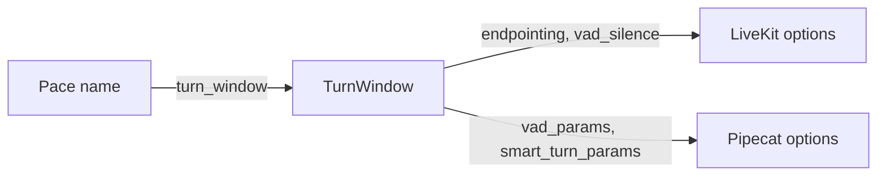
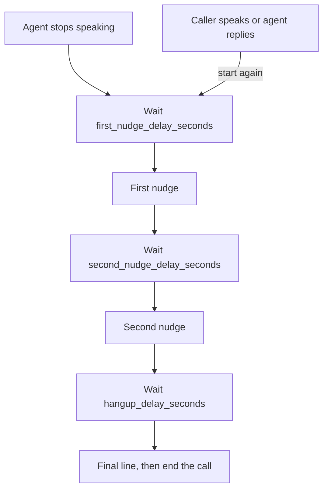

This page is the full detail behind [Turn taking](/core/build/turn-taking). Start there to set the pace, the interruption rule and the idle nudges. Come here for every argument, window and error.

## What it gives you

| On a call without it | What the library does |
|---|---|
| Callers get cut off mid-sentence, or wait too long for a reply. | Three paces, `snappy`, `balanced` and `patient`, set each framework's own timing. [Turn pace](#turn-pace) |
| The caller pauses, then goes on. The reply plays over them. | The reply is dropped. The next one answers everything they said. [When the caller goes on speaking](#when-the-caller-goes-on-speaking) |
| A "yes" or a cough cuts the agent off. | Keep short answers until the line ends, or stop only for real speech. [When the caller speaks over a line](#when-the-caller-speaks-over-a-line) |
| A quiet caller keeps the line open, or the agent asks "are you there?" during its own slow tool. | Up to two nudges, then a hang-up. The timer runs only while the agent listens. [When the caller goes quiet](#when-the-caller-goes-quiet) |
| A call that never ends keeps costing money. | `CallLimit` ends it. [Call length](#call-length) |

## All of it together

<CodeGroup>

```python LiveKit
from unmute_core.idle import IdleNudges
from unmute_core.livekit import endpointing, idle_nudges, interruption, yield_to_caller
from unmute_core.turn import turn_window

window = turn_window("balanced", "livekit")
session = AgentSession(
    ...,
    turn_handling=TurnHandlingOptions(
        endpointing=endpointing(window), interruption=interruption("keep")
    ),
    user_away_timeout=None,
)
yield_to_caller(session)
idle_nudges(session, IdleNudges(first_nudge_text="Are you still there?"))
```

```python Pipecat
from unmute_core.idle import IdleNudges
from unmute_core.pipecat import IdleNudgeObserver, interruption, smart_turn_params, vad_params
from unmute_core.turn import turn_window

window = turn_window("balanced", "pipecat")
vad = SileroVADAnalyzer(params=vad_params(window))
turn = LocalSmartTurnAnalyzerV3(params=smart_turn_params(window))
params = LLMUserAggregatorParams(
    user_turn_strategies=interruption("keep", stop=[TurnAnalyzerUserTurnStopStrategy(...)]),
)
worker.add_observer(IdleNudgeObserver(IdleNudges(first_nudge_text="Are you still there?"), worker))
```

</CodeGroup>

On Unmute, `conversation` and `models.turn.*.pace` in `agent.yaml` turn into these objects. See [How Unmute uses unmute-core](/core/start/unmute-and-core).

## Turn pace

A caller pauses mid-sentence. The pace says how long the agent waits before it decides the turn is over.



1. Pick a pace by name: `snappy`, `balanced` or `patient`. `TURN_PACES` lists them.
2. `turn_window(pace, framework)` returns the floor and ceiling that framework uses for the pace.
3. The framework's helper turns the window into its own options.

These windows are Unmute's measured ones. The pace is how long the caller may pause before the turn ends.

### turn_window

```python
from unmute_core.turn import turn_window
```

<ParamField path="pace" type="str | None" required>
  `snappy`, `balanced` or `patient`. None means `balanced`.
</ParamField>
<ParamField path="framework" type="livekit | pipecat" default="livekit">
  Whose window to return.
</ParamField>

A constraint error names the function and the field, like `1 validation error for turn_window`. A pace that is not one of the three raises `ValueError` with the text `turn_pace 'x' is not one of snappy, balanced, patient`. A framework that is not one of the two raises Pydantic's `ValidationError`, which is a `ValueError`.

### TurnWindow

A frozen Pydantic dataclass. A wrong type, or a `mode` other than `fixed` or `dynamic`, raises `ValidationError`.

<ParamField path="vad_silence" type="float" required>
  The floor. The silence the VAD waits before it says speech stopped and the end of turn model is asked.
</ParamField>
<ParamField path="min_delay" type="float" required>
  The shortest wait LiveKit's endpointing considers.
</ParamField>
<ParamField path="max_delay" type="float" required>
  The ceiling. The longest the agent waits for a caller the end of turn model thinks is not done.
</ParamField>
<ParamField path="mode" type="fixed | dynamic" default="fixed">
  LiveKit's endpointing mode. `dynamic` adapts inside the window to the pauses this caller leaves. Pipecat has no mode.
</ParamField>

### The windows

| Pace | LiveKit floor, min, max, mode | Pipecat floor and max |
|---|---|---|
| `snappy` | 0.25, 0.25, 1.2, dynamic | 0.2 and 1.2 |
| `balanced` | 0.3, 0.3, 1.6, dynamic | 0.2 and 1.6 |
| `patient` | 0.4, 0.5, 2.5, fixed | 0.2 and 3.0 |

`balanced` is the default pace. On Pipecat the floor stays at 0.2 seconds for every pace, so the pace moves only the ceiling.

`TURN_WINDOWS` in `unmute_core.turn` holds these numbers, by framework and then by pace. It is a read-only mapping, and assigning to it raises `TypeError`. To use other numbers, build your own `TurnWindow` or your own framework options. Do not edit the table.

### On each framework

`endpointing(window)` returns the window's ceiling as `TurnHandlingOptions(endpointing=...)`. Use `window.vad_silence` as Silero's `min_silence_duration`. On Pipecat the VAD waits a short, fixed silence, and the turn analyzer decides the rest within the ceiling. [Turn taking](/core/build/turn-taking#set-the-turn-pace) shows the code.

## When the caller goes on speaking

A caller pauses ("Hi." then "I'd like to book a haircut"). LiveKit ends their turn at the pause. If they go on before the reply plays, LiveKit still plays the reply, over them. `yield_to_caller` drops that reply. On Pipecat there is nothing to call: a new caller turn interrupts whatever the bot is thinking, saying or running.

Call `yield_to_caller` once, after building the session.

1. The caller speaks while the agent thinks, or the agent starts to think while the caller speaks. The reply is dropped.
2. The caller's words are already in the history, so the next reply answers all of them.
3. Audio that already plays is left to LiveKit's interruption settings.
4. A reply with a tool running is kept, because dropping it would cancel the tool.

### yield_to_caller

<ParamField path="session" type="AgentSession" required>
  The call's session.
</ParamField>

## When the caller speaks over a line

A "mm-hm" or a "yes" over the agent can mean "go on" or "that is my answer". The `interruption` rule picks which. It uses the same three names on both frameworks: `keep`, `drop` and `stop`. [Turn taking](/core/build/turn-taking#choose-what-speech-over-a-line-does) shows what each one does, and the code.

The details differ by framework:

- **LiveKit** uses its adaptive detector. It judges the sound. With `keep` or `drop`, the detector decides, and LiveKit drops a backchannel's words unless they ended in the line's last second. The detector runs on LiveKit's inference service. It needs `LIVEKIT_API_KEY` or `LIVEKIT_INFERENCE_API_KEY`. Without one, LiveKit falls back to `stop`, and the library logs a warning. That is why `keep` and `drop` differ there. With `stop`, the agent stops after half a second of speech. `keep` and `drop` ask for the detector. LiveKit turns the detector on by itself only in dev mode and for an agent deployed on LiveKit Cloud. In production, with no `interruption` set, LiveKit uses plain voice detection. That is the same as `stop`. So `drop` is not LiveKit's default in production. `keep` and `drop` set the detector on purpose.
- **Pipecat** has no detector, so `keep` counts words. A turn of fewer than 3 words waits for the line to end. A turn of 3 or more words stops the agent. "Yes, that's right" has 3 words and stops it. Chinese, Japanese and Thai have no spaces between words, so `word_count` counts them: one word for each 2 characters of Chinese or Japanese, and one for each 4 characters of Thai.

### InterruptionRule

`interruption(...)` on both frameworks checks its arguments with `unmute_core.turn.InterruptionRule`. Use the rule yourself to check numbers before you build the options. A frozen Pydantic dataclass.

```python
from unmute_core.turn import InterruptionRule

InterruptionRule("stop", min_speech_s=0.8)
```

<ParamField path="backchannels" type="keep | drop | stop" required>
  The rule.
</ParamField>
<ParamField path="min_words" type="int" default="0">
  Words the caller must say over the agent before it counts.
</ParamField>
<ParamField path="min_speech_s" type="float | None" default="None">
  Seconds of speech over the agent before it stops. It works with `stop` only.
</ParamField>
<ParamField path="min_words_floor" type="int" default="0">
  The lowest `min_words` the framework takes. It is 0 on LiveKit and 1 on Pipecat.
</ParamField>

It raises `ValueError` with a text that names the argument and the fix:

- `min_words must be 0 or more, got -1`, with the floor in place of 0.
- A `min_speech_s` below 0 raises a Pydantic `ValidationError`, which is a `ValueError`.
- `words already gate the turn, so min_speech_s applies to stop only`, when `min_speech_s` comes with `keep` or `drop`.

### word_count

`word_count(text)` from `unmute_core.turn` counts the words a caller said, also in a language written without spaces. A run of Chinese or Japanese counts one word for each 2 characters. A run of Thai counts one for each 4. The rest counts what spaces separate. The count for Chinese, Japanese and Thai is an average, not a word splitter. Pipecat's `interruption("keep")` uses it.

```python
from unmute_core.turn import word_count

word_count("Yes, that is right")  # 4
```

### interruption on LiveKit

It returns the session's `InterruptionOptions`. The floor for `min_words` is 0. With `keep` or `drop`, it needs `LIVEKIT_API_KEY` or `LIVEKIT_INFERENCE_API_KEY`. Without one it logs a warning, and LiveKit stops the agent on any speech, as `stop` does.

<ParamField path="backchannels" type="keep | drop | stop" required>
  The rule.
</ParamField>
<ParamField path="enabled" type="bool" default="True">
  False lets the agent finish every line, whatever the caller says.
</ParamField>
<ParamField path="min_words" type="int" default="0">
  Words the caller must say before speech counts as an interruption. 0 keeps LiveKit's default.
</ParamField>
<ParamField path="min_speech_s" type="float | None" default="None">
  Seconds of speech over the agent before it stops. It sets LiveKit's interruption `min_duration`, 0.5 seconds by default. A cough or a "mm" shorter than this does not cut the agent off. It works with `stop` only.
</ParamField>

It raises the `InterruptionRule` `ValueError` when `min_words` or `min_speech_s` is negative, or when `min_speech_s` comes with `keep` or `drop`. With those two, the detector already judges the sound.

### interruption on Pipecat

It returns `UserTurnStrategies`. Give them to `LLMUserAggregatorParams(user_turn_strategies=...)`. The floor for `min_words` is 1.

<ParamField path="backchannels" type="keep | drop | stop" required>
  The rule.
</ParamField>
<ParamField path="stop" type="Sequence[BaseUserTurnStopStrategy]" required>
  The stop strategies, like a `TurnAnalyzerUserTurnStopStrategy`.
</ParamField>
<ParamField path="min_words" type="int" default="3">
  Words over the agent that cut it off, for `keep` and `drop`. It must be 1 or more.
</ParamField>
<ParamField path="min_speech_s" type="float | None" default="None">
  Seconds of speech over the agent that cut it off, for `stop`. Speech that ends sooner does not cut the agent off. A cough holds nothing. A "mm" or a "yes" with words is kept: when the agent stops, those words start the caller's turn and reach the model. The VAD's own `start_secs` counts toward it. When the agent is silent, speech starts the turn at once.
</ParamField>

It raises the `InterruptionRule` `ValueError` when `min_words` is below 1, when `min_speech_s` is negative, or when `min_speech_s` comes with `keep` or `drop`. With those two, words already gate the turn.

On Pipecat, `keep` uses Pipecat's own start strategies and `drop` uses `MinWordsUserTurnStartStrategy`. `stop` keeps Pipecat's defaults.

### Turn off interruption or protect a line

Unmute's `conversation.interruption` has `enabled` and `minimum_words`. On LiveKit, `interruption("keep", enabled=False)` lets the agent finish every line. `interruption("keep", min_words=2)` needs two words before speech counts.

On Pipecat, `min_words` covers `minimum_words` and `user_mute_strategies` covers the rest:

```python
from unmute_core.pipecat import interruption, user_mute_strategies

LLMUserAggregatorParams(
    user_turn_strategies=interruption("drop", stop=[...], min_words=2),
    user_mute_strategies=user_mute_strategies(protect=["greeting", "tool_calls"]),
)
```

<ParamField path="enabled" type="bool" default="True">
  False mutes the caller while the agent speaks, so no line is cut off.
</ParamField>
<ParamField path="protect" type="sequence of greeting | tool_calls" default="()">
  What the caller cannot cut off while interruption is on. `greeting` is the agent's first line. `tool_calls` is a running tool.
</ParamField>

`user_mute_strategies` raises `ValueError` when `protect` comes with `enabled=False`, or names something else. On LiveKit, a greeting nobody may cut off is `Greeting(interruptible=False)`. A tool call that runs always finishes.

### What the trace shows

Each verdict is a `caller.over_agent` event in the trace.

- **LiveKit** records the probability the detector gave.
- **Pipecat** records `interruption: true` when the caller's turn starts over the agent. It records `false` when their words wait for the line to end.

A step's confirm line, like "Can you confirm your number is +34 671 51 01 03?", counts as heard when the caller cuts in after it said every value. LiveKit keeps the words that played, so a "yes, that's right" over the last word books. A cut before that asks again.

## When the caller goes quiet

`IdleNudges` holds up to three lines, each said after its own quiet. Any word from the caller, or any reply from the agent, starts again from the first one. The lines are spoken by code, so no model request is made. A nudge with no text is worded by the model. [Turn taking](/core/build/turn-taking#nudge-a-quiet-caller) shows the code on each framework.



1. After the agent stops speaking, it waits `first_nudge_delay_seconds`, then says the first line.
2. It waits again, says the second line, waits again, says the final line and ends the call.
3. Any caller transcript, interim ones too, starts again from the first line.
4. A nudge the model words (one with no text) runs the whole sequence too: the second nudge and the idle hang-up still come after it.

On LiveKit, leave `user_away_timeout` at `None`. LiveKit's own timeout never starts while a tool runs, and a task runs inside the tool that starts it. `idle_nudges` reads only the agent's state and the caller's words, so it keeps working in the middle of a booking.

On LiveKit, closing the session hangs up a phone caller only with `delete_room_on_close=True`. Without it, the caller stays on an empty line.

On Pipecat, leave the user aggregator's `user_idle_timeout` unset. The observer reads the agent's state from frames. The bot speaks between `BotStartedSpeakingFrame` and `BotStoppedSpeakingFrame`. It thinks from a model response's start, and while a tool call runs. The final step runs `worker.end()`, which drains the pipeline so the final line plays.

### IdleNudges

A frozen Pydantic model. It refuses unknown fields. A delay below 1 or a wrong type raises `ValidationError`, which is a `ValueError`.

<ParamField path="enabled" type="bool" default="True">
  Off keeps every timer still.
</ParamField>
<ParamField path="first_nudge_delay_seconds" type="float | None" default="15">
  Quiet before the first nudge, at least 1. None gives no nudges: the call ends after `hangup_delay_seconds` of quiet.
</ParamField>
<ParamField path="second_nudge_delay_seconds" type="float | None" default="30">
  Quiet after the first nudge, at least 1. None gives no second nudge: the hang-up wait follows the first.
</ParamField>
<ParamField path="hangup_delay_seconds" type="float | None" default="15">
  Quiet after the last nudge, at least 1. None never ends the call: the agent only nudges.
</ParamField>
<ParamField path="first_nudge_text" type="str | None" default="None">
  The first nudge, like "Are you still there?" Trimmed, 1 to 500 characters. None lets the model word it.
</ParamField>
<ParamField path="second_nudge_text" type="str | None" default="None">
  The second nudge. None lets the model word it.
</ParamField>
<ParamField path="final_hangup_text" type="str | None" default="None">
  Said just before the call ends. None ends it without a line.
</ParamField>
<ParamField path="nudge_instruction" type="str" default="GENERATED_NUDGE_INSTRUCTIONS">
  What the model is told for a nudge with no text. Write it in the language the model should answer in, or leave the English default.
</ParamField>

`IdleNudges` refuses these, with a `ValidationError`:

- Both `first_nudge_delay_seconds` and `hangup_delay_seconds` None is refused. Use `enabled=False`.
- With no first nudge, set `second_nudge_delay_seconds=None` and leave out the nudge texts.
- A second nudge text needs a second nudge delay.
- A final hang-up text needs a hang-up delay.

`GENERATED_NUDGE_INSTRUCTIONS` is the default `nudge_instruction`: "The caller went quiet. Briefly check whether they are still there." On Pipecat, the instruction goes into the context as a developer message.

### Nudge only, hang up only

```python
IdleNudges(first_nudge_text="Are you still there?", hangup_delay_seconds=None)  # nudge only
IdleNudges(first_nudge_delay_seconds=None, hangup_delay_seconds=40)  # hang up only
```

1. `hangup_delay_seconds=None` never ends the call. The agent only nudges.
2. `first_nudge_delay_seconds=None` says no nudge. The call ends after `hangup_delay_seconds` of quiet.

Unmute's `conversation.inactivity` maps like this:

| Unmute | `IdleNudges` |
|---|---|
| nudge and end | `first_nudge_delay_seconds=nudge_after`, `second_nudge_delay_seconds=None`, `hangup_delay_seconds=end_after - nudge_after` |
| nudge only | `hangup_delay_seconds=None` |
| end only | `first_nudge_delay_seconds=None`, `second_nudge_delay_seconds=None`, `hangup_delay_seconds=end_after` |

### idle_nudges and IdleNudgeObserver

Both return or hold an `IdleNudgeController`. Use its `suspend(reason)` and `resume(reason)` around something that must not draw a nudge. Calls nest.

<ParamField path="session" type="AgentSession" required>
  For `idle_nudges` on LiveKit: the call's session, before it starts.
</ParamField>
<ParamField path="config" type="IdleNudges | None" required>
  The lines and waits. None turns it off.
</ParamField>
<ParamField path="worker" type="PipelineWorker" required>
  For `IdleNudgeObserver` on Pipecat: the call's worker, which speaks the lines and ends the call. Pass it as the second argument, after `config`.
</ParamField>
<ParamField path="hangup" type="Callable[[], Awaitable[object]] | None" default="None">
  How to end the call. LiveKit uses `session.shutdown()` and Pipecat uses `worker.end()` when None.
</ParamField>
<ParamField path="on_event" type="Callable[[str, dict | None], None] | None" default="None">
  Called with each `idle_nudges.*` event, for the trace.
</ParamField>
<ParamField path="call" type="CallHooks | None" default="None">
  The call's hooks. With them, the hang-up is noted as `idle`, so the call's end reads `idle`. See [Why the call ended](/core/build/call-lifecycle#why-the-call-ended).
</ParamField>
<ParamField path="llm" type="LLMService | None" default="None">
  Pipecat only, on `IdleNudgeObserver`. OpenAI's realtime or live service that speaks itself says the lines and words the nudges in replies of its own.
</ParamField>

### IdleNudgeController

`IdleNudgeController(config, speak=..., hangup=..., on_event=None, sleep=asyncio.sleep, generate=None)` runs the nudges for one call. The two adapters build it for you. Build one yourself only for a framework the library does not wrap. Report each agent state change with `on_agent_state_changed(old, new)` and each caller transcript with `on_user_transcript(text)`. Call `close()` when the call ends.

It raises `ValueError` when a nudge has no text and there is no `generate`.

## Call length

`CallLimit` ends a call after a longest allowed length, with no closing line. The adapters wrap it as `max_duration` on each framework, on [LiveKit](/core/frameworks/livekit) and on [Pipecat](/core/frameworks/pipecat).

```python
from unmute_core.idle import CallLimit

limit = CallLimit(20 * 60, session.shutdown)
limit.start()
```

<ParamField path="seconds" type="float" required>
  The longest the call may run. It must be above zero, or `ValidationError` is raised. It is a `ValueError`, and its first line names `CallLimit` and the field.
</ParamField>
<ParamField path="end" type="Callable[[], Awaitable[object] | object]" required>
  Ends the call, like `session.shutdown`.
</ParamField>

`start()` begins the count and a second call does nothing. `cancel()` stops it. `running` is True from `start` until the call ends.

## Where to go next

<CardGroup cols={2}>
  <Card title="Turn taking" icon="mic" href="/core/build/turn-taking">
    Set the pace, the interruption rule and the idle nudges.
  </Card>
  <Card title="The call's life" icon="phone-call" href="/core/build/call-lifecycle">
    The greeting, the failure line and the end of the call.
  </Card>
</CardGroup>
