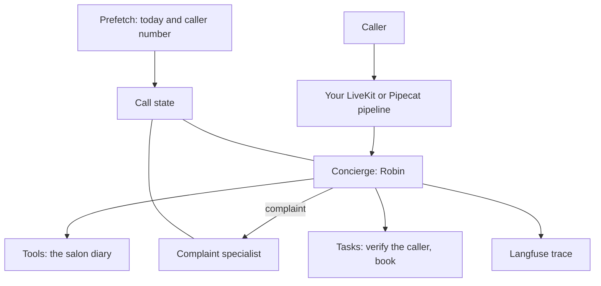

You will build one agent, step by step. It answers the phone for a hair salon called Sage and Stone. Each page adds one piece of unmute-core and ends with a call you can try.

The last page maps your code to a real example in the repository. CI runs that example on every change.

## The call

A caller phones the salon. The agent, Robin, answers.

1. The caller asks for a haircut on Friday. Robin checks the diary and offers times.
2. The caller gives their phone number. Robin saves it, reads it back and waits for a yes.
3. The caller picks a time. Robin asks "Shall I book it?" and books only after the caller agrees.
4. The caller says a colour went wrong. Robin hands the call to a complaint specialist, who takes it down.
5. The caller says goodbye. Robin says goodbye and hangs up.

## The finished agent



The agent lives in one framework-neutral package, `salon/`. It imports only unmute-core. The LiveKit file and the Pipecat file build the pipeline around it.

## What you need

- Python 3.12 and [uv](https://docs.astral.sh/uv/).
- An SLNG API key and its region, for speech. The pages use SLNG's Soniox speech to text and Fish Audio text to speech.
- An OpenAI API key for the model. Any LLM plugin works.
- For LiveKit, the [`lk` CLI](https://docs.livekit.io/home/cli/). Console mode needs no LiveKit server.
- For Pipecat, nothing more. The Pipecat runner serves a test page on your machine.
- Optional, for the last step: Langfuse keys.

Install the library with the extra for your framework.

<CodeGroup>

```bash LiveKit
uv add "unmute-core[livekit]" livekit-plugins-openai livekit-plugins-silero livekit-plugins-slng
```

```bash Pipecat
uv add "unmute-core[pipecat]" "pipecat-ai[openai,runner,silero,webrtc]" pipecat-slng
```

</CodeGroup>

## The files you will grow

```text
salon-agent/
  salon/
    pyproject.toml
    src/salon/
      state.py       what one call remembers
      store.py       the demo diary, copied from the example
      agent.py       prompt, tools, tasks, prefetch, idle nudges
  livekit/
    pyproject.toml
    agent.py         the LiveKit pipeline
  pipecat/
    pyproject.toml
    bot.py           the Pipecat pipeline
```

Package the `salon/` folder like the example does, and add it to each framework project as a path dependency. Copy the three `pyproject.toml` files from `examples/salon-concierge-unmute/` and keep only what you use. `store.py` is plain Python with no framework in it, so copy it too.

Code in `salon/` has no framework in it, so it has no tabs. Where LiveKit and Pipecat differ, a page shows one tab for each.

## The nine steps

| Step | You add |
|---|---|
| [Answer the phone](/core/tutorial/answer-the-phone) | The smallest agent, with a prompt and a greeting |
| [Remember the caller](/core/tutorial/remember-the-caller) | Call state, with a phone number that is checked |
| [Check the diary](/core/tutorial/check-the-diary) | A typed tool the model can call |
| [Book step by step](/core/tutorial/book-step-by-step) | A task and a group that cannot get stuck |
| [Hand off complaints](/core/tutorial/hand-off-complaints) | A second agent and the handoff to it |
| [Know the time](/core/tutorial/know-the-time) | Today's date and the caller's number, read before hello |
| [Quiet callers](/core/tutorial/quiet-callers) | Turn pace, idle nudges and a call time limit |
| [See every call](/core/tutorial/see-every-call) | One Langfuse trace per call |
| [What you built](/core/tutorial/what-you-built) | Your code next to the full example |

<Card title="Start with step 1: Answer the phone" icon="phone" href="/core/tutorial/answer-the-phone">
  The smallest agent that picks up and says hello.
</Card>
