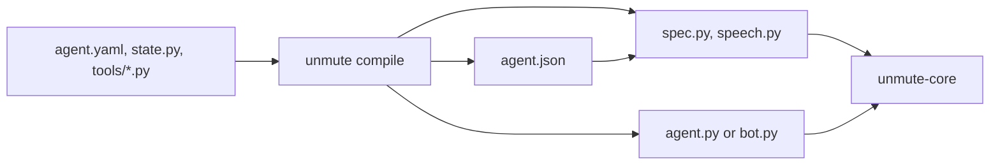

`version: 2` compiles a package onto [unmute-core](/core/start/why-unmute-core), the library that holds the
voice-agent behaviour LiveKit and Pipecat share. The model picks what to do. Code says
the lines that must be exact: read-backs, offers and receipts.

Every key of [version 1](/reference/agent-yaml) keeps its name and spelling. This page
lists what version 2 adds, what it reads differently, and what it does not compile yet.

## How a package compiles



1. You write `agent.yaml`, a `State` class in `state.py`, and typed tool handlers.
2. `unmute compile` writes `agent.json`, the package's data in the library's own names.
3. `spec.py` builds the library's objects from `agent.json` when the agent starts. A
   broken package fails then, never during a call.
4. `agent.py` (LiveKit) or `bot.py` (Pipecat) builds the pipeline around them.
   `speech.py` holds any speech model that is not SLNG's.

## Tools

A local tool names its Python function. Its input and output types come from the
function's signature, so a local tool file has no `input:` or `output:`.

```yaml tools/find_slots.yaml
description: Read the diary for a day.

local:
  handler: tools/salon.py:find_slots

inject:
  - customer_phone: "{{state.customer_phone}}"

# Saved on any result, before a reply reads it.
assign:
  - offer: result.offer

# Lines code says for a typed result. The first match speaks.
replies:
  - when:
      - offered:
          - true
    say:
      - "{{state.offer}}"
```

<ParamField path="local.handler" type="string">
  `file.py:function`. Its signature is the tool's input, its return type the output.
</ParamField>

<ParamField path="assign" type="list of key: path">
  State values the result saves, on any result. `+` appends, `?` allows absent.
</ParamField>

<ParamField path="replies" type="list of when and say">
  Lines code says when the result matches `when`. A field matches any value listed.
</ParamField>

<ParamField path="precheck" type="string">
  `file.py:function` run first. It returns an outcome to refuse, or `None` to go on.
</ParamField>

<ParamField path="hidden" type="list of string">
  Result fields the model never reads. Code can still save and say them.
</ParamField>

<ParamField path="announce_wait" type="boolean">
  Run the tool once its `announce:` line has played, like a goodbye before hanging up.
</ParamField>

A **webhook** tool keeps `input:` and `output:` as JSON Schema, and takes no `replies:` or
`precheck:`. Its URL is the `url_env` variable plus `path`. A **knowledge** tool and the
**`end_call` builtin** work as in version 1.

## Lines read only State

Every line code speaks, and every prompt, reads State: `{{state.x}}` and
`{{state.x.y}}`, plus `{{call.x}}` for what the call carries. A line never reads
`{{input.x}}` or `{{result.x}}`. Save the value to State first, and the compiler
rewrites the line to read it where it comes from.

## Steps

```yaml agent.yaml
      - name: manage_booking
        instructions: tasks/booking.md
        # Code calls the tool as the step opens, and says the offer.
        opens_with:
          tool: find_slots
          arguments:
            - service: requested_service
            - date: requested_day
          say:
            - "{{state.offer}}"
        tools:
          - find_slots
          - book_appointment
        finish:
          - tool: book_appointment
            success:
              - status:
                  - booked
            # Code reads this back. The tool runs on the caller's yes.
            confirm:
              - Shall I book your {{state.chosen_service}} for {{state.chosen_day}}?
            # Code says this once it succeeds. The step ends.
            say:
              - Lovely, you're booked for {{state.appointment.date}}.
        assign:
          - appointment: result.appointment
          - chosen_service: input.service
          - chosen_day: input.date
```

<ParamField path="finish[].confirm" type="list of string">
  Code reads the change back. The tool runs on the caller's yes.
</ParamField>

<ParamField path="finish[].say" type="list of string">
  Code says it when the tool succeeds, and the step ends.
</ParamField>

<ParamField path="replies" type="list of when and say">
  Lines code says for a step tool's result, before the tool's own.
</ParamField>

<ParamField path="opens_with" type="tool, arguments and say">
  A tool code runs as the step opens, with State values, and its `say:`.
</ParamField>

<ParamField path="opening: listen" type="listen">
  The step waits for the caller instead of asking a model first.
</ParamField>

<ParamField path="assign: x: input.p" type="key: input.path">
  Saves the closing tool's input, so a read-back can say it.
</ParamField>

<ParamField path="handoffs" type="list of string">
  Handoff tools the step offers too.
</ParamField>

A group takes typed `arguments:`, State values the agent passes as it starts the
group. `mode: record` makes each step save what the caller confirmed.

## Other keys

<ParamField path="entry_by" type="value and agents">
  Starts the call on the agent a State value names, read after the prefetch.
</ParamField>

<ParamField path="prefetch[].refuse_call" type="string">
  Refuses the call when that lookup finds nothing, with this line.
</ParamField>

<ParamField path="handoffs.*.saves" type="list of key: value">
  State values the handoff sets as the call moves.
</ParamField>

<ParamField path="handoffs.*.opens_with" type="tool and arguments">
  A tool of the next agent's, run in code as it takes the call.
</ParamField>

```yaml agent.yaml
entry_by:
  value: explanation
  agents:
    - EN: faro_en
    - ES: faro_es
```

An agent's language is its voice's `language:`, and its timezone is the clock
prefetch's `timezone:`. Code says dates in them.

## Models

| Role | Version 2 compiles |
|---|---|
| `think` | Google, OpenAI, and the SLNG Context Router |
| `speak`, `listen` | SLNG speech, and every provider the catalogue lists for the target |
| `realtime` | OpenAI's realtime model |
| `live` | OpenAI's live model, with the `think` model its `backend:` names |

`escalations:` transfer the caller on a phone line. A browser session needs no phone
route variable to start. `tracing:` compiles `langfuse`.

## Not compiled yet

| Key | Why |
|---|---|
| `mcp` and `slng` tools, builtins other than `end_call` | No unmute-core equivalent wired yet |
| A second idle nudge | One nudge and the end, as in version 1 |

## Test a package

A package with a `scenarios/` folder runs whole calls on the real model:

```bash
make e2e PKG=salon-concierge FW=livekit
```

See [`examples/salon-concierge`](https://github.com/slng-ai/unmute/tree/main/examples/salon-concierge)
for every key on this page in one agent.
