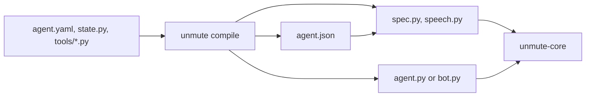

`version: 2` compiles a package onto [unmute-core](/core/start/why-unmute-core), the library that holds the
voice-agent behaviour LiveKit and Pipecat share. The model picks what to do. Code says
the lines that must be exact: read-backs, offers and receipts.

Every key of [version 1](/reference/agent-yaml) keeps its name and spelling. This page
lists what version 2 adds, what it reads differently, and what it does not compile yet.

## How a package compiles



1. You write `agent.yaml`, a `State` class in `state.py`, and typed tool handlers.
2. `unmute compile` writes `agent.json`, the package's data in the library's own names.
3. `spec.py` builds the library's objects from `agent.json` when the agent starts. A
   broken package fails then, never during a call.
4. `agent.py` (LiveKit) or `bot.py` (Pipecat) builds the pipeline around them.
   `speech.py` holds any speech model that is not SLNG's.

## Tools

A local tool names its Python function. Its input and output types come from the
function's signature, so a local tool file has no `input:` or `output:`.

```yaml tools/find_slots.yaml
description: Read the diary for a day.

local:
  handler: tools/salon.py:find_slots

with:
  - customer_phone: "state.customer_phone"
```

What happens around the tool is written once, on its entry in the top-level
`tools:` list of `agent.yaml`:

```yaml agent.yaml
tools:
  - name: find_slots
    # Saved on any result, before an outcome reads it.
    save:
      - offer: result.offer
    # Lines code says for a typed result. The first match speaks.
    outcomes:
      - if:
          - offered: true
        say:
          - "{{result.offer}}"
```

<ParamField path="local.handler" type="string">
  `file.py:function`. Its signature is the tool's input, its return type the output.
</ParamField>

<ParamField path="with" type="list of key: value">
  Arguments the model never sees. A value is `state.x`, a scalar, or a string with
  `{{state.x}}`.
</ParamField>

<ParamField path="precheck" type="string">
  `file.py:function` run first. It returns an outcome to refuse, or `None` to go on.
</ParamField>

<ParamField path="tools[].save" type="list of key: path">
  State values the result saves, on any result. `+` appends, `?` allows absent.
</ParamField>

<ParamField path="tools[].outcomes" type="list of if or else, and say">
  Lines code says when the result matches `if:`. A field matches any value listed. `else:`
  takes every other result. The first match speaks.
</ParamField>

<ParamField path="tools[].hidden" type="list of string">
  Result fields the model never reads. Code can still save and say them.
</ParamField>

<ParamField path="tools[].start" type="say and wait">
  `say:` is said as the tool starts. `wait: true` runs the tool once the line has
  played, like a goodbye before hanging up.
</ParamField>

A **webhook** tool keeps `input:` and `output:` as JSON Schema, and takes no `precheck:`.
Its URL is the `url_env` variable plus `path`. A **knowledge** tool and the
**`end_call` builtin** work as in version 1.

## Lines read what they have

A prompt and a greeting read State: `{{state.x}}` and `{{state.x.y}}`, plus
`{{call.x}}` for what the call carries. A line code says next to a tool reads one
more thing. A `confirm:` line reads the tool's `{{input.x}}`. An outcome's `say:` reads
the tool's `{{result.x}}`. No helper `save:` is needed to say a value.

## Steps

```yaml agent.yaml
      - name: manage_booking
        prompt: tasks/booking.md
        # Code calls the tool as the step opens, and says the offer.
        start:
          call: find_slots
          with:
            - service: state.requested_service?
            - date: state.requested_day?
        tools:
          - name: find_slots
            outcomes:
              - if:
                  - offered: true
                say:
                  - "{{result.offer}}"
          - name: book_appointment
            # Code reads this back. The tool runs on the caller's yes.
            confirm:
              - Shall I book your {{input.service}} for {{input.date}}?
            outcomes:
              # Code says this once it succeeds. The step ends.
              - if:
                  - status: booked
                save:
                  - appointment: result.appointment
                say:
                  - Lovely, you're booked for {{result.appointment.date}}.
                then: done
              - else:
                say:
                  - That did not go through. Shall I try another time?
        handoffs:
          - to_complaints
```

<ParamField path="tools[].confirm" type="list of string">
  Code reads the change back. The tool runs on the caller's yes.
</ParamField>

<ParamField path="tools[].outcomes" type="list of objects">
  What the step does with each result: `if:` or `else:`, then `save:`, `say:` and
  `then:`. An outcome that says `then: done` ends the step, and `then: failed` fails it.
  Without `then:` the step goes on. The rules are in
  [Say what success looks like](/build/orchestration/tasks#say-what-success-looks-like).
</ParamField>

<ParamField path="start" type="say, listen, call and with">
  What the step does as it opens. `call:` runs a tool with State values from `with:`.
  `listen: true` waits for the caller instead of asking a model first.
</ParamField>

<ParamField path="save" type="list of key: path">
  What the step saves when it ends. A `then: done` outcome without its own `save:` saves
  these from the tool's result. `x: input.p` saves the closing tool's input.
</ParamField>

<ParamField path="handoffs" type="list of string">
  Handoff tools the step offers too.
</ParamField>

A flow takes `fills:`, State values the agent passes as it starts the
flow. Each step saves what the caller confirmed, and hands it to the agent.

## Other keys

<ParamField path="entry_by" type="value and agents">
  Starts the call on the agent a State value names, read after the prefetch.
</ParamField>

<ParamField path="prefetch[].refuse_call" type="string">
  Refuses the call when that lookup finds nothing, with this line.
</ParamField>

<ParamField path="handoffs[].save" type="list of key: value">
  State values the handoff sets as the call moves.
</ParamField>

<ParamField path="handoffs[].start" type="call and with">
  A tool of the next agent's, run in code as it takes the call.
</ParamField>

```yaml agent.yaml
entry_by:
  value: explanation
  agents:
    - EN: faro_en
    - ES: faro_es
```

An agent's language is its voice's `language:`, and its timezone is the clock
prefetch's `timezone:`. Code says dates in them.

## Models

| Role | Version 2 compiles |
|---|---|
| `think` | Google, OpenAI, and the SLNG Context Router |
| `speak`, `listen` | SLNG speech, and every provider the catalogue lists for the target |
| `realtime` | OpenAI's realtime model |
| `live` | OpenAI's live model, with the `think` model its `backend:` names |

`transfers:` transfer the caller on a phone line. A browser session needs no phone
route variable to start. `tracing:` compiles `langfuse`.

## Twilio and SLNG read version 2

The `twilio` and `slng` targets read `version: 2` too, but they run it with their own
runtimes and without unmute-core. They refuse these keys at compile time, and the error
says to remove them or compile to livekit or pipecat:

- a tool entry's `save`, `outcomes`, `hidden` and `start: wait`, and a tool file's `precheck`;
- a step's outcomes without `then:`, a step `start:` with `call:`, and a step outcome with `confirm:`;
- `entry_by`;
- prefetch `refuse_call`;
- a handoff's `save` or `start`.

A step outcome with `then: done` and `say:` is refused on Twilio only. SLNG speaks the line itself.
Each target refuses more of its own: see [Twilio](/targets/twilio#what-the-package-may-carry)
and [SLNG](/targets/slng).

## Not compiled yet

| Key | Why |
|---|---|
| `mcp` and `slng` tools, builtins other than `end_call` | No unmute-core equivalent wired yet on livekit and pipecat. They still work on SLNG |
| A second idle nudge | One nudge and the end, as in version 1 |

## Test a package

A package with a `scenarios/` folder runs whole calls on the real model:

```bash
make e2e PKG=salon-concierge FW=livekit
```

See [`examples/salon-concierge`](https://github.com/slng-ai/unmute/tree/main/examples/salon-concierge)
for every key on this page in one agent.
