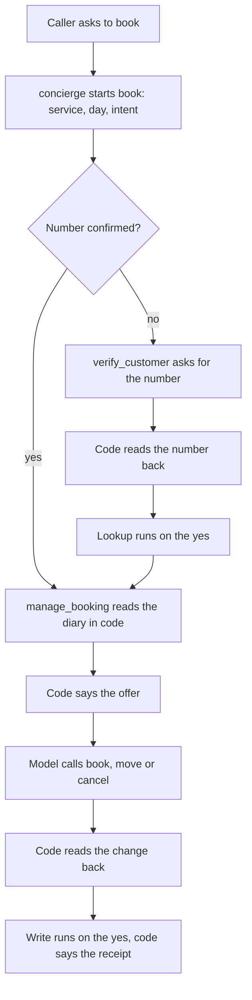

# salon-concierge

The full Sage and Stone Salon project, and the package to read when you want to
see every Unmute path working together in one agent.

The salon takes calls. The agent works out who is calling, books, moves and
cancels appointments, answers questions from the salon's own documents, writes
down complaints, and puts a caller through to a manager when they ask for one.

This example deliberately combines many features. Its variable count is not a
target to match: keep only the facts and saved results your own call needs.
See [choosing fewer variables](https://unmute.ai/build/variables#keep-only-the-values-the-call-needs).

On this page:

- [Quickstart](#quickstart) - validate, compile, talk
- [What you need](#what-you-need) - the values in `.env`
- [Structure](#structure) - what each path holds
- [The two agents and their tasks](#the-two-agents-and-their-tasks) - who does what
- [The booking flow](#the-booking-flow) - one group, two steps, one request per turn
- [Typed values and context](#typed-values-and-context) - what crosses a handoff
- [Before the greeting](#before-the-greeting) - the pre-fetch block
- [The manager transfer and the knowledge bases](#the-manager-transfer-and-the-knowledge-bases) - escalation and documents
- [Routes, tracing and the speech gateway](#routes-tracing-and-the-speech-gateway) - two telephony planes
- [Advanced](#advanced) - the dev page
- [Troubleshooting](#troubleshooting) - what goes wrong
- [Where to go next](#where-to-go-next) - harness and baseline

## Quickstart

Validate and compile:

```sh
unmute validate examples/salon-concierge
unmute compile examples/salon-concierge
```

The generated projects land in `build/livekit/` and `build/pipecat/`. Each one
has a `Dockerfile` and a `.env.example`. Do not commit `build/`, it is disposable.

Talk to it in the browser:

```sh
cp examples/salon-concierge/build/pipecat/.env.example examples/salon-concierge/.env
unmute dev examples/salon-concierge --target pipecat
```

Use `--target livekit` for the same conversation on the other target. Use
headphones, or the agent hears its own voice and interrupts itself. If your
worker image sets `HTTPS_PROXY`, also set `NO_PROXY=livekit_server` in it, so
the LiveKit worker reaches the local server directly.

## What you need

Keep every value in `.env`. No credential and no real phone number belongs in
the package.

| Name | Purpose |
|---|---|
| `OPENAI_API_KEY` | the knowledge embeddings at startup |
| `GOOGLE_API_KEY` | the reasoning model, on Vertex AI |
| `SLNG_API_KEY` | the voice and the transcription. One key for both |
| `LANGFUSE_SECRET_KEY`, `LANGFUSE_PUBLIC_KEY`, `LANGFUSE_BASE_URL` | trace ingest. All three together, or startup fails |
| `MANAGER_PHONE_NUMBER` | the transfer destination, in E.164. Needed only for a phone call |

Both targets reason on `gemini-3.1-flash-lite`, served by Vertex AI in `eu`,
with `thinking_level: MINIMAL` so there is no thinking before the first token.

Gemini 3.5 Flash-Lite held the slot for two days in September 2026 and came out
after one live call lost 18.5 seconds to two `MALFORMED_FUNCTION_CALL` aborts,
which is Gemini throwing away a turn whose tool call it emitted as plain text
rather than as a structured part. 3.1 is a different model and has not shown
that abort here.

`gpt-5.6-luna` held the slot in between and stays commented out in `agent.yaml`
next to the live binding, so going back is one edit. It is the model this
package has a routing number for: 12 out of 12 on multi-turn tool routing,
measured against its own prompts and tools. Screen any replacement the same way
before you look at latency; latency and single-turn tool calls predict neither.

The knowledge embeddings use OpenAI, and speech uses the SLNG gateways declared
below.

A real inbound call also needs its carrier credentials. The `livekit` target
needs `SIP_TRUNK_HOSTNAME`, `SIP_AUTH_USERNAME`, `SIP_AUTH_PASSWORD` and
`SIP_FROM_NUMBER`. The `pipecat` target needs `TWILIO_ACCOUNT_SID`,
`TWILIO_AUTH_TOKEN` and `TWILIO_PHONE_NUMBER`. Neither is read by a browser
session.

## Structure

| Path | What it holds |
|---|---|
| `agent.yaml` | the package: agents and the tasks they run, handoffs, escalations, the `variables:` list, pre-fetch, knowledge and secrets |
| `state.py` | the `State` class: every saved value's type, default and description, and the `Appointment` model. Read by `validate` and `compile` through `uv` |
| `targets.yaml` | the two targets, one per telephony plane |
| `instructions.md` | the concierge prompt |
| `agents/complaint-specialist.md` | the customer care prompt |
| `tasks/` | the verification and booking step prompts |
| `tools/` | one file per tool, plus `salon.py`: the typed tools over one in-memory diary, and the `end_call` builtin |
| `knowledge/refunds/`, `knowledge/services/` | two document sets, each its own index |
| `connections/` | the two carrier connections |

## The two agents and their tasks

**Two agents.** The concierge is the one the caller talks to for almost the whole
call. Customer care is a second agent because it holds a document set and a
permission the concierge must not have: the refund policy and the complaint
record.

**Two tasks, run in that order by the `book` flow.** Verification confirms who
is calling. Booking does book, move and cancel in one task and saves a typed
Appointment.

A task is worth a model request when something has to happen in an order.
Verification before a write is that; filing a complaint is not, so
`record_complaint` sits on customer care as an ordinary tool. Entering a task
costs one model request whatever the task does, and that request speaks no
words, so a task wrapped around a single action is a silence the caller pays
for.

**One verification step, named by both agents.** `verify_customer` is defined
once, on the concierge, and customer care names it as a bare
`- verify_customer`. It has to be in reach there, because `record_complaint`
injects `customer_phone` and is refused while the caller has not agreed to it,
and a caller who opens with a complaint has never been near the booking flow.

It was the concierge's alone until September 2026, with `to_concierge` as the
way back to the agent that verifies. That return never worked: the concierge has
no rule for a complaint handed back, so it escalated to the manager instead, and
when the transfer failed it told the caller to ring the salon. A task within
reach beats a prompt rule, so the specialist's prompt now asks for the step
instead of forbidding it, and asks for it last: identify only once the complaint
is about to be written down.

**One agent asks for agreement.** The specialist says the complaint back and
asks once, then calls `record_complaint` with what was agreed. The tool speaks
its own fixed line as it starts, so the prompt adds none of its own.

## The booking flow

One booking costs one model request per caller turn. The model picks what to do,
and code says the lines that must be exact: the read-backs, the offer and the
receipt.



1. The concierge starts the `book` group once, with what the caller asked for as
   typed `arguments:`: `requested_service`, `requested_day`, `requested_intent`.
2. `verify_customer` runs only while the number is not confirmed
   (`skip_when_confirmed: customer_phone`). With no saved number it asks for one
   and listens (`opening: listen`). With a saved number it opens on the lookup.
3. The model calls `find_or_create_customer` with the number. Code reads it back
   (`confirm:`), and the lookup runs on the caller's yes. The model never asks
   for the yes itself.
4. `manage_booking` opens by calling `find_slots` in code, with the group's
   arguments (`opens_with:`). The tool returns the offer as a sentence, and code
   says it (`say: {{state.offer}}`). No model request.
5. The caller picks a time. The model calls `book_appointment`,
   `move_appointment` or `cancel_appointment`. Code reads the change back, and
   the write runs on the yes.
6. Code says the receipt, with the day and time from the saved appointment:
   "Lovely, your haircut is booked for tomorrow, October 9 at 9:00 AM." The step
   ends, and the concierge makes no request to confirm it.

Code says the day relative to the salon's today, in the voice's language, because
the prefetch clock sets the agent's timezone. Every part of that sentence the
agent composed itself, it got wrong on a live call on 2026-09-16, so the model no
longer composes it.

The diary keeps three rules in code. `book_appointment` refuses with
`has_booking` while the caller already holds one, unless the caller asked for
another (`additional`). A slot earlier than the salon's clock today is neither
offered nor accepted. And `find_slots` with no day answers `need_date` when the
caller holds nothing, and its offer asks which day.

### What changed from the version 1 salon

This design is ported from unmute-core's `examples/salon-concierge-unmute`, which
is this salon written by hand on the library.

| Before | Now |
|---|---|
| One `save_booking` tool with `action` and a `confirmed` flag the model set | `book_appointment`, `move_appointment`, `cancel_appointment`. Code reads each one back, so there is no `confirmed` flag |
| The model read the number and the booking back | Code reads them back (`confirm:`) |
| The model offered the free times | `find_slots` returns the offer, and code says it |
| `Appointment.spoken` held the sentence to read | Code says the typed day and time in the receipt (`say:`) |
| `to_complaints` was silent | It says "I'm sorry to hear that. Let me take this down properly." first |
| 2 to 3 model requests on a booking turn | 1 |
| `phonenumbers` and `pydantic-extra-types` for the phone type | unmute-core's `Phone` and `Id` |

Core's version has a second idle nudge. `agent.yaml` version 2 has one, so the
salon keeps its one nudge at 15 seconds and its end at 45.

## Typed values and context

**Spoken messages across every task and handoff.** Each context block declares
`history: messages`, also the framework default. The receiver gets the caller
and assistant speech available at entry, without tool calls and results.
Returning from a task restores the owner's earlier conversation and gives only
a completed or unserved status. It does not copy the task's conversation back.

**Typed values shared on purpose.** Booking saves `appointment`, a Pydantic model
in `state.py`, only after a book, move or cancellation succeeds. The owner and
customer care read it through explicit `{{state.appointment}}` prompt references, so a later complaint can refer to the updated date
without asking again. Tools inject the confirmed phone number. No value is
automatically added to a prompt.

**Five variables, and each one is read somewhere.** A saved value costs a task
to write and a line in every prompt that names it, so a value nothing reads is
pure cost. This package used to carry a `customer_status` that only ever said
what `confirm:` already enforced, and a name and an on-file flag that no prompt
mentioned at all. They are gone. See
[choosing fewer variables](https://unmute.ai/build/variables#keep-only-the-values-the-call-needs).

## Before the greeting

**Facts resolved before the greeting.** The `prefetch:` block reads the date,
the weekday and the salon's local time off one clock reading, and the caller's
number off the call. Nothing in the block can fail a call: an entry whose
inputs are empty is skipped and the values keep their defaults.

No entry runs a tool, and that is deliberate. A pre-fetch runs unasked on every
inbound call, so an entry nothing reads costs the caller time on every wrong
number that ever rings. `salon-concierge-v3` keeps a tool-bearing entry if you
want to see one.

## The manager transfer and the knowledge bases

**A cold manager transfer.** Both agents hold it. Asking for a person is never
gated on identifying yourself first.

**Two knowledge bases.** An agent reaches one by holding its tool:
`look_up_salon_info` for services, `look_up_refund_policy` for refunds. That is
the whole access model. Both document sets are fictional and both are committed.

The bases are built at startup, and the stopword list is read through NLTK. NLTK
refuses a hard-linked file, which is how uv installs packages on Linux by
default. The generated `pyproject.toml` sets `link-mode = "copy"`, so
`unmute dev` and a local `uv run` work on Linux.

## Routes, tracing and the speech gateway

**Two routes, one per telephony plane.** The LiveKit target carries inbound calls
and the transfer over a Twilio Elastic SIP Trunk (`sip`). The Pipecat target
carries them over Pipecat Cloud's Twilio websocket (`cloud-websocket`). Both
targets also do browser audio. There is no outbound route.

Phone calls need a deployment. Compile writes the Dockerfile, and you deploy it
with the platform's own tool, `lk agent create` or `pcc deploy`. Unmute does not
write the carrier files (`pcc-deploy.toml`, `sip-*.json`) yet, so you set up the
route in the carrier console and the platform CLI. There is no local phone loop.

**Tracing.** Both targets send traces to Langfuse.

**Speech gateway.** Both targets send STT and TTS through `eu-north.api.slng.ai`.
Change `params.world_part` on each speech model to choose another
[SLNG gateway](../../docs-site/optimization/regional-infrastructure.mdx).

## Advanced

<details>
<summary>What the dev page shows</summary>

The dev page streams caller and generated agent text, running tools and available
measurements. Final caller words do not wait for a model reply. Each numbered
SDK model call shows its own first-response and full-duration values at a glance.
TTS first audio and tool duration also stay visible; Debug details holds
secondary timings and source metadata. A call into a task or a flow, such as
`book`, gets a `HANDOFF` row and no duration, which is what accounts for the
extra model call in that reply. Each save to the call's state is a row of its
own where it happened: today's date and the caller's number at call start, the
number turning `confirmed` when `verify_customer` hears a yes, and
`appointment` once a booking succeeds. The State section beside the
conversation holds every field with its current value. On Pipecat each measured reply is also split
into the parts that make it up, with what each cost and who owns it, and a tool that produced no
result says whether it failed or ran past its deadline. On both targets reply
latency sits on the reply the caller heard. Reply latency excludes
browser delivery; source-limited measurements
remain unassigned, and a lost event range labels the call count as observed.
Missing values have no placeholder; measured zero stays visible.
Generated text can be ahead of audio. Disconnect keeps unfinished text visible;
Latest returns to the live end after scrollback. The local
`build/<target>/dev.log` includes transcript snapshots as well as raw timing data.

</details>

<details>
<summary>Run the tools without the agent</summary>

Run the tools' own check on its own:

```sh
python3 examples/salon-concierge/tools/salon.py
```

</details>

<details>
<summary>Read a call back afterwards</summary>

Read a call back after somebody has talked to the agent:

```sh
python3 scripts/read_langfuse_trace.py --env examples/salon-concierge/.env
```

</details>

## Troubleshooting

### It stops at startup and nothing speaks

A value the agent reads at startup is missing from `.env`. `OPENAI_API_KEY`
reasons and embeds the knowledge documents, `SLNG_API_KEY` covers both speech
legs, and the three Langfuse values have to be there together.

**Fix:** take the names from the generated example file, fill them in, and run
again.

```sh
cp examples/salon-concierge/build/pipecat/.env.example examples/salon-concierge/.env
unmute dev examples/salon-concierge --target pipecat
```

### The agent talks over itself in the browser

It is hearing its own voice through the speakers and treating it as the caller
interrupting.

**Fix:** use headphones.

### The agent does not know the caller's number

A browser session has no carrier, so nothing supplies a caller number. The
`caller` pre-fetch entry is skipped and `customer_phone` keeps its default, so
the agent asks the caller for their number.

**Fix:** Seed one to exercise the pre-fetch and the readback:

```sh
unmute dev examples/salon-concierge --source from_number=<E.164 number>
```

### The agent will not book a second appointment

That rule is in the booking backend, not the prompt. `book_appointment` refuses
while the caller already holds a booking, unless the caller has asked for another
appointment as well as the one they have.

**Fix:** say that the second appointment is an extra one, so the model sends
`additional`, or move the booking instead of making a new one. The scenarios in
`scenarios/` run whole calls on the real model, on LiveKit and Pipecat:

```sh
make e2e PKG=salon-concierge
```

### Asking for a manager goes nowhere

The escalation dials `MANAGER_PHONE_NUMBER`, and there is nothing to dial
without it.

**Fix:** set `MANAGER_PHONE_NUMBER` in `.env`, in E.164. It is read on a phone
call only, so a browser session cannot complete the transfer.

### The phone number rings and no agent answers

The route's carrier credentials are missing from `.env`, or the package has not
been deployed yet.

**Fix:** set the four `SIP_*` values for the `livekit` target, or the three
`TWILIO_*` values for the `pipecat` target, then set up the route in the carrier
console and deploy the compiled project with `lk agent create` or `pcc deploy`.
Unmute does not write the deploy or SIP files for you yet.

## Where to go next

- For the same salon in one prompt, with the same tools and model, see [`salon-concierge-single-prompt`](../salon-concierge-single-prompt/).
- For the same salon with none of the optimizations, see [`salon-concierge-unoptimized`](../salon-concierge-unoptimized/).
- For the other shipped packages, see the [examples index](../README.md).
