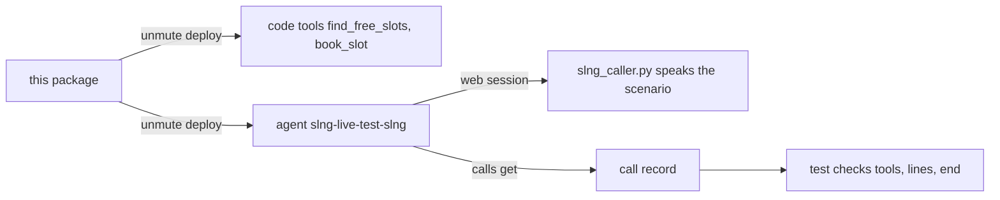

# slng-live

The slng target's live package. `make e2e-slng` deploys it to SLNG with the real
key and holds each scenario as a real web call.



1. `unmute deploy --target slng` publishes `tools/salon.py` as two SLNG code
   tools, each run once on its `tools/<name>.sample.json`, then pushes the agent.
2. `internal/e2e/slng_caller.py` joins a web session as the caller. It speaks
   each line with SLNG speech, and waits for the agent's own `lk.agent.state`.
3. The test reads the call record and checks that each tool the scenario names
   ran and succeeded, that the caller heard each line it names, and that the
   agent ended the call.

## What it covers

- `find_free_slots` and `book_slot`: Python tools in `tools/salon.py`, which
  deploy publishes as code tools.
- `search_places`: an API request tool SLNG hosts, referenced with `slng:`.
- `end_call`: the builtin.
- `verify_identity`, a task with its own `when:`, and `take_booking`, a step only
  the `book` flow runs. The flow skips `verify_identity` once the number is
  confirmed.
- `take_booking` finishes on `book_slot` when its status is `booked`, and SLNG
  says "Thanks for having us..." with the booked time and day.

## What it needs

- `SLNG_API_KEY` of an organisation that holds `search_places` and its
  `SEARCH_PLACES_API` secret. Today that is Nicola Croon's Workspace, in
  `eu-north`. A key already set in your shell wins over `.env`.
- `voiceai` 0.1.23 or newer, and `uv`.

```bash
make e2e-slng PKG=slng-live
```

The agent keeps the name `slng-live-test-slng`, so each run updates it.
